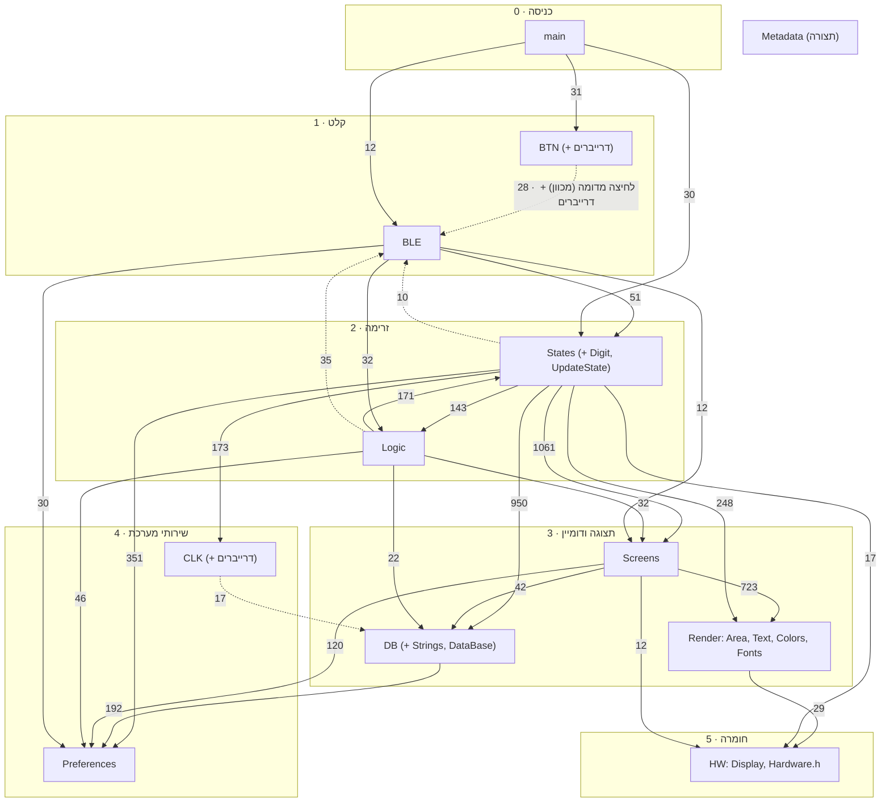
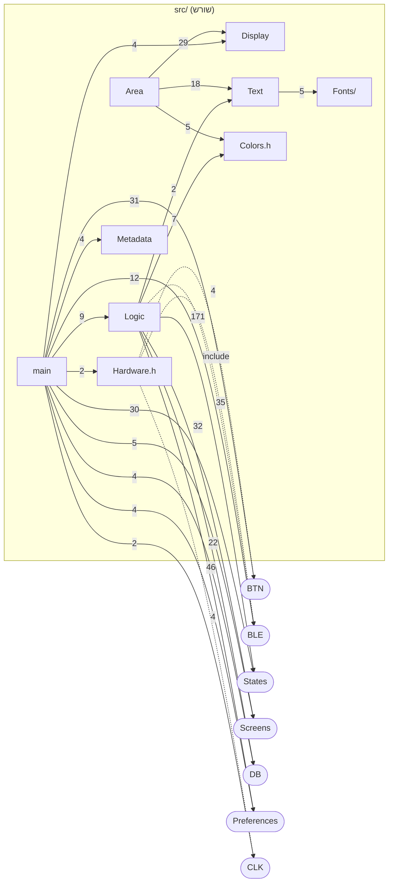
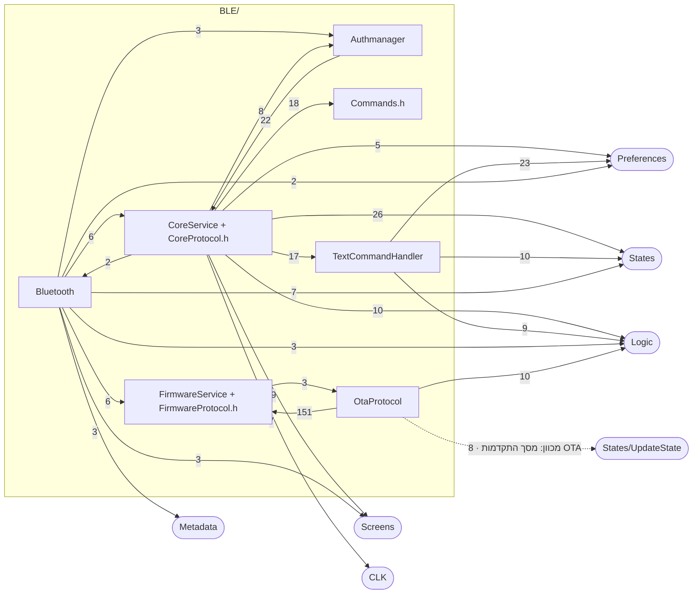
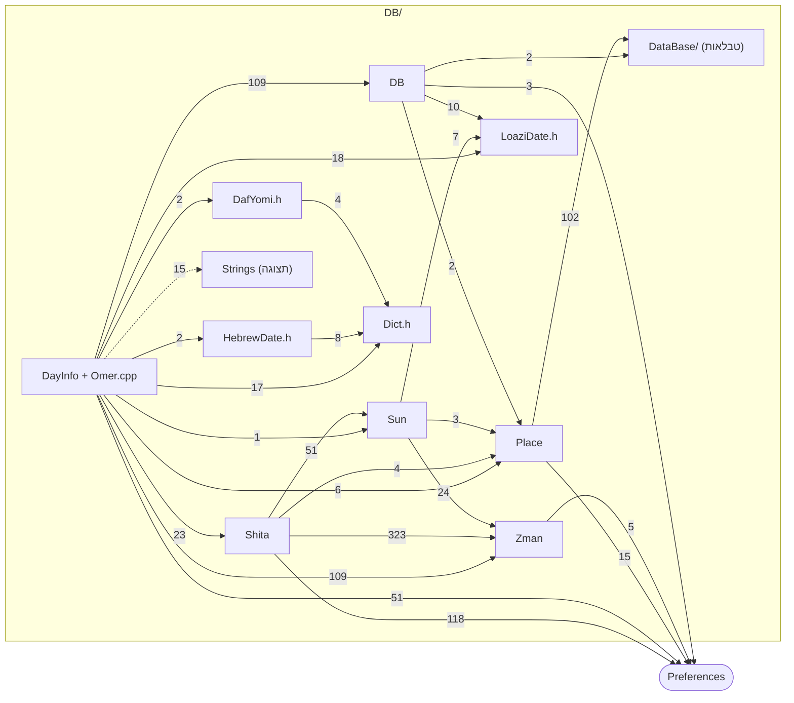
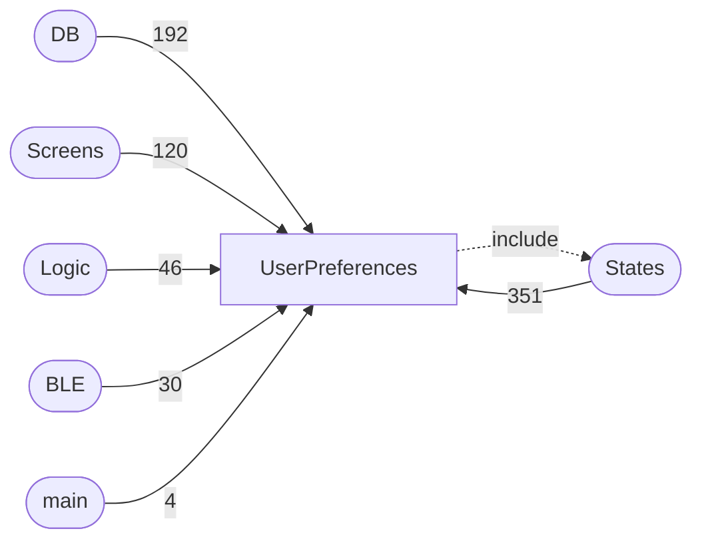
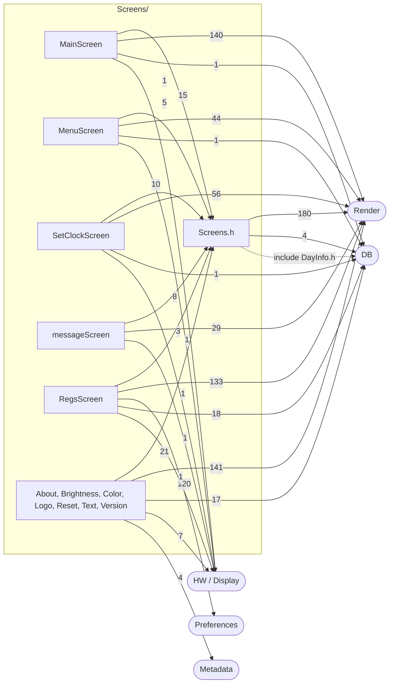
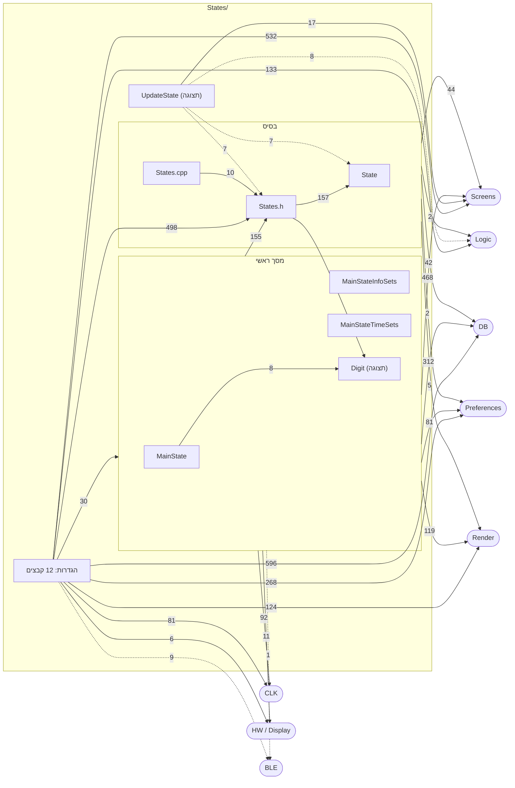

# מפת קשרים בין יחידות — JC6416

שלב 0, משימה ב, חלק 1. המסמך ממפה את הקשרים בין יחידות הקוד, כבסיס לחלוקה לשכבות.
הוא לא מחפש פגמים ולא מציע תיקונים.

תשובות, החלטות ושיוך לשכבות של יחידות שהיו לא ברורות: [notes.md](notes.md).

## 1. בסיס ושיטה

**בסיס:** פרויקט `JC6416`, commit `9c75812`. מספרי השורות במסמך נכונים ל-commit הזה. הבדלים ב-JC4020 וב-JC6432 מופיעים רק כהערות, בסעיף 10.
השינויים בפרודקשן 7.06 ו-7.07 (commit `dcd2cdb`) מתועדים בנפרד בסעיף 11. סעיפים 2-10 והנספח נשארים תמונת מצב של `9c75812`.

### יחידה

יחידה היא זוג `.h`/`.cpp`, עם החריגים האלה:

- `BLE/CoreProtocol.h` שייך ל-`BLE/CoreService`, ו-`BLE/FirmwareProtocol.h` שייך ל-`BLE/FirmwareService`.
- `DB/Omer.cpp` שייך ל-`DB/DayInfo`. הוא מממש מתודות של `DayInfo`.
- `metadata.cpp` שייך ל-`Metadata`.
- `Screens/Screens.h` ו-`States/States.h` הן כותרות משותפות שמצהירות על כל המחלקות. כל `.cpp` תחתיהן הוא תת-יחידה נפרדת. הכותרת עצמה מופיעה כיחידה בשם `Screens/Screens.h` או `States/States.h`.
- `States/State` (מחלקת הבסיס) ו-`States/Digit` הן יחידות רגילות.
- `DB/DataBase/*` (101 טבלאות) ו-`Fonts/*` (25 קבצים) הן יחידות נתונים בשם `DataBase` ו-`Fonts`.

### הפניה

הפניה היא אזכור בקוד של מזהה ששייך ליחידה אחרת: מחלקה, פונקציה חופשית, גלובלי, מאקרו, enumerator או const ברמת הקובץ.
הערות ומחרוזות לא נספרות.

### כלל הספירה לגלובליים

- שימוש בגלובלי נספר כתלות ביחידה שמגדירה את **הטיפוס** שלו, ולא ביחידה שבה המשתנה מוגדר.
  - דוגמאות: `mainScreen` → `Screens/Screens.h`, `dayInfo` → `DB/DayInfo`, `strings` → `DB/Strings`, `bl` → `Logic`, `currentState` → `States/State`, `userPreferences` → `Preferences/UserPreferences`.
- גלובלי מטיפוס בסיסי או מטיפוס של ספרייה חיצונית נספר ביחידה שמצהירה עליו בכותרת.
  - דוגמאות: `display` → `Display`, `now` → `CLK/Clock`, `lonPre` → `DB/Place`.
- המקום שבו כל גלובלי מוגדר בפועל מופיע כמידע בלבד, בסעיף 8.

### שרשראות גישה

- בשרשרת כמו `bl.mainState.numOfValidTexts`, כל יחידה שהשרשרת נוגעת בה נספרת **פעם אחת**:
  - `Logic`, הטיפוס של `bl`.
  - `States/States.h`, השדה של `MainState`.
- קריאה למתודה נספרת ביחידה שבה המתודה ממומשת. למשל `bl.updateState.showUpdateProgress` נספר ב-`States/UpdateState`.

### עוצמה

עוצמה היא מספר ההפניות, ולצדו מספר המזהים השונים. ההפניות כוללות גם אזכורי טיפוס בחתימות, ולכן למשל `DB/Shita → DB/Zman` הוא 323 הפניות למזהה אחד בלבד.

### החרגות ידניות

- הצללות מקומיות:
  - `now` ב-`DayInfo.*` (פרמטר) וב-`OtaProtocol.cpp` (משתנה `uint32_t` מקומי).
  - `place` ב-`DayInfo.*`, ב-`DB.*` ובפרמטרים של `Sun.*`.
- התנגשויות שמות:
  - `Place::orHachaim` מול המחלקה `orHachaim`.
  - `Strings::model` ופרמטר `model` מול `Metadata::model`. Metadata נספר רק דרך `Metadata::`.
- פונקציות עזר ב-`.cpp` שאף כותרת לא מצהירה עליהן נחשבות פנימיות לקובץ. דוגמאות: `getZriha()` ב-`MinhagState.cpp`, `loaziStr()` ב-`SetTochenTimeState.cpp`.

### אימות

הספירה נעשתה בסקריפט קריאה-בלבד. הסקריפט המקורי לא נשמר. הוא נכתב מחדש לפי הכללים שלמעלה, ונשמר ב-[tools/count_deps.py](../../tools/count_deps.py). הוראות שימוש בראש הקובץ. על `9c75812` הוא משחזר את כל 374 הקשתות בסעיף 4 עם אותו מספר הפניות בדיוק (6,747). מספר המזהים זהה ב-372 קשתות, ובשתיים (`MainStateInfoSets→DayInfo`, `MainState→DayInfo`) הוא שונה בגלל תוויות של שרשראות עמוקות.

הספירה המקורית נבדקה ידנית מול grep בחמישה תאים, והסקריפט החדש נותן בהם את אותן תוצאות:

- `ConfigState→Authmanager` = 1
- `OtaProtocol→UpdateState` = 8
- `TextCommandHandler→States.h` = 9
- `MainStateInfoSets→Screens.h` = 197
- `Clock→Zman` = 17. grep מוצא 19 מופעים, אבל שניים מהם בהערה ובשורת include.

## 2. רמות לפי ההשערה

ההשערה, מלמעלה למטה: `main` → קלט → זרימה → תצוגה ודומיין → שירותי מערכת → חומרה. `Metadata` היא תצורה בבסיס, וכולם רשאים להשתמש בה.
השיוך של היחידות שלא היו ברורות מבוסס על [notes.md](notes.md).

| רמה | יחידות |
| --- | --- |
| 0 · כניסה | `main` |
| 1 · קלט | כל `BLE/*`, כולל `Commands` ו-`TextCommandHandler`; `BTN/Button` |
| 2 · זרימה | `Logic`; `States/State`; `States/States.h`; כל `States/*.cpp` חוץ מ-`Digit` ו-`UpdateState` |
| 3 · תצוגה | `Screens/*`; `Area`; `Text`; `Colors`; `Fonts`; `States/Digit`; `States/UpdateState`; `DB/Strings` |
| 3 · דומיין | `DB/*` חוץ מ-`Strings`; `DataBase` |
| 4 · שירותי מערכת | `Preferences/UserPreferences`; `CLK/Clock` |
| 5 · חומרה | `Display`; `Hardware.h`; `BTN/ButtonDriver`; `BTN/ButtonLH1022`; `BTN/ButtonLH0826`; `CLK/ClockDriver`; `CLK/ClockDS3231`; `CLK/ClockRV3028` |
| תצורה | `Metadata` |

## 3. גרף ברמת נושא

הצמתים מבוססים על תיקיות. את השורש פיצלתי לשלושה נושאים: `Render` (`Area`, `Text`, `Colors`, `Fonts/`), `HW` (`Display`, `Hardware.h`) ו-`Metadata`.

יש צמתים שמכילים יחידות מרמות שונות:

- `States` כולל את `Digit` ואת `UpdateState`, ששייכות לתצוגה.
- `DB` כולל את `Strings`, ששייכת לתצוגה, ואת `DataBase`.
- `BTN` ו-`CLK` כוללים את הדרייברים, ששייכים לחומרה.

הגרף מציג רק קשתות של **10 הפניות ומעלה**. קשתות חלשות יותר מופיעות ברשימה (סעיף 4) ובנספח א'.
קו מקווקו = קשת בין נושאים שהולכת נגד הכיוון, או קשת שסומנה כמכוונת.



**קשתות נושא מתחת לסף:**

| קשת | הפניות | הערה |
| --- | --- | --- |
| `Logic → Render` | 9 | |
| `main → Logic` | 9 | |
| `BLE → CLK` | 7 | |
| `main → HW` | 6 | |
| `main → Screens` | 5 | |
| `HW → CLK` | 4 | |
| `HW → BTN` | 4 | |
| `main → DB` | 4 | |
| `main → Metadata` | 4 | |
| `main → Prefs` | 4 | |
| `Screens → Metadata` | 4 | |
| `BLE → Metadata` | 3 | |
| `main → CLK` | 2 | |
| `Prefs → States` | 0 | include בלבד |
| `HW → BLE` | 0 | include בלבד |

## 4. רשימת קשתות בין יחידות (א)

כל הקשתות בין יחידות, ממוינות לפי עוצמה. קשתות בתוך אותה יחידה לא נכללות.

בעמודת "סימון":

- **מכוון**: לפי [notes.md](notes.md).
- **נגד הכיוון**: לפי טבלת הרמות בסעיף 2. פירוט בסעיף 7.
- **צדדית**: קשת בין תצוגה לדומיין, שתיהן ברמה 3. פירוט בסעיף 7.

<div dir="ltr">

| # | מ- | אל | הפניות | מזהים | דוגמאות | סימון |
| --- | --- | --- | --- | --- | --- | --- |
| 1 | `DB/Shita` | `DB/Zman` | 323 | 1 | `Zman`×323 |  |
| 2 | `States/MainStateInfoSets` | `Screens/Screens.h` | 197 | 29 | `mainScreen`×88, `mainScreen.infoDown`×18, `mainScreen.infoUp`×17 |  |
| 3 | `Screens/Screens.h` | `Area` | 175 | 1 | `Area`×175 |  |
| 4 | `Logic` | `States/States.h` | 169 | 169 | `MainState`, `MenuClockState`, `MenuTzugaState` |  |
| 5 | `States/States.h` | `States/State` | 157 | 1 | `State`×157 |  |
| 6 | `BLE/OtaProtocol` | `BLE/FirmwareService` | 151 | 41 | `OTA_TAG`×70, `getStateName`×8, `OTA_IN_PROGRESS`×6 |  |
| 7 | `States/MinhagState` | `DB/Shita` | 130 | 19 | `numOfZeetCochavin`×24, `numOfZS`×12, `zeetMethod`×12 |  |
| 8 | `States/MainStateInfoSets` | `DB/DayInfo` | 121 | 72 | `dayInfo.isShabat`×6, `dayInfo.getGeshemTal`×5, `dayInfo.getBircatHashanim`×4 |  |
| 9 | `Screens/RegsScreen` | `Preferences/UserPreferences` | 120 | 60 | `userPreferences.leil`×4, `userPreferences.shita`×2, `userPreferences.eda`×2 |  |
| 10 | `DB/Shita` | `Preferences/UserPreferences` | 118 | 15 | `userPreferences.nerot`×10, `userPreferences.zeetCochavim`×9, `userPreferences.rabenuTam`×9 |  |
| 11 | `DB/DayInfo` | `DB/DB` | 109 | 103 | `db.shabatPlus`×2, `db.holidayType`×2, `db.roshHodesh`×2 |  |
| 12 | `DB/DayInfo` | `DB/Zman` | 109 | 1 | `Zman`×109 |  |
| 13 | `States/MinhagState` | `States/States.h` | 105 | 32 | `bl.mainState.updateDayValues`×14, `ShowTime`×5, `SetZrihaState`×5 |  |
| 14 | `DB/Place` | `DataBase` | 102 | 98 | `chai_tel_aviv_db`×3, `chai_hazor_haglilit_db`×2, `chai_kfar_saba_raanana_db`×2 |  |
| 15 | `States/MainStateTimeSets` | `Screens/Screens.h` | 91 | 9 | `mainScreen`×45, `mainScreen.zmanLeftUp`×9, `mainScreen.zmanRightUp`×7 |  |
| 16 | `States/MainStateInfoSets` | `Screens/MainScreen` | 88 | 1 | `mainScreen.update`×88 |  |
| 17 | `States/MainStateInfoSets` | `States/States.h` | 85 | 1 | `MainState`×85 |  |
| 18 | `States/SetClockState` | `CLK/Clock` | 81 | 11 | `now`×62, `currentHour`×3, `currentMinute`×3 |  |
| 19 | `States/MinhagState` | `Screens/Screens.h` | 80 | 4 | `menuScreen`×44, `messageScreen`×24, `menuScreen.nerot`×6 |  |
| 20 | `States/MinhagState` | `DB/Strings` | 78 | 19 | `strings.menuMinag`×18, `strings.zeetHacochavim`×5, `strings.shitaTitle`×4 |  |
| 21 | `States/SetClockState` | `States/States.h` | 75 | 18 | `SetClockState`×10, `SetHour`×6, `SetMinute`×6 |  |
| 22 | `States/MinhagState` | `DB/DayInfo` | 70 | 29 | `dayInfo.shkiaaM`×11, `dayInfo.zrihaM`×10, `dayInfo.sun`×10 |  |
| 23 | `States/OfekState` | `States/States.h` | 70 | 21 | `SetOfekState`×5, `SetGovaCustomState`×5, `SetTimeZoneCustomState`×5 |  |
| 24 | `Screens/RegsScreen` | `Colors` | 65 | 3 | `BLACK`×63, `GREEN`, `RED` |  |
| 25 | `Screens/RegsScreen` | `Area` | 64 | 1 | `Area`×64 |  |
| 26 | `States/MainState` | `CLK/Clock` | 63 | 18 | `now`×38, `currentSecond1`×3, `currentSecond2`×3 |  |
| 27 | `States/SetTochenTimeState` | `DB/Strings` | 63 | 14 | `strings.zmaneHayom`×10, `strings.talitAlotZriha`×7, `strings.hazotMinhaGMinhaK`×7 |  |
| 28 | `States/SetTochenTimeState` | `States/States.h` | 59 | 32 | `SetTohenTimeStateKezevSet`×5, `TohenTimeState`×2, `SetTohenBottomLineLoazi`×2 |  |
| 29 | `States/OfekState` | `DB/Place` | 56 | 10 | `places`×8, `numOfOfeks`×7, `lonPre`×6 |  |
| 30 | `States/SetClockState` | `Screens/Screens.h` | 53 | 13 | `setClockScreen`×19, `menuScreen`×10, `messageScreen`×10 |  |
| 31 | `States/SetTochenTimeState` | `Preferences/UserPreferences` | 53 | 11 | `userPreferences.TAZ`×6, `userPreferences.SOZT`×6, `userPreferences.SOZKS`×6 |  |
| 32 | `DB/DayInfo` | `Preferences/UserPreferences` | 51 | 14 | `userPreferences.eda`×24, `userPreferences.shita`×5, `userPreferences.zriha`×4 |  |
| 33 | `DB/Shita` | `DB/Sun` | 51 | 1 | `Sun`×51 |  |
| 34 | `Screens/MainScreen` | `Area` | 51 | 1 | `Area`×51 |  |
| 35 | `Screens/MainScreen` | `Colors` | 49 | 1 | `BLACK`×49 |  |
| 36 | `States/ColorState` | `States/States.h` | 49 | 14 | `SetColorUpLine`×5, `SetColorMiddleLine`×5, `SetColorBottomTLine`×5 |  |
| 37 | `States/MainStateInfoSets` | `Preferences/UserPreferences` | 48 | 11 | `userPreferences.tfila`×20, `userPreferences.moadim`×9, `userPreferences.IORT`×4 |  |
| 38 | `States/MainStateInfoSets` | `Text` | 48 | 2 | `Text`×32, `CENTER`×16 |  |
| 39 | `States/MinhagState` | `Preferences/UserPreferences` | 48 | 16 | `userPreferences.shita`×11, `userPreferences.shanim`×6, `userPreferences.nerot`×6 |  |
| 40 | `States/SetTochenInfoState` | `Preferences/UserPreferences` | 48 | 12 | `userPreferences.intervalInfo`×6, `userPreferences.netzClk`×6, `userPreferences.IORT`×6 |  |
| 41 | `Logic` | `Preferences/UserPreferences` | 46 | 34 | `userPreferences.colorUp`×2, `userPreferences.colorMiddle`×2, `userPreferences.colorBottomT`×2 |  |
| 42 | `States/MainStateTimeSets` | `Screens/MainScreen` | 45 | 1 | `mainScreen.update`×45 |  |
| 43 | `States/MainStateInfoSets` | `DB/Strings` | 44 | 31 | `strings.yaaleveyavo`×5, `strings.halelShalem`×3, `strings.enOmrim`×2 |  |
| 44 | `States/MinhagState` | `Screens/MenuScreen` | 44 | 2 | `menuScreen.printMenu`×31, `menuScreen.addZman`×13 |  |
| 45 | `States/MainState` | `DB/DayInfo` | 42 | 28 | `DayInfo`×5, `dayInfo.getZriha`×4, `dayInfo.shaon`×3 |  |
| 46 | `States/SetTochenInfoState` | `DB/Strings` | 42 | 16 | `strings.meidaHayom`×12, `strings.cShabatZShabatRT`×6, `strings.meidaLamitpalel`×2 |  |
| 47 | `States/ColorState` | `Screens/Screens.h` | 41 | 12 | `messageScreen`×14, `colorScreen`×7, `mainScreen.loaziDate`×2 |  |
| 48 | `States/SetInputText` | `States/States.h` | 41 | 8 | `bl.mainState.indexText`×21, `SetTohenIluyStateKezevSet`×5, `SetTohenIluyStateTextList`×5 |  |
| 49 | `States/States` | `DB/Strings` | 40 | 12 | `strings.menuTitle`×7, `strings.menuConfg`×3, `strings.menuClock`×3 |  |
| 50 | `States/OfekState` | `Screens/Screens.h` | 39 | 7 | `setClockScreen`×14, `menuScreen`×11, `messageScreen`×4 |  |
| 51 | `States/MainState` | `States/States.h` | 37 | 4 | `MainState`×28, `numOfTimeSets`×3, `numOfInfoSets`×3 |  |
| 52 | `States/ConfigState` | `DB/Strings` | 35 | 13 | `strings.menuConfg`×8, `strings.MemoryMap`×4, `strings.resetPref`×4 |  |
| 53 | `States/OfekState` | `Preferences/UserPreferences` | 35 | 11 | `userPreferences.timezone`×6, `userPreferences.nz_height`×6, `userPreferences.homa`×5 |  |
| 54 | `Logic` | `BLE/Commands` | 34 | 1 | `MenuCommand`×34 | נגד הכיוון |
| 55 | `States/MainStateTimeSets` | `DB/DayInfo` | 33 | 19 | `dayInfo.getZeetCochavim`×5, `dayInfo.getZriha`×4, `dayInfo.sofZmanShmaGra`×3 |  |
| 56 | `States/MainStateTimeSets` | `States/States.h` | 33 | 1 | `MainState`×33 |  |
| 57 | `States/SetTochenInfoState` | `States/States.h` | 33 | 15 | `SetTohenInfoStateKezevSet`×5, `SetTohenBottomLineNetzSet`×5, `TohenInfoState`×2 |  |
| 58 | `Logic` | `Screens/Screens.h` | 32 | 32 | `MainScreen`, `mainScreen`, `MenuScreen` |  |
| 59 | `Screens/MainScreen` | `Text` | 32 | 4 | `Text`×25, `CENTER`×5, `RIGHT` |  |
| 60 | `States/ColorState` | `Logic` | 31 | 4 | `bl.mainState`×22, `bl.configStates`×7, `Logic` |  |
| 61 | `States/SetClockState` | `Preferences/UserPreferences` | 31 | 5 | `userPreferences.timeFormat`×10, `userPreferences.dateFormat`×7, `userPreferences.shaonKaiz`×5 |  |
| 62 | `States/SetInputText` | `Logic` | 31 | 4 | `bl.mainState`×27, `bl.configStates`×2, `Logic` |  |
| 63 | `main` | `BTN/Button` | 31 | 12 | `long_push_temp`×8, `Button`×4, `okButton.isPushed`×4 |  |
| 64 | `States/ConfigState` | `States/States.h` | 30 | 14 | `SetBTState`×5, `SetResetPrefState`×5, `SetResetTextState`×5 |  |
| 65 | `States/MainState` | `Screens/Screens.h` | 30 | 11 | `mainScreen`×16, `mainScreen.colorBottomT`×3, `messageScreen`×2 |  |
| 66 | `States/SetInputText` | `Screens/Screens.h` | 30 | 11 | `menuScreen.kezev`×6, `textScreen.text2`×5, `mainScreen.iluyNishmat`×3 |  |
| 67 | `Area` | `Display` | 29 | 1 | `display`×29 |  |
| 68 | `States/MinhagState` | `Logic` | 29 | 4 | `bl.mainState`×14, `bl.configStates`×13, `Logic` |  |
| 69 | `States/SetClockState` | `DB/Strings` | 29 | 11 | `strings.menuClock`×9, `strings.kivunShaon`×6, `strings.mivneTaarich`×2 |  |
| 70 | `main` | `States/State` | 29 | 12 | `currentState`×10, `currentState.showStateScreen`×9, `State` |  |
| 71 | `States/SetTochenInfoState` | `Screens/Screens.h` | 28 | 4 | `menuScreen`×14, `menuScreen.kezev`×6, `menuScreen.netz`×6 |  |
| 72 | `States/ConfigState` | `Screens/Screens.h` | 27 | 7 | `menuScreen`×8, `messageScreen`×8, `resetScreen`×6 |  |
| 73 | `States/Digit` | `Colors` | 26 | 1 | `BLACK`×26 |  |
| 74 | `States/MainStateTimeSets` | `DB/Strings` | 25 | 16 | `strings.zriha`×3, `strings.shkiaa`×2, `strings.tzetCoc`×2 |  |
| 75 | `States/MainStateTimeSets` | `Preferences/UserPreferences` | 25 | 10 | `userPreferences.ZSZ1`×3, `userPreferences.TAZ`×3, `userPreferences.SOZKS`×3 |  |
| 76 | `States/OfekState` | `DB/Strings` | 25 | 9 | `strings.ofekTitle`×11, `strings.bharOfek`×3, `strings.hagderMakom`×3 |  |
| 77 | `States/SetInputText` | `Area` | 25 | 23 | `mainScreen.iluyNishmat.addRoundRectBorder`×2, `textScreen.text2.addRoundRectBorder`×2, `menuScreen.kezev.addRoundRect` |  |
| 78 | `DB/Sun` | `DB/Zman` | 24 | 3 | `Zman`×21, `decimalDayToTime`×2, `TimeToDecimalDay` |  |
| 79 | `States/States.h` | `Screens/Screens.h` | 24 | 24 | `MainScreen`, `mainScreen`, `MenuScreen` |  |
| 80 | `BLE/CoreService` | `States/State` | 23 | 3 | `currentState`×14, `State`×5, `currentState.showStateScreen`×4 |  |
| 81 | `BLE/TextCommandHandler` | `Preferences/UserPreferences` | 23 | 3 | `UserPref`×14, `userPreferences`×8, `UserPreferences` |  |
| 82 | `DB/DayInfo` | `DB/Shita` | 23 | 9 | `TEIMAN_BALADI`×4, `Shita`×3, `ASHKENAZ`×3 |  |
| 83 | `BLE/Authmanager` | `BLE/CoreService` | 22 | 3 | `AUTH_CLIENT_ID_SIZE`×12, `AUTH_TRUSTED_SLOTS`×6, `AUTH_DEFAULT_PIN`×4 |  |
| 84 | `States/EdotState` | `DB/Strings` | 21 | 8 | `strings.minhagTitle`×7, `strings.chabad`×2, `strings.teimanShami`×2 |  |
| 85 | `Screens/SetClockScreen` | `Text` | 20 | 2 | `Text`×16, `CENTER`×4 |  |
| 86 | `States/ColorState` | `Area` | 20 | 10 | `mainScreen.loaziDate.addRoundRectBorder`×2, `mainScreen.ivriDate.addRoundRectBorder`×2, `mainScreen.clockAll.addRoundRectBorder`×2 |  |
| 87 | `States/MainStateInfoSets` | `Fonts` | 20 | 4 | `font6`×10, `font7`×5, `font5`×3 |  |
| 88 | `States/MainStateTimeSets` | `CLK/Clock` | 20 | 2 | `zmanPlusDakot`×11, `isTimeInRange`×9 |  |
| 89 | `Screens/SetClockScreen` | `Colors` | 19 | 4 | `BLACK`×8, `WHITE`×7, `BLUE`×2 |  |
| 90 | `States/SetClockState` | `Screens/SetClockScreen` | 19 | 8 | `setClockScreen.focusArea`×6, `setClockScreen.updateHour`×2, `setClockScreen.updateMinute`×2 |  |
| 91 | `Area` | `Text` | 18 | 3 | `Text`×14, `CENTER`×2, `RIGHT`×2 |  |
| 92 | `BLE/CoreService` | `BLE/Commands` | 18 | 4 | `ButtonCommand`×6, `currentButtonCommand`×5, `MenuCommand`×5 |  |
| 93 | `DB/DayInfo` | `DB/LoaziDate` | 18 | 1 | `LoaziDate`×18 |  |
| 94 | `Screens/MenuScreen` | `Colors` | 18 | 4 | `RED`×11, `BLACK`×3, `WHITE`×2 |  |
| 95 | `Screens/RegsScreen` | `DB/Place` | 18 | 6 | `lonPre`×4, `latPre`×4, `lonInt`×3 | צדדית |
| 96 | `BLE/CoreService` | `BLE/TextCommandHandler` | 17 | 12 | `CommandResult`×6, `handleReadText`, `handleWriteText` |  |
| 97 | `CLK/Clock` | `DB/Zman` | 17 | 1 | `Zman`×17 | נגד הכיוון |
| 98 | `DB/DayInfo` | `DB/Dict` | 17 | 9 | `daysOfTheWeek`×6, `hodesh_list_l`×3, `holidays`×2 |  |
| 99 | `States/EdotState` | `Preferences/UserPreferences` | 17 | 3 | `userPreferences.eda`×12, `userPreferences.hul`×4, `userPreferences.shita` |  |
| 100 | `States/SetTochenTimeState` | `Screens/Screens.h` | 17 | 3 | `menuScreen`×13, `mainScreen.zmanAll`×2, `menuScreen.kezev`×2 |  |
| 101 | `Screens/VersionScreen` | `Colors` | 16 | 4 | `BLACK`×11, `BLUE`×2, `RED`×2 |  |
| 102 | `States/MainState` | `Screens/MainScreen` | 16 | 13 | `mainScreen.update`×4, `mainScreen.printScreen`, `mainScreen.updateHour` |  |
| 103 | `DB/DayInfo` | `DB/Strings` | 15 | 14 | `strings.vetenTalUmatar`×2, `Strings`, `strings` | צדדית |
| 104 | `DB/Place` | `Preferences/UserPreferences` | 15 | 11 | `userPreferences.ofek`×3, `userPreferences.nz_lat`×2, `userPreferences.nz_long`×2 |  |
| 105 | `Screens/MainScreen` | `Screens/Screens.h` | 15 | 1 | `MainScreen`×15 |  |
| 106 | `States/EdotState` | `States/States.h` | 15 | 8 | `EdotMizrah`×2, `EdotSfarad`×2, `EdotAshkenaz`×2 |  |
| 107 | `States/MainStateInfoSets` | `DB/Zman` | 15 | 1 | `Zman`×15 |  |
| 108 | `Screens/MenuScreen` | `Area` | 14 | 1 | `Area`×14 |  |
| 109 | `Screens/messageScreen` | `Text` | 14 | 4 | `Text`×9, `LEFT`×2, `CENTER`×2 |  |
| 110 | `States/ColorState` | `Preferences/UserPreferences` | 14 | 7 | `userPreferences.colorUp`×2, `userPreferences.colorMiddle`×2, `userPreferences.colorBottomT`×2 |  |
| 111 | `States/ColorState` | `States/MainState` | 14 | 2 | `bl.mainState.showStateScreen`×7, `bl.mainState.stateLoop`×7 |  |
| 112 | `States/MinhagState` | `DB/Zman` | 14 | 1 | `Zman`×14 |  |
| 113 | `States/OfekState` | `Screens/SetClockScreen` | 14 | 4 | `setClockScreen.updateHour`×4, `setClockScreen.updateMinute`×4, `setClockScreen.updateSecond`×4 |  |
| 114 | `States/SetTochenInfoState` | `Area` | 14 | 13 | `mainScreen.infoAll.addRoundRectBorder`×2, `menuScreen.kezev.addRoundRect`, `menuScreen.kezev.x` |  |
| 115 | `States/SetTochenInfoState` | `Screens/MenuScreen` | 14 | 1 | `menuScreen.printMenu`×14 |  |
| 116 | `States/SetTochenTimeState` | `Screens/MenuScreen` | 13 | 1 | `menuScreen.printMenu`×13 |  |
| 117 | `States/ShitaState` | `DB/Shita` | 13 | 3 | `numOfShitot`×7, `shitot`×5, `Shita` |  |
| 118 | `Logic` | `DB/Place` | 12 | 6 | `lonPre`×2, `lonInt`×2, `lonFrac`×2 |  |
| 119 | `States/MinhagState` | `Area` | 12 | 12 | `menuScreen.nerot.addRoundRect`, `menuScreen.nerot.x`, `menuScreen.nerot.y` |  |
| 120 | `States/MinhagState` | `Screens/messageScreen` | 12 | 1 | `messageScreen.printMessages`×12 |  |
| 121 | `States/States.h` | `States/Digit` | 12 | 1 | `Digit`×12 |  |
| 122 | `Screens/TextScreen` | `Colors` | 11 | 3 | `BLACK`×8, `BLUE`×2, `WHITE` |  |
| 123 | `Screens/VersionScreen` | `Area` | 11 | 1 | `Area`×11 |  |
| 124 | `States/Digit` | `Display` | 11 | 1 | `display`×11 |  |
| 125 | `States/OfekState` | `Screens/MenuScreen` | 11 | 1 | `menuScreen.printMenu`×11 |  |
| 126 | `States/SetInputText` | `DB/Strings` | 11 | 5 | `strings.hakdasha`×3, `strings.aroch`×3, `strings.empty`×3 |  |
| 127 | `States/UpdateState` | `Screens/Screens.h` | 11 | 1 | `messageScreen`×11 |  |
| 128 | `main` | `BLE/Commands` | 11 | 4 | `currentMenuCommand`×4, `MenuCommand`×3, `ButtonCommand`×2 |  |
| 129 | `BLE/CoreService` | `Logic` | 10 | 6 | `bl.updateState`×4, `bl.setClockState`×2, `Logic` |  |
| 130 | `BLE/OtaProtocol` | `Logic` | 10 | 3 | `bl.updateState`×8, `Logic`, `bl` |  |
| 131 | `BTN/Button` | `BLE/Commands` | 10 | 2 | `ButtonCommand`×8, `currentButtonCommand`×2 | מכוון: לחיצה מדומה |
| 132 | `DB/DB` | `DB/LoaziDate` | 10 | 1 | `LoaziDate`×10 |  |
| 133 | `Logic` | `DB/DayInfo` | 10 | 6 | `DayInfo`×5, `dayInfo`, `dayInfoYesterday` |  |
| 134 | `Screens/ResetScreen` | `Colors` | 10 | 4 | `BLACK`×4, `BLUE`×2, `GREEN`×2 |  |
| 135 | `Screens/SetClockScreen` | `Screens/Screens.h` | 10 | 1 | `SetClockScreen`×10 |  |
| 136 | `States/FontState` | `States/States.h` | 10 | 2 | `SetFontState`×6, `bl.mainState.morphing`×4 |  |
| 137 | `States/MainState` | `Text` | 10 | 2 | `Text`×5, `CENTER`×5 |  |
| 138 | `States/OfekState` | `Area` | 10 | 5 | `menuScreen.timeZone.addRoundRectBorder`×2, `menuScreen.timeZone.addArrows`×2, `setClockScreen.hour.addArrows`×2 |  |
| 139 | `States/OfekState` | `Logic` | 10 | 4 | `bl.configStates`×4, `bl.mainState`×4, `Logic` |  |
| 140 | `States/SetClockState` | `Screens/MenuScreen` | 10 | 1 | `menuScreen.printMenu`×10 |  |
| 141 | `States/States` | `Screens/MenuScreen` | 10 | 1 | `menuScreen.printMenu`×10 |  |
| 142 | `States/States` | `Screens/Screens.h` | 10 | 1 | `menuScreen`×10 |  |
| 143 | `States/States` | `States/States.h` | 10 | 10 | `MenuClockState`, `MenuTzugaState`, `MenuEddotState` |  |
| 144 | `BLE/TextCommandHandler` | `Logic` | 9 | 4 | `bl.mainState`×6, `Logic`, `bl` |  |
| 145 | `BLE/TextCommandHandler` | `States/States.h` | 9 | 4 | `numOfNameSets`×3, `bl.mainState.numOfValidTexts`×2, `bl.mainState.stateIndexNameSet`×2 |  |
| 146 | `BTN/ButtonLH0826` | `BLE/Commands` | 9 | 1 | `ButtonCommand`×9 | נגד הכיוון |
| 147 | `Screens/AboutScreen` | `Colors` | 9 | 4 | `BLACK`×5, `GREEN`×2, `BLUE` |  |
| 148 | `Screens/MenuScreen` | `Text` | 9 | 4 | `Text`×6, `RIGHT`, `CENTER` |  |
| 149 | `Screens/SetClockScreen` | `Area` | 9 | 1 | `Area`×9 |  |
| 150 | `Screens/VersionScreen` | `Text` | 9 | 4 | `Text`×5, `LEFT`×2, `CENTER` |  |
| 151 | `States/MainStateInfoSets` | `CLK/Clock` | 9 | 2 | `isTimeInRange`×8, `zmanPlusDakot` |  |
| 152 | `States/SetInputText` | `Text` | 9 | 2 | `Text`×6, `CENTER`×3 |  |
| 153 | `main` | `Logic` | 9 | 8 | `bl.mainState`×2, `Logic`, `bl` |  |
| 154 | `BLE/CoreService` | `BLE/Authmanager` | 8 | 6 | `authManager.grantSession`×2, `authManager.isSessionAuthenticated`×2, `authManager.isTrusted` |  |
| 155 | `BLE/OtaProtocol` | `States/UpdateState` | 8 | 5 | `bl.updateState.showUpdateSuccessScreen`×3, `bl.updateState.showUpdateFailedScreen`×2, `bl.updateState.showUpdateStartScreen` | מכוון: מסך התקדמות OTA |
| 156 | `BTN/ButtonLH1022` | `BLE/Commands` | 8 | 1 | `ButtonCommand`×8 | נגד הכיוון |
| 157 | `DB/HebrewDate` | `DB/Dict` | 8 | 6 | `hodesh_list_l`×2, `yom_list`×2, `shana_list_s` |  |
| 158 | `Screens/MainScreen` | `Fonts` | 8 | 3 | `font6`×4, `font7`×2, `ariel10`×2 |  |
| 159 | `Screens/SetClockScreen` | `Fonts` | 8 | 2 | `font7`×4, `number19`×4 |  |
| 160 | `Screens/TextScreen` | `Area` | 8 | 1 | `Area`×8 |  |
| 161 | `Screens/messageScreen` | `Screens/Screens.h` | 8 | 2 | `MessageScreen`×6, `MessageType`×2 |  |
| 162 | `States/ConfigState` | `Screens/MenuScreen` | 8 | 1 | `menuScreen.printMenu`×8 |  |
| 163 | `States/FontState` | `Logic` | 8 | 3 | `bl.mainState`×6, `Logic`, `bl` |  |
| 164 | `States/FontState` | `Text` | 8 | 2 | `font_list`×4, `numOfFonts`×4 |  |
| 165 | `States/MainState` | `Preferences/UserPreferences` | 8 | 6 | `userPreferences.clockFormat`×3, `userPreferences.clockFont`, `userPreferences.shaonKaiz` |  |
| 166 | `States/MainState` | `States/Digit` | 8 | 2 | `Digit`×6, `MorphMulty`×2 |  |
| 167 | `States/SetClockState` | `Area` | 8 | 8 | `menuScreen.clkFormat.addRoundRectBorder`, `menuScreen.clkFormat.addArrows`, `menuScreen.kaiz.addRoundRectBorder` |  |
| 168 | `States/UpdateState` | `Logic` | 8 | 4 | `bl.updateState`×4, `bl.mainState`×2, `Logic` | נגד הכיוון |
| 169 | `BLE/Bluetooth` | `States/State` | 7 | 3 | `currentState`×4, `State`×2, `currentState.showStateScreen` |  |
| 170 | `BLE/CoreService` | `CLK/Clock` | 7 | 1 | `now`×7 |  |
| 171 | `DB/Sun` | `DB/LoaziDate` | 7 | 1 | `LoaziDate`×7 |  |
| 172 | `Logic` | `Colors` | 7 | 1 | `color_list`×7 |  |
| 173 | `Screens/ColorScreen` | `Colors` | 7 | 3 | `BLACK`×4, `BLUE`×2, `color_list` |  |
| 174 | `States/ColorState` | `Screens/ColorScreen` | 7 | 1 | `colorScreen.setColor`×7 |  |
| 175 | `States/ColorState` | `Screens/messageScreen` | 7 | 1 | `messageScreen.printMessages`×7 |  |
| 176 | `States/ConfigState` | `Preferences/UserPreferences` | 7 | 3 | `userPreferences.bt`×5, `userPreferences.resetSimplePrefs`, `userPreferences.resetTextPrefs` |  |
| 177 | `States/EdotState` | `Screens/MenuScreen` | 7 | 1 | `menuScreen.printMenu`×7 |  |
| 178 | `States/EdotState` | `Screens/Screens.h` | 7 | 1 | `menuScreen`×7 |  |
| 179 | `States/FontState` | `Screens/Screens.h` | 7 | 4 | `mainScreen.clockFont`×3, `messageScreen`×2, `mainScreen` |  |
| 180 | `States/MainState` | `DB/Place` | 7 | 2 | `place`×6, `Place` |  |
| 181 | `States/MainStateTimeSets` | `DB/Zman` | 7 | 1 | `Zman`×7 |  |
| 182 | `States/UpdateState` | `States/State` | 7 | 3 | `currentState`×4, `currentState.showStateScreen`×2, `State` | נגד הכיוון |
| 183 | `States/UpdateState` | `States/States.h` | 7 | 1 | `UpdateState`×7 | נגד הכיוון |
| 184 | `BLE/Bluetooth` | `BLE/CoreService` | 6 | 4 | `applyDeviceName`×2, `loadDeviceName`×2, `initCoreService` |  |
| 185 | `BLE/Bluetooth` | `BLE/FirmwareService` | 6 | 5 | `onOtaMtuChanged`×2, `onOtaConnect`, `onOtaDisconnect` |  |
| 186 | `BLE/CoreService` | `Screens/Screens.h` | 6 | 1 | `messageScreen`×6 |  |
| 187 | `DB/DayInfo` | `DB/Place` | 6 | 1 | `Place`×6 |  |
| 188 | `Screens/BrightnessScreen` | `Colors` | 6 | 3 | `BLACK`×2, `BLUE`×2, `WHITE`×2 |  |
| 189 | `Screens/TextScreen` | `Text` | 6 | 2 | `Text`×4, `CENTER`×2 |  |
| 190 | `Screens/VersionScreen` | `DB/Strings` | 6 | 6 | `strings.odotHamozr`, `strings.model`, `strings.swVersion` |  |
| 191 | `Screens/messageScreen` | `Colors` | 6 | 2 | `BLACK`×4, `WHITE`×2 |  |
| 192 | `States/ConfigState` | `Screens/ResetScreen` | 6 | 2 | `resetScreen.SetScreen`×3, `resetScreen.focusArea`×3 |  |
| 193 | `States/SetInputText` | `BLE/TextCommandHandler` | 6 | 2 | `getTextByIndex`×5, `handleDeleteText` | נגד הכיוון |
| 194 | `States/SetInputText` | `Preferences/UserPreferences` | 6 | 3 | `userPreferences.intervalIluy`×4, `UserPreferences`, `userPreferences` |  |
| 195 | `States/SetTochenInfoState` | `Logic` | 6 | 4 | `bl.mainState`×2, `bl.configStates`×2, `Logic` |  |
| 196 | `States/ShitaState` | `States/States.h` | 6 | 2 | `ShitaState`×5, `bl.mainState.updateDayValues` |  |
| 197 | `States/UpdateState` | `Screens/messageScreen` | 6 | 3 | `messageScreen.printMessages`×4, `messageScreen.printScreen`, `messageScreen.printProgressBar` |  |
| 198 | `Area` | `Colors` | 5 | 2 | `YELLOW`×3, `BLUE`×2 |  |
| 199 | `BLE/CoreService` | `Preferences/UserPreferences` | 5 | 2 | `userPreferences`×4, `UserPreferences` |  |
| 200 | `DB/Zman` | `Preferences/UserPreferences` | 5 | 4 | `userPreferences.timeFormat`×2, `UserPreferences`, `userPreferences` |  |
| 201 | `Screens/AboutScreen` | `Area` | 5 | 1 | `Area`×5 |  |
| 202 | `Screens/AboutScreen` | `Text` | 5 | 1 | `Text`×5 |  |
| 203 | `Screens/MenuScreen` | `Screens/Screens.h` | 5 | 1 | `MenuScreen`×5 |  |
| 204 | `Screens/ResetScreen` | `Text` | 5 | 2 | `Text`×4, `CENTER` |  |
| 205 | `Screens/messageScreen` | `Fonts` | 5 | 3 | `logo`×2, `font7`×2, `font6` |  |
| 206 | `States/BrightnessState` | `States/States.h` | 5 | 1 | `SetBrightnessState`×5 |  |
| 207 | `States/MainState` | `Fonts` | 5 | 3 | `font5`×2, `font6`×2, `font8` |  |
| 208 | `States/MainStateInfoSets` | `Area` | 5 | 3 | `mainScreen.infoAll.textFits`×3, `mainScreen.infoUp.textFits`, `mainScreen.infoDown.textFits` |  |
| 209 | `States/SetClockState` | `Screens/messageScreen` | 5 | 1 | `messageScreen.printMessages`×5 |  |
| 210 | `States/SetTochenTimeState` | `Logic` | 5 | 4 | `bl.mainState`×2, `Logic`, `bl` |  |
| 211 | `States/States.h` | `Text` | 5 | 1 | `Text`×5 |  |
| 212 | `Text` | `Fonts` | 5 | 4 | `number25d`×2, `number23`, `number22` |  |
| 213 | `DB/DafYomi` | `DB/Dict` | 4 | 2 | `ot_list`×2, `masechet_list`×2 |  |
| 214 | `DB/Shita` | `DB/Place` | 4 | 4 | `Place`, `place`, `place.orHachaim` |  |
| 215 | `Hardware` | `BTN/Button` | 4 | 2 | `selectButtonDriver`×2, `ButtonDriverType`×2 | נגד הכיוון |
| 216 | `Hardware` | `CLK/Clock` | 4 | 2 | `selectClock`×2, `ClockType`×2 | נגד הכיוון |
| 217 | `Screens/AboutScreen` | `DB/Strings` | 4 | 4 | `strings.info1`, `strings.info2`, `strings.phone` |  |
| 218 | `Screens/ResetScreen` | `Area` | 4 | 1 | `Area`×4 |  |
| 219 | `Screens/ResetScreen` | `Screens/Screens.h` | 4 | 1 | `ResetScreen`×4 |  |
| 220 | `Screens/TextScreen` | `Screens/Screens.h` | 4 | 1 | `TextScreen`×4 |  |
| 221 | `Screens/messageScreen` | `Area` | 4 | 1 | `Area`×4 |  |
| 222 | `States/BrightnessState` | `Display` | 4 | 1 | `display`×4 |  |
| 223 | `States/ColorState` | `States/MainStateInfoSets` | 4 | 1 | `bl.mainState.infoSetShabatInShabatOutRabenuTam`×4 |  |
| 224 | `States/ColorState` | `States/MainStateTimeSets` | 4 | 1 | `bl.mainState.timeSetZrihaShkiaaCochavim`×4 |  |
| 225 | `States/ConfigState` | `Screens/messageScreen` | 4 | 1 | `messageScreen.printMessages`×4 |  |
| 226 | `States/SetClockState` | `DB/DayInfo` | 4 | 4 | `DayInfo`, `dayInfo`, `dayInfo.loaziDate` |  |
| 227 | `States/SetClockState` | `Logic` | 4 | 3 | `bl.mainState`×2, `Logic`, `bl` |  |
| 228 | `States/SetInputText` | `Colors` | 4 | 3 | `YELLOW`×2, `WHITE`, `RED` |  |
| 229 | `States/SetTochenTimeState` | `Area` | 4 | 3 | `mainScreen.zmanAll.addRoundRectBorder`×2, `menuScreen.kezev.addRoundRectBorder`, `menuScreen.kezev.addArrows` |  |
| 230 | `States/ShitaState` | `Logic` | 4 | 4 | `Logic`, `bl`, `bl.configStates` |  |
| 231 | `States/ShitaState` | `Preferences/UserPreferences` | 4 | 3 | `userPreferences.shita`×2, `UserPreferences`, `userPreferences` |  |
| 232 | `main` | `Display` | 4 | 2 | `display`×3, `initDisplay` |  |
| 233 | `main` | `Metadata` | 4 | 4 | `DEVICE_MODEL`, `PROJECT_VER`, `HARDWARE_VERSION` |  |
| 234 | `main` | `Preferences/UserPreferences` | 4 | 3 | `userPreferences.brightness`×2, `setupPreferences`, `userPreferences.bt` |  |
| 235 | `BLE/Bluetooth` | `BLE/Authmanager` | 3 | 2 | `authManager.resetSession`×2, `authManager.init` |  |
| 236 | `BLE/Bluetooth` | `Logic` | 3 | 3 | `Logic`, `bl`, `bl.updateState` |  |
| 237 | `BLE/Bluetooth` | `Metadata` | 3 | 1 | `Metadata`×3 |  |
| 238 | `BLE/CoreService` | `Screens/messageScreen` | 3 | 1 | `messageScreen.printMessages`×3 |  |
| 239 | `BLE/FirmwareService` | `BLE/OtaProtocol` | 3 | 1 | `OtaProtocol`×3 |  |
| 240 | `DB/DB` | `Preferences/UserPreferences` | 3 | 1 | `userPreferences.shita`×3 |  |
| 241 | `DB/Sun` | `DB/Place` | 3 | 1 | `Place`×3 |  |
| 242 | `Screens/AboutScreen` | `Fonts` | 3 | 2 | `font6`×2, `logo` |  |
| 243 | `Screens/BrightnessScreen` | `Screens/Screens.h` | 3 | 1 | `BrightnessScreen`×3 |  |
| 244 | `Screens/BrightnessScreen` | `Text` | 3 | 2 | `Text`×2, `CENTER` |  |
| 245 | `Screens/ColorScreen` | `Screens/Screens.h` | 3 | 1 | `ColorScreen`×3 |  |
| 246 | `Screens/ColorScreen` | `Text` | 3 | 2 | `Text`×2, `CENTER` |  |
| 247 | `Screens/MenuScreen` | `Fonts` | 3 | 1 | `font7`×3 |  |
| 248 | `Screens/RegsScreen` | `Screens/Screens.h` | 3 | 1 | `RegsScreen`×3 |  |
| 249 | `Screens/RegsScreen` | `Text` | 3 | 2 | `Text`×2, `CENTER` |  |
| 250 | `Screens/ResetScreen` | `DB/Strings` | 3 | 3 | `strings.resetTitle`, `strings.no`, `strings.yes` |  |
| 251 | `Screens/ResetScreen` | `Fonts` | 3 | 1 | `font7`×3 |  |
| 252 | `Screens/Screens.h` | `Colors` | 3 | 3 | `RED`, `YELLOW`, `GREEN` |  |
| 253 | `Screens/VersionScreen` | `Fonts` | 3 | 2 | `font7`×2, `font6` |  |
| 254 | `Screens/VersionScreen` | `Metadata` | 3 | 1 | `Metadata`×3 |  |
| 255 | `Screens/VersionScreen` | `Screens/Screens.h` | 3 | 1 | `VersionScreen`×3 |  |
| 256 | `States/BrightnessState` | `Screens/Screens.h` | 3 | 2 | `messageScreen`×2, `brightnessScreen` |  |
| 257 | `States/EdotState` | `Logic` | 3 | 3 | `Logic`, `bl`, `bl.mainState` |  |
| 258 | `States/FontState` | `Preferences/UserPreferences` | 3 | 1 | `userPreferences.clockFont`×3 |  |
| 259 | `States/MainState` | `DB/Strings` | 3 | 3 | `strings.parashatShavua`, `strings.henetzHahama`, `strings.hazmanShenotar` |  |
| 260 | `States/MainStateInfoSets` | `DB/Shita` | 3 | 3 | `ASHKENAZ`, `CHABAD`, `SFARAD` |  |
| 261 | `States/MainStateTimeSets` | `Text` | 3 | 2 | `Text`×2, `CENTER` |  |
| 262 | `States/SetInputText` | `Fonts` | 3 | 2 | `font6`×2, `font7` |  |
| 263 | `States/SetInputText` | `Screens/MenuScreen` | 3 | 1 | `menuScreen.printMenu`×3 |  |
| 264 | `States/ShitaState` | `Screens/Screens.h` | 3 | 2 | `messageScreen`×2, `menuScreen` |  |
| 265 | `main` | `DB/Strings` | 3 | 3 | `Strings`, `strings`, `strings.setStringsHeb` |  |
| 266 | `main` | `Screens/Screens.h` | 3 | 2 | `messageScreen`×2, `logoScreen` |  |
| 267 | `BLE/Bluetooth` | `Preferences/UserPreferences` | 2 | 2 | `UserPreferences`, `userPreferences` |  |
| 268 | `BLE/Bluetooth` | `Screens/Screens.h` | 2 | 1 | `messageScreen`×2 |  |
| 269 | `BLE/CoreService` | `BLE/Bluetooth` | 2 | 1 | `deviceConnected`×2 |  |
| 270 | `BLE/CoreService` | `States/SetClockState` | 2 | 2 | `bl.setClockState.validateAndSetTime`, `bl.setClockState.commonMenuAction` |  |
| 271 | `DB/DB` | `DB/Place` | 2 | 1 | `Place`×2 |  |
| 272 | `DB/DB` | `DataBase` | 2 | 2 | `common_db`, `Tucazinsky_db` |  |
| 273 | `DB/DayInfo` | `DB/DafYomi` | 2 | 1 | `DafYomi`×2 |  |
| 274 | `DB/DayInfo` | `DB/HebrewDate` | 2 | 1 | `HebrewDate`×2 |  |
| 275 | `Logic` | `States/State` | 2 | 1 | `State`×2 |  |
| 276 | `Logic` | `Text` | 2 | 1 | `font_list`×2 |  |
| 277 | `Screens/AboutScreen` | `Screens/Screens.h` | 2 | 1 | `AboutScreen`×2 |  |
| 278 | `Screens/BrightnessScreen` | `Area` | 2 | 1 | `Area`×2 |  |
| 279 | `Screens/ColorScreen` | `Area` | 2 | 1 | `Area`×2 |  |
| 280 | `Screens/LogoScreen` | `Colors` | 2 | 2 | `BLACK`, `BLUE` |  |
| 281 | `Screens/LogoScreen` | `Screens/Screens.h` | 2 | 1 | `LogoScreen`×2 |  |
| 282 | `Screens/LogoScreen` | `Text` | 2 | 1 | `Text`×2 |  |
| 283 | `Screens/Screens.h` | `DB/Strings` | 2 | 2 | `Strings`, `strings` |  |
| 284 | `Screens/Screens.h` | `DB/Zman` | 2 | 1 | `Zman`×2 | צדדית |
| 285 | `Screens/Screens.h` | `Text` | 2 | 1 | `Text`×2 |  |
| 286 | `Screens/TextScreen` | `DB/Strings` | 2 | 2 | `strings.mchak`, `strings.TextsTitle` |  |
| 287 | `Screens/TextScreen` | `Fonts` | 2 | 2 | `font6`, `font7` |  |
| 288 | `States/BrightnessState` | `Preferences/UserPreferences` | 2 | 1 | `userPreferences.brightness`×2 |  |
| 289 | `States/ConfigState` | `Area` | 2 | 2 | `menuScreen.bt.addRoundRectBorder`, `menuScreen.bt.addArrows` |  |
| 290 | `States/ConfigState` | `BLE/Bluetooth` | 2 | 1 | `bleApplyState`×2 | נגד הכיוון |
| 291 | `States/ConfigState` | `Logic` | 2 | 2 | `Logic`, `bl` |  |
| 292 | `States/FontState` | `States/MainState` | 2 | 2 | `bl.mainState.updateClockOnScreen`, `bl.mainState.checkTimeChanged` |  |
| 293 | `States/MainState` | `Area` | 2 | 2 | `mainScreen.zmanAll.clearArea`, `mainScreen.infoAll.clearArea` |  |
| 294 | `States/MainState` | `DB/HebrewDate` | 2 | 1 | `dayInfo.hebrewDate.toString`×2 |  |
| 295 | `States/MainState` | `DB/Zman` | 2 | 1 | `Zman`×2 |  |
| 296 | `States/MainStateInfoSets` | `DB/DafYomi` | 2 | 2 | `dayInfo.dafYomiBavli.toString`, `dayInfo.dafYomiYerushalmi.toString` |  |
| 297 | `States/MainStateInfoSets` | `DB/HebrewDate` | 2 | 1 | `dayInfo.hebrewDate.toString`×2 |  |
| 298 | `States/MainStateTimeSets` | `DB/Shita` | 2 | 1 | `CHABAD`×2 |  |
| 299 | `States/MinhagState` | `Colors` | 2 | 1 | `YELLOW`×2 |  |
| 300 | `States/OfekState` | `Display` | 2 | 1 | `display`×2 |  |
| 301 | `States/OfekState` | `Screens/messageScreen` | 2 | 1 | `messageScreen.printMessages`×2 |  |
| 302 | `States/SetClockState` | `DB/Zman` | 2 | 1 | `Zman`×2 |  |
| 303 | `States/SetInputText` | `Screens/TextScreen` | 2 | 2 | `textScreen.printScreen`, `textScreen.printDelete` |  |
| 304 | `States/SetInputText` | `States/MainState` | 2 | 2 | `bl.mainState.showStateScreen`, `bl.mainState.stateLoop` |  |
| 305 | `States/SetTochenInfoState` | `Colors` | 2 | 1 | `YELLOW`×2 |  |
| 306 | `States/SetTochenInfoState` | `States/MainState` | 2 | 2 | `bl.mainState.showStateScreen`, `bl.mainState.stateLoop` |  |
| 307 | `States/SetTochenTimeState` | `States/MainState` | 2 | 2 | `bl.mainState.showStateScreen`, `bl.mainState.stateLoop` |  |
| 308 | `States/States` | `Logic` | 2 | 2 | `Logic`, `bl` |  |
| 309 | `States/States.h` | `DB/Zman` | 2 | 1 | `Zman`×2 |  |
| 310 | `States/States.h` | `Preferences/UserPreferences` | 2 | 2 | `UserPreferences`, `userPreferences` |  |
| 311 | `main` | `CLK/Clock` | 2 | 2 | `validate_rtc`, `validate_time` |  |
| 312 | `main` | `Hardware` | 2 | 2 | `configureHardware`, `HARDWARE_MODEL` |  |
| 313 | `BLE/Bluetooth` | `Screens/messageScreen` | 1 | 1 | `messageScreen.printMessages` |  |
| 314 | `BLE/CoreService` | `States/OfekState` | 1 | 1 | `bl.setCustomState.printUpdateSucc` |  |
| 315 | `BLE/TextCommandHandler` | `States/SetInputText` | 1 | 1 | `bl.setTohenIluyStateTextList.validateTextLen` |  |
| 316 | `BTN/Button` | `BTN/ButtonDriver` | 1 | 1 | `IButtonDriver` |  |
| 317 | `BTN/Button` | `BTN/ButtonLH0826` | 1 | 1 | `ButtonLH0826` |  |
| 318 | `BTN/Button` | `BTN/ButtonLH1022` | 1 | 1 | `ButtonLH1022` |  |
| 319 | `BTN/ButtonDriver` | `BLE/Commands` | 1 | 1 | `ButtonCommand` | נגד הכיוון |
| 320 | `BTN/ButtonLH0826` | `BTN/ButtonDriver` | 1 | 1 | `IButtonDriver` |  |
| 321 | `BTN/ButtonLH1022` | `BTN/ButtonDriver` | 1 | 1 | `IButtonDriver` |  |
| 322 | `CLK/Clock` | `CLK/ClockDS3231` | 1 | 1 | `ClockDS3231` |  |
| 323 | `CLK/Clock` | `CLK/ClockDriver` | 1 | 1 | `ClockDriver` |  |
| 324 | `CLK/Clock` | `CLK/ClockRV3028` | 1 | 1 | `ClockRV3028` |  |
| 325 | `CLK/ClockDS3231` | `CLK/ClockDriver` | 1 | 1 | `ClockDriver` |  |
| 326 | `CLK/ClockRV3028` | `CLK/ClockDriver` | 1 | 1 | `ClockDriver` |  |
| 327 | `DB/DayInfo` | `DB/Sun` | 1 | 1 | `Sun` |  |
| 328 | `Logic` | `BLE/TextCommandHandler` | 1 | 1 | `handleGetTextCount` | נגד הכיוון |
| 329 | `Screens/AboutScreen` | `Display` | 1 | 1 | `display` |  |
| 330 | `Screens/AboutScreen` | `Metadata` | 1 | 1 | `Metadata` |  |
| 331 | `Screens/BrightnessScreen` | `DB/Strings` | 1 | 1 | `strings.brightnessTitle` |  |
| 332 | `Screens/BrightnessScreen` | `Display` | 1 | 1 | `display` |  |
| 333 | `Screens/BrightnessScreen` | `Fonts` | 1 | 1 | `font7` |  |
| 334 | `Screens/ColorScreen` | `DB/Strings` | 1 | 1 | `strings.colorsTitle` |  |
| 335 | `Screens/ColorScreen` | `Display` | 1 | 1 | `display` |  |
| 336 | `Screens/ColorScreen` | `Fonts` | 1 | 1 | `font7` |  |
| 337 | `Screens/LogoScreen` | `Area` | 1 | 1 | `Area` |  |
| 338 | `Screens/LogoScreen` | `Display` | 1 | 1 | `display` |  |
| 339 | `Screens/LogoScreen` | `Fonts` | 1 | 1 | `logo` |  |
| 340 | `Screens/MainScreen` | `DB/Zman` | 1 | 1 | `Zman` | צדדית |
| 341 | `Screens/MainScreen` | `Display` | 1 | 1 | `display` |  |
| 342 | `Screens/MenuScreen` | `DB/Zman` | 1 | 1 | `Zman` | צדדית |
| 343 | `Screens/MenuScreen` | `Display` | 1 | 1 | `display` |  |
| 344 | `Screens/RegsScreen` | `Display` | 1 | 1 | `display` |  |
| 345 | `Screens/RegsScreen` | `Fonts` | 1 | 1 | `font6` |  |
| 346 | `Screens/ResetScreen` | `Display` | 1 | 1 | `display` |  |
| 347 | `Screens/SetClockScreen` | `DB/Strings` | 1 | 1 | `strings.kivunShaon` |  |
| 348 | `Screens/SetClockScreen` | `Display` | 1 | 1 | `display` |  |
| 349 | `Screens/TextScreen` | `Display` | 1 | 1 | `display` |  |
| 350 | `Screens/VersionScreen` | `Display` | 1 | 1 | `display` |  |
| 351 | `Screens/messageScreen` | `Display` | 1 | 1 | `display` |  |
| 352 | `States/BrightnessState` | `Screens/BrightnessScreen` | 1 | 1 | `brightnessScreen.setBrightness` |  |
| 353 | `States/BrightnessState` | `Screens/messageScreen` | 1 | 1 | `messageScreen.printMessages` |  |
| 354 | `States/ConfigState` | `BLE/Authmanager` | 1 | 1 | `authManager.factoryReset` | נגד הכיוון |
| 355 | `States/ConfigState` | `Screens/AboutScreen` | 1 | 1 | `aboutScreen.printScreen` |  |
| 356 | `States/ConfigState` | `Screens/RegsScreen` | 1 | 1 | `regsScreen.printScreen` |  |
| 357 | `States/ConfigState` | `Screens/VersionScreen` | 1 | 1 | `versionScreen.printScreen` |  |
| 358 | `States/FontState` | `Area` | 1 | 1 | `mainScreen.clockAll.addArrows` |  |
| 359 | `States/FontState` | `Screens/MainScreen` | 1 | 1 | `mainScreen.printScreen` |  |
| 360 | `States/FontState` | `Screens/messageScreen` | 1 | 1 | `messageScreen.printMessages` |  |
| 361 | `States/MainState` | `BLE/TextCommandHandler` | 1 | 1 | `getTextByIndex` | נגד הכיוון |
| 362 | `States/MainState` | `DB/LoaziDate` | 1 | 1 | `dayInfo.loaziDate.toString` |  |
| 363 | `States/MainState` | `Screens/messageScreen` | 1 | 1 | `messageScreen.printMessages` |  |
| 364 | `States/MainStateTimeSets` | `DB/LoaziDate` | 1 | 1 | `dayInfo.loaziDate.toString` |  |
| 365 | `States/MinhagState` | `DB/LoaziDate` | 1 | 1 | `dayInfo.loaziDate.year` |  |
| 366 | `States/SetClockState` | `DB/LoaziDate` | 1 | 1 | `dayInfo.loaziDate.toString` |  |
| 367 | `States/ShitaState` | `DB/Strings` | 1 | 1 | `strings.shitaTitle` |  |
| 368 | `States/ShitaState` | `Screens/MenuScreen` | 1 | 1 | `menuScreen.printMenu` |  |
| 369 | `States/ShitaState` | `Screens/messageScreen` | 1 | 1 | `messageScreen.printMessages` |  |
| 370 | `main` | `BLE/Bluetooth` | 1 | 1 | `initBluetooth` |  |
| 371 | `main` | `DB/Place` | 1 | 1 | `initPlace` |  |
| 372 | `main` | `Screens/LogoScreen` | 1 | 1 | `logoScreen.printScreen` |  |
| 373 | `main` | `Screens/messageScreen` | 1 | 1 | `messageScreen.printMessages` |  |
| 374 | `main` | `States/MainState` | 1 | 1 | `bl.mainState.setNewDay` |  |

</div>

סה"כ 374 קשתות.

## 5. גרף לכל תיקייה (ג)

בכל גרף מופיעות היחידות שבתיקייה, הקשתות ביניהן והקשתות היוצאות אל נושאים אחרים. בגרפים הגדולים חלק מהיחידות מקובצות. הקשתות הנכנסות מסוכמות מתחת לכל גרף.

### 5.1 שורש `src/` (main, Logic, Render, HW, Metadata)



**קשתות נכנסות:**

- `Logic` ← States 143, BLE 32.
- `Area`, `Text`, `Colors`, `Fonts` ← Screens 723, States 248.
- `Display` ← States 17, Screens 12.
- `Metadata` ← Screens 4, BLE 3.

### 5.2 `BLE/`



**קשתות נכנסות:**

- `Commands` ← Logic 34, BTN 28, main 11.
- `TextCommandHandler` ← States 7 (SetInputText 6, MainState 1), Logic 1.
- `Bluetooth` ← States/ConfigState 2, main 1.
- `Authmanager` ← States/ConfigState 1.

**הערה:** `Authmanager → CoreService` (22) ו-`OtaProtocol → FirmwareService` (151) הן הפניות לקבועי הפרוטוקול שב-`CoreProtocol.h` וב-`FirmwareProtocol.h`, שמשויכים ליחידות האלה.

### 5.3 `BTN/`


**קשתות נכנסות:**

- `Button` ← main 31, Hardware.h 4.

`Button → Commands` כולל את `ButtonCommand` (8) ואת `currentButtonCommand` (2). את `currentButtonCommand` מצהיר `Commands.h` ומגדיר `CoreService.cpp`.

### 5.4 `CLK/`


**קשתות נכנסות:**

- `Clock` ← States 173 (SetClockState 81, MainState 63, MainStateTimeSets 20, MainStateInfoSets 9).
- `Clock` ← BLE/CoreService 7, Hardware.h 4, main 2.

### 5.5 `DB/`



**קשתות נכנסות:**

- מ-States, 950 בסך הכול:
  - Strings 417
  - DayInfo 270
  - Shita 148
  - Place 63
  - Zman 42
  - HebrewDate, LoaziDate ו-DafYomi 10
- מ-Screens 42: RegsScreen→Place 18, Strings 20, Zman 4.
- מ-Logic 22: Place 12, DayInfo 10.
- מ-CLK 17 (Zman) ומ-main 4 (Strings 3, Place 1).

### 5.6 `Preferences/`



**הערות:**

- כל הקשתות מ-Screens מגיעות מ-`RegsScreen`.
- `UserPreferences` לא מפנה לאף יחידה. יש לה רק include ל-`States/States.h` ב-`UserPreferences.cpp:3`.

### 5.7 `Screens/`



**קשתות נכנסות:** States 1061, Logic 32, BLE 12 (`messageScreen`), main 5.

### 5.8 `States/`

לקריאוּת, היחידות מקובצות בגרף לארבע קבוצות. הפירוט לפי קובץ נמצא בנספח ב'.

- **בסיס:** `State`, `States.h`, `States.cpp` (כותרות תפריט).
- **מסך ראשי:** `MainState`, `MainStateInfoSets`, `MainStateTimeSets`, `Digit`.
- **הגדרות:** `ColorState`, `BrightnessState`, `FontState`, `EdotState`, `MinhagState`, `ShitaState`, `OfekState`, `SetClockState`, `ConfigState`, `SetInputText`, `SetTochenInfoState`, `SetTochenTimeState`.
- **OTA:** `UpdateState`.



**קשתות נכנסות:**

- Logic 171 (`States.h` 169: כל המחלקות שבתוך `Logic`).
- BLE 51 (`CoreService→State` 23, `TextCommandHandler` 10, `OtaProtocol→UpdateState` 8, `Bluetooth→State` 7, `CoreService→SetClockState/OfekState` 3).
- main 30.

**חלוקה פנימית:**

- `MAING → SETG` (30): `ColorState`, `FontState`, `SetInputText` ו-`SetTochen*` קוראים ל-`bl.mainState.*`, למשל `showStateScreen`, `stateLoop`, `timeSet*` ו-`infoSet*`.
- `DB` כולל `Strings`, 417 מתוך 950: מסך ראשי 72, הגדרות 305, בסיס 40.

## 6. קבוצות שקשורות חזק (ד)

**מסך ראשי.**

- **חברים:** `MainState`, `MainStateInfoSets`, `MainStateTimeSets`, `Digit`, `MainScreen` ו-`Screens.h` (השדות של `MainScreen`), `DayInfo`.
- **מה עושה:** בוחרת בכל רגע איזה מידע מוצג בשורות התחתונות ומציירת אותו.
- **קשתות פנימיות:** `MainState*` → `mainScreen` 468, `dayInfo`/`DayInfo` 270, `Strings` 72, `Prefs` 81, `Clock` 92.
- **קשר לאחרים:** מעט. `main` קורא ל-`setNewDay` ומפעיל את ה-loop דרך `currentState`, ומצבי ההגדרות קוראים ל-`bl.mainState.*`.

**חישוב יום (דומיין).**

- **חברים:** `DayInfo`, `DB`, `Shita`, `Sun`, `Zman`, `Place`, `LoaziDate`, `HebrewDate`, `DafYomi`, `Dict`, `DataBase`.
- **קשתות פנימיות:**
  - `Shita→Zman` 323, `DayInfo→DB` 109, `DayInfo→Zman` 109, `Place→DataBase` 102, `Shita→Sun` 51.
- **מה יוצא החוצה:** רק `Prefs` (192). `Shita` 118 ו-`DayInfo` 51 מגיעות ממנהגים, שיטה ומקום.
- **קשרים נוספים:** קשת צדדית אחת ל-`Strings` (`DayInfo` 15).
- **מי משתמש בקבוצה:** בעיקר `States`, דרך `dayInfo`, `shitot` ו-`places`.

**מצבי הגדרות.**

- **חברים:** 12 קבצי ההגדרות ב-`States`, `MenuScreen`, `SetClockScreen`, `messageScreen`, `ResetScreen`, `TextScreen`, `Strings`, `UserPreferences`.
- **מה עושה:** כל קובץ מציג תפריט, משנה ערך זמני וכותב העדפה.
- **קשתות:** `Screens` 532, `DB` 596 (מהן `Strings` 305 ו-`Shita` 143), `Prefs` 268.
- **החזרה למנוע:** ההגדרות חוזרות למנוע דרך `bl.configStates()` ו-`bl.mainState.updateDayValues` (`Logic` 133).

**Logic ↔ States.**

- **חברים:** `Logic`, `States/States.h`, כל המצבים.
- **מה עושה:** `Logic` מחזיק את כל אובייקטי המצב ומחבר ביניהם (`Logic→States.h` 169 מזהים). המצבים פונים חזרה ל-`bl` (`States→Logic` 143).
- **אופי הקשר:** קשר דו-כיווני. `Logic` הוא גם הבעלים של הגרף וגם נקודת הגישה של המצבים זה לזה.

**Render.**

- **חברים:** `Area`, `Text`, `Colors`, `Fonts`, ו-`Display` מתחתם.
- **מי משתמש:** `Screens` (723) ו-`States` (248). `States` משתמש בעיקר ב-`Area` של שדות המסכים, ב-`Text` וב-`Fonts`.
- **מה מתחתם:** `Render` תלוי רק ב-`Display`, דרך `display`, 29 הפניות מ-`Area`.

**BLE Core.**

- **חברים:** `CoreService`, `Authmanager`, `Commands`, `TextCommandHandler`, `Bluetooth`.
- **קשתות פנימיות:** `Authmanager→CoreService` 22, `CoreService→Commands` 18, `CoreService→TextCommandHandler` 17.
- **קשתות החוצה:**
  - `States/State` 23, דרך `currentState`
  - `Logic` 10
  - `Screens` 9, דרך `messageScreen`
  - `CLK` 7 (`now`)
  - `Prefs` 5
  - `TextCommandHandler→Prefs` 23

**BLE OTA.**

- **חברים:** `FirmwareService`, `OtaProtocol`, `UpdateState`.
- **קשתות:** `OtaProtocol→FirmwareService` 151, שהן קבועי פרוטוקול.
- **הקשת למסך:** `OtaProtocol→UpdateState` 8. מכוון: מסך התקדמות OTA.

**קלט.**

- **חברים:** `main`, `BTN/*`, `Commands`.
- **קשתות:**
  - `main→Button` 31, דרך `menuButton`, `upButton`, `downButton`, `okButton` ו-`long_push_temp`
  - `main→Commands` 11
  - `Button→Commands` 10, לחיצה מדומה (מכוון)

## 7. קשתות נגד הכיוון הרצוי (ה)

הרשימה מבוססת על טבלת הרמות בסעיף 2. אין בה שיפוט ואין הצעות.

### 7.1 קשתות לרמה גבוהה יותר

| # | מ- | אל | רמה → רמה | הפניות | מזהים | דוגמה |
| --- | --- | --- | --- | --- | --- | --- |
| 1 | `Logic` | `BLE/Commands` | זרימה → קלט | 34 | `MenuCommand` | `Logic.h:6`, `Logic.h:208`, `Logic.cpp:898-950` |
| 2 | `Logic` | `BLE/TextCommandHandler` | זרימה → קלט | 1 | `handleGetTextCount` | `Logic.cpp:3`, `Logic.cpp:62` |
| 3 | `States/SetInputText` | `BLE/TextCommandHandler` | זרימה → קלט | 6 | `getTextByIndex`, `handleDeleteText` | `SetInputText.cpp:3`, `:127-142`, `:169` |
| 4 | `States/MainState` | `BLE/TextCommandHandler` | זרימה → קלט | 1 | `getTextByIndex` | `MainState.cpp:3`, `:142` |
| 5 | `States/ConfigState` | `BLE/Bluetooth` | זרימה → קלט | 2 | `bleApplyState` | `ConfigState.cpp:3`, `:61-62` |
| 6 | `States/ConfigState` | `BLE/Authmanager` | זרימה → קלט | 1 | `authManager.factoryReset` | `ConfigState.cpp:2`, `:119` |
| 7 | `States/UpdateState` | `Logic` | תצוגה → זרימה | 8 | `bl.updateState`, `bl.mainState` | `UpdateState.cpp:21-44` |
| 8 | `States/UpdateState` | `States/State` | תצוגה → זרימה | 7 | `currentState`, `State` | `UpdateState.cpp:5`, `:21`, `:43`, `:61` |
| 9 | `States/UpdateState` | `States/States.h` | תצוגה → זרימה | 7 | `UpdateState` (המחלקה מוצהרת ב-`States.h`) | `States.h:602-612` |
| 10 | `CLK/Clock` | `DB/Zman` | שירותי מערכת → דומיין | 17 | `Zman` | `Clock.h:6`, `:44-53` |
| 11 | `Preferences/UserPreferences` | `States/States.h` | שירותי מערכת → זרימה | include בלבד | — | `UserPreferences.cpp:3` |
| 12 | `Hardware.h` | `BTN/Button` | חומרה → קלט | 4 | `selectButtonDriver`, `ButtonDriverType` | `Hardware.h:4`, `:34`, `:39` |
| 13 | `Hardware.h` | `BLE/Bluetooth` | חומרה → קלט | include בלבד | — | `Hardware.h:5` |
| 14 | `Hardware.h` | `CLK/Clock` | חומרה → שירותי מערכת | 4 | `selectClock`, `ClockType` | `Hardware.h:6`, `:33`, `:38` |
| 15 | `BTN/ButtonLH0826` | `BLE/Commands` | חומרה → קלט | 9 | `ButtonCommand` | `ButtonLH0826.h:11`, `ButtonLH0826.cpp:9-36` |
| 16 | `BTN/ButtonLH1022` | `BLE/Commands` | חומרה → קלט | 8 | `ButtonCommand` | `ButtonLH1022.h:11`, `ButtonLH1022.cpp:11-30` |
| 17 | `BTN/ButtonDriver` | `BLE/Commands` | חומרה → קלט | 1 | `ButtonCommand` | `ButtonDriver.h:4`, `:10` |

### 7.2 קשתות מסומנות (מכוון)

| מ- | אל | הפניות | סימון |
| --- | --- | --- | --- |
| `BTN/Button` | `BLE/Commands` | 10 | מכוון: לחיצה מדומה. `Button.cpp:5`, `:21` (שתי היחידות ברמת הקלט) |
| `BLE/OtaProtocol` | `States/UpdateState` | 8 | מכוון: מסך התקדמות OTA. `OtaProtocol.cpp:283`, `:720` ועוד |

### 7.3 קשתות צדדיות, ברמה 3 בין תצוגה לדומיין (מידע)

| מ- | אל | כיוון | הפניות | מזהים | דוגמה |
| --- | --- | --- | --- | --- | --- |
| `DB/DayInfo` | `DB/Strings` | דומיין → תצוגה | 15 | `strings.*`, `Strings` | `DayInfo.h:8`, `DayInfo.cpp:3` |
| `Screens/RegsScreen` | `DB/Place` | תצוגה → דומיין | 18 | `lonPre`, `lonInt`, `lonFrac`, `latPre`, `latInt`, `latFrac` | `RegsScreen.cpp` |
| `Screens/Screens.h` | `DB/DayInfo` | תצוגה → דומיין | include | דרך הכותרת הזו מגיעים `Zman` ו-`Strings` | `Screens.h:5` |
| `Screens/Screens.h` | `DB/Zman` | תצוגה → דומיין | 2 | `Zman` | `Screens.h` (`MainScreen::update`, `MenuScreen::addZman`) |
| `Screens/MainScreen` | `DB/Zman` | תצוגה → דומיין | 1 | `Zman` | |
| `Screens/MenuScreen` | `DB/Zman` | תצוגה → דומיין | 1 | `Zman` | |

## 8. גלובליים: איפה מוגדרים (מידע)

התלות נספרת לפי הטיפוס (סעיף 1). הטבלה כאן מתעדת רק את המיקום הפיזי.

| גלובלי | טיפוס | נספר ב- | הצהרה בכותרת | הגדרה |
| --- | --- | --- | --- | --- |
| `currentState` | `State*` | `States/State` | אין. `extern` בכל קובץ משתמש | `main.cpp:13` |
| `strings` | `Strings` | `DB/Strings` | `Screens.h:7` | `main.cpp:14` |
| `bl` | `Logic` | `Logic` | אין. `extern` בכל קובץ משתמש | `main.cpp:15` |
| `userPreferences` | `UserPreferences` | `Preferences/UserPreferences` | `States.h:24`, `DayInfo.h:14`, `Place.h:111` | `UserPreferences.cpp:5` |
| `display` | `MatrixPanel_I2S_DMA*` | `Display` | `Display.h:15` | `Area.cpp:3` |
| `now`, `currentHour` … `currentYear` | `DateTime`, `int` | `CLK/Clock` | `Clock.h:21-30` | `Clock.cpp:11-20` |
| `db` | `DB` | `DB/DB` | אין. `extern` ב-`DayInfo.cpp:4` | `DB.cpp:3` |
| `place`, `numOfOfeks`, `lonPre` … `latFrac`, `places[]` | `Place*`, `int`, `Place[]` | `DB/Place` | אין. `extern` בקבצים המשתמשים | `Place.cpp:3-12` |
| `shitot[]` | `Shita*[8]` | `DB/Shita` | אין. `extern` בקבצים המשתמשים | `Shita.cpp:14` |
| `mainScreen`, `menuScreen`, `brightnessScreen`, `colorScreen`, `aboutScreen`, `logoScreen`, `versionScreen`, `regsScreen`, `setClockScreen`, `resetScreen`, `textScreen`, `messageScreen` | מחלקות `Screens.h` | `Screens/Screens.h` (והמתודות ב-`Screens/*.cpp`) | `States.h:12-23` | `Logic.cpp:5-16` |
| `dayInfo`, `dayInfoYesterday`, `dayInfoTomorrow`, `dayInfoNextShishi`, `dayInfoNextShabat` | `DayInfo` | `DB/DayInfo` | אין. `extern` בקבצים המשתמשים | `Logic.cpp:18-22` |
| `authManager` | `AuthManager` | `BLE/Authmanager` | `Authmanager.h:86` | `Authmanager.cpp:8` |
| `otaService` | `FirmwareService` | `BLE/FirmwareService` | `FirmwareService.h:117` | `FirmwareService.cpp:4` |
| `deviceConnected` | `bool` | `BLE/Bluetooth` | `Bluetooth.h:9` | `Bluetooth.cpp:13` |
| `currentButtonCommand`, `currentMenuCommand` | `ButtonCommand`, `MenuCommand` | `BLE/Commands` | `Commands.h:86-87` | `CoreService.cpp:21-22` |
| `loadDeviceName()`, `applyDeviceName()` (פונקציות) | — | `BLE/CoreService` (לפי ההגדרה) | `Bluetooth.h:13-14` | `CoreService.cpp:712`, `:734` |
| `menuButton`, `upButton`, `downButton`, `okButton` | `Button` | `BTN/Button` | `Button.h:29-32` | `Button.cpp:44-47` |
| `long_push_temp` | `int` | `BTN/Button` | אין. `extern` ב-`main.cpp:7` | `Button.cpp:7` |
| `font_list[]` | `const GFXfont*[5]` | `Text` | אין. `extern` ב-`Logic.cpp:24` וב-`FontState.cpp:4` | `Text.cpp:3` |
| `color_list[]` | `const int[7]` | `Colors` | `Colors.h:17` (הגדרה בכותרת) | `Colors.h:17` |
| `showAll`, `globalchanged`, `globalchangedOfek` | `bool` | בשימוש רק בקובץ המגדיר | — | `MainStateInfoSets.cpp`, `SetClockState.cpp`, `OfekState.cpp` |

## 9. includes שלא מלוות בהפניה ישירה (מידע)

includes שמביאות יחידה שאין אליה הפניה ישירה, אלא רק אל מה שהיא מכלילה הלאה:

- `BLE/Bluetooth.cpp:5` → `Display.h`
- `Hardware.h:5` → `BLE/Bluetooth.h`
- `Preferences/UserPreferences.cpp:3` → `States/States.h`
- `Screens/Screens.h:5` → `DB/DayInfo.h`. השימוש בפועל הוא ב-`Zman` וב-`Strings`.
- `States/MainState.cpp:2` ו-`States/SetClockState.cpp:2` → `DB/DB.h`. השימוש בפועל הוא ב-`Place`.
- `main.cpp:2` → `DB/DB.h`. השימוש בפועל הוא ב-`initPlace` מ-`Place.h`.

## 10. הבדלים בין דגמים (הערות)

### JC4020

- **יחידות שחסרות:** אין `States/SetInputText`, `States/SetTochenInfoState`, `States/SetTochenTimeState` ו-`Screens/TextScreen`. במקומן יש `States/SetTochenState.cpp`.
- **TextCommandHandler:** לא מפנה ל-`bl` ול-States. הבדיקה `validateTextLen` והעדכון של `bl.mainState` בהערה. לכן הקשתות `TextCommandHandler → Logic/States` לא קיימות.
- **MainState:** לא מכליל את `TextCommandHandler` ולא כותב `userPreferences.dayIndex`.
- **Logic:** לא מכליל את `TextCommandHandler`.
- **קשתות נגד הכיוון:** מתוך 7.1, קשתות 2-4 לא קיימות.

### JC6432

- **Display:** `display` הוא `VirtualMatrixPanel_T<…>*`, ויש גם `dma_display` (`Display.h`). `main.cpp` משתמש ב-`dma_display`.
- **DafYomi:** `DB/DafYomi.h` מכליל את `strings.h` ומשתמש ב-`extern Strings strings`. זו קשת נוספת דומיין → תצוגה.
- **Screens:** `Screens.h` מכליל את `States/Digit.h`. שתי היחידות ברמת התצוגה.
- **MainStateInfoSets:** מפוצל ל-`MainStateInfoSets1.cpp` ול-`MainStateInfoSets2.cpp`.
- **ההעדפה `screen`:** שולטת ב-`MainScreen::setScreen`, שנקרא מ-`Logic`, מ-`FontState` ומ-`SetClockState`.
- **Fonts:** `Text.h` מכליל ארבעה פונטים נוספים.

## 11. שינויים ב-7.06 וב-7.07

השוואה בין `9c75812` (7.04) ל-`dcd2cdb` (פרודקשן 7.07), באותם כללי ספירה (סעיף 1), עם [tools/count_deps.py](../../tools/count_deps.py) ב-`--compare`. מספרי השורות בסעיף הזה נכונים ל-`dcd2cdb`.

**סיכום:**

- 378 קשתות ו-6,860 הפניות, לעומת 374 ו-6,747.
- ארבע קשתות חדשות. כולן בכיוון הרצוי, ואין קשת חדשה נגד הכיוון.
- אף קשת לא נעלמה.
- הדלתא זהה בשלושת הדגמים. ב-JC4020 וב-JC6432 יש בדיוק אותן קשתות שהשתנו, באותם מספרים.

### 11.1 קשתות חדשות

| מ- | אל | רמה → רמה | הפניות | מזהים | מקור | גרסה |
| --- | --- | --- | --- | --- | --- | --- |
| `Hardware` | `Metadata` | חומרה → תצורה | 4 | `Metadata::setHardwareVersion`, `Metadata::hwLH1022`, `Metadata::hwLH0826` | `Hardware.h:4` (include), `:62`, `:68` | 7.06: גרסת החומרה מזוהה בזמן ריצה |
| `BLE/CoreService` | `DB/Place` | קלט → דומיין | 2 | `numOfOfeks` (`extern`) | `CoreService.cpp:19`, `:655` | 7.07: בדיקת טווח של `ofek` |
| `BLE/CoreService` | `DB/Shita` | קלט → דומיין | 1 | `numOfShitot` | `CoreService.cpp:654` | 7.07: בדיקת טווח של `shita` |
| `BLE/CoreService` | `States/ShitaState` | קלט → זרימה | 1 | `bl.shitaState.setShita` | `CoreService.cpp:684` | 7.07: הטמעת `shita` מ-BLE |

`Metadata` היא תצורה, וכולם רשאים להשתמש בה (סעיף 2). שלוש הקשתות מ-`CoreService` יורדות מרמת הקלט.

### 11.2 קשתות שהתחזקו

| מ- | אל | לפני | אחרי | מה נוסף | גרסה |
| --- | --- | --- | --- | --- | --- |
| `DB/Shita` | `Preferences/UserPreferences` | 118 | 146 | `setDefault` של `myZmanim` ו-`pozen` (12 שיטות כל אחת), `nerot` ב-`calc`, ו-`nz_hul` ב-`myZmanim::setDefault` | 7.05 |
| `DB/Shita` | `DB/Zman` | 323 | 348 | `myZmanim::calc`, `pozen::calc` | 7.05 |
| `DB/Shita` | `DB/Sun` | 51 | 55 | אותו מקור | 7.05 |
| `States/ConfigState` | `States/States.h` | 30 | 36 | `ResetAllState`, `SetResetAllState` | 7.06 |
| `States/ConfigState` | `DB/Strings` | 35 | 40 | `strings.resetAll`, `strings.resetAllRequest` | 7.06 |
| `States/ConfigState` | `Screens/Screens.h` | 27 | 32 | `menuScreen`, `messageScreen`, `resetScreen` | 7.06 |
| `States/ConfigState` | `Preferences/UserPreferences` | 7 | 9 | `userPreferences.resetSimplePrefs`, `resetTextPrefs` | 7.06 |
| `States/ConfigState` | `Screens/ResetScreen` | 6 | 8 | `resetScreen.SetScreen`, `resetScreen.focusArea` | 7.06 |
| `States/ConfigState` | `Screens/MenuScreen` | 8 | 9 | `menuScreen.printMenu` | 7.06 |
| `States/ConfigState` | `Screens/messageScreen` | 4 | 5 | `messageScreen.printMessages` | 7.06 |
| `States/ConfigState` | `BLE/Authmanager` | 1 | 2 | `authManager.factoryReset` (`ConfigState.cpp:120`, `:140`) | 7.06 |
| `Logic` | `States/States.h` | 169 | 171 | `ResetAllState`, `SetResetAllState` (`Logic.h:70-71`) | 7.06 |
| `States/States.h` | `States/State` | 157 | 159 | שתי המחלקות החדשות | 7.06 |
| `States/OfekState` | `Preferences/UserPreferences` | 35 | 41 | `userPreferences.ofek` +4, `userPreferences.nz_hul` +2 (`SetOfekState::printUpdateSucc`) | 7.05 |
| `States/OfekState` | `States/States.h` | 70 | 71 | `SetOfekState` | 7.05 |
| `BLE/CoreService` | `States/State` | 23 | 28 | `currentState`, `State` (בלוק ההטמעה של `shita`) | 7.07 |
| `BLE/CoreService` | `Logic` | 10 | 13 | `bl.setOfekState`, `bl.shitaState`, `bl.updateState` | 7.05, 7.07 |
| `BLE/CoreService` | `States/OfekState` | 1 | 2 | `bl.setOfekState.printUpdateSucc` (`CoreService.cpp:675`) | 7.05 |
| `States/ShitaState` | `Preferences/UserPreferences` | 4 | 5 | `userPreferences.shita` (`setShita`) | 7.07 |
| `States/ShitaState` | `States/States.h` | 6 | 7 | `ShitaState` (`setShita`) | 7.07 |
| `DB/DayInfo` | `Preferences/UserPreferences` | 51 | 52 | `userPreferences.hul` (`setAfterShkiaa`, F14) | 7.07 |
| `main` | `Hardware` | 2 | 4 | `detectHardwareModel`, `hardwareModel` ×2 (`main.cpp:22-23`). `HARDWARE_MODEL` הוסר | 7.06 |
| `main` | `Metadata` | 4 | 4 | המאקרואים `DEVICE_MODEL`, `PROJECT_VER`, `HARDWARE_VERSION` הוחלפו ב-`Metadata::model`, `SWversion`, `HWversion` (`main.cpp:24`) | 7.06 |

### 11.3 עדכונים לסעיפים הקודמים (תמונת המצב לא שונתה)

- **סעיף 4, קשתות 233 ו-312:** מ-7.06 `main → Metadata` עובר דרך `Metadata::` ולא דרך המאקרואים. `HARDWARE_VERSION` כבר לא קיים (F13). `main → Hardware` עובר דרך `detectHardwareModel` ו-`hardwareModel`, ולא דרך `HARDWARE_MODEL`.
- **סעיף 7.1:**
  - קשת 6 (`ConfigState → Authmanager`): 2 הפניות, מ-`SetResetPassState` ומ-`SetResetAllState`.
  - קשתות 12-14 (`Hardware.h → Button`, `→ Bluetooth`, `→ Clock`): אותן הפניות. ה-include זז בשורה אחת (`Hardware.h:5`, `:6`, `:7`), והקריאות ל-`selectButtonDriver`/`selectClock` נמצאות ב-`:63-64`, `:69-70`.
- **סעיף 8, גלובליים:**
  - `shitot[]` הוא `Shita*[10]` (`numOfShitot` = 10, מ-7.05).
  - גלובלי חדש: `hardwareModel` (`HardwareModel`), מוגדר `inline` ב-`Hardware.h:14` (F12). נספר ב-`Hardware`.
  - `Metadata::HWversion` הוא מערך בזמן ריצה (`metadata.cpp`), שנקבע ב-`Metadata::setHardwareVersion`. עד 7.04 היה `constexpr` מהמאקרו.
- **סעיף 9:** אין include חדש בלי הפניה. ה-include החדש היחיד הוא `Hardware.h:4 → Metadata.h`, ויש מאחוריו הפניות. `Hardware.h:5 → BLE/Bluetooth.h` נמצא עכשיו ב-`Hardware.h:6`.

### 11.4 איך לספור מחדש בסנכרון הבא

**כלל:** בסנכרון הבא, או כשמתחיל שלב 2 (בידוד שכבות), המוקדם מביניהם, מייצרים מחדש את סעיפים 2-10 מ-[tools/count_deps.py](../../tools/count_deps.py) לבסיס החדש, ומוחקים את סעיף 11. לא מוסיפים סעיף 12.

השוואה בין בסיס קודם לעץ הנוכחי:

```
git archive <commit-before> JC6416/src | tar -x -C <empty-folder>
python -I tools/count_deps.py <empty-folder>/JC6416/src --compare JC6416/src
```

לספירת ההעדפות (סעיף 4 ב-[preferences.md](preferences.md)): [tools/count_prefs.py](../../tools/count_prefs.py).

## נספח א' — מטריצות

### א.1 נושא × נושא

שורה = מקור, עמודה = יעד.

<div dir="ltr">

| מ-\אל | main | BLE | BTN | Logic | States | Screens | Render | DB | Prefs | CLK | HW | Meta |
| --- | --- | --- | --- | --- | --- | --- | --- | --- | --- | --- | --- | --- |
| **main** | · | 12 | 31 | 9 | 30 | 5 |  | 4 | 4 | 2 | 6 | 4 |
| **BLE** |  | · |  | 32 | 51 | 12 |  |  | 30 | 7 |  | 3 |
| **BTN** |  | 28 | · |  |  |  |  |  |  |  |  |  |
| **Logic** |  | 35 |  | · | 171 | 32 | 9 | 22 | 46 |  |  |  |
| **States** |  | 10 |  | 143 | · | 1061 | 248 | 950 | 351 | 173 | 17 |  |
| **Screens** |  |  |  |  |  | · | 723 | 42 | 120 |  | 12 | 4 |
| **Render** |  |  |  |  |  |  | · |  |  |  | 29 |  |
| **DB** |  |  |  |  |  |  |  | · | 192 |  |  |  |
| **Prefs** |  |  |  |  | inc |  |  |  | · |  |  |  |
| **CLK** |  |  |  |  |  |  |  | 17 |  | · |  |  |
| **HW** |  | inc | 4 |  |  |  |  |  |  | 4 | · |  |
| **Meta** |  |  |  |  |  |  |  |  |  |  |  | · |

</div>

`inc` = include בלבד. ב-DB נכללים `Strings` ו-`DataBase`.

### א.2 קבצי States × נושא

`intra` = קשתות לקבצים אחרים בתוך `States/`.

<div dir="ltr">

| States/ | BLE | Logic | intra | Screens | Render | DB (מתוכם Strings) | Prefs | CLK | HW |
| --- | --- | --- | --- | --- | --- | --- | --- | --- | --- |
| States.h |  |  | 169 | 24 | 5 | 2 (0) | 2 |  |  |
| State |  |  |  |  |  |  |  |  |  |
| States.cpp |  | 2 | 10 | 20 |  | 40 (40) |  |  |  |
| MainState | 1 |  | 45 | 47 | 17 | 57 (3) | 8 | 63 |  |
| MainStateInfoSets |  |  | 85 | 285 | 73 | 187 (44) | 48 | 9 |  |
| MainStateTimeSets |  |  | 33 | 136 | 3 | 68 (25) | 25 | 20 |  |
| Digit |  |  |  |  | 26 |  |  |  | 11 |
| UpdateState |  | 8 | 14 | 17 |  |  |  |  |  |
| ColorState |  | 31 | 71 | 55 | 20 |  | 14 |  |  |
| BrightnessState |  |  | 5 | 5 |  |  | 2 |  | 4 |
| FontState |  | 8 | 12 | 9 | 9 |  | 3 |  |  |
| EdotState |  | 3 | 15 | 14 |  | 21 (21) | 17 |  |  |
| MinhagState |  | 29 | 105 | 136 | 14 | 293 (78) | 48 |  |  |
| ShitaState |  | 4 | 6 | 5 |  | 14 (1) | 4 |  |  |
| OfekState |  | 10 | 70 | 66 | 10 | 81 (25) | 35 |  | 2 |
| SetClockState |  | 4 | 75 | 87 | 8 | 36 (29) | 31 | 81 |  |
| ConfigState | 3 | 2 | 30 | 48 | 2 | 35 (35) | 7 |  |  |
| SetInputText | 6 | 31 | 43 | 35 | 41 | 11 (11) | 6 |  |  |
| SetTochenInfoState |  | 6 | 35 | 42 | 16 | 42 (42) | 48 |  |  |
| SetTochenTimeState |  | 5 | 61 | 30 | 4 | 63 (63) | 53 |  |  |
| **סה"כ (בלי intra)** | 10 | 143 |  | 1061 | 248 | 950 (417) | 351 | 173 | 17 |

</div>

### א.3 קבצי Screens × יעד

<div dir="ltr">

| Screens/ | Screens.h | Area | Colors | Text | Fonts | Prefs | DB | Display | Metadata |
| --- | --- | --- | --- | --- | --- | --- | --- | --- | --- |
| Screens.h | · | 175 | 3 | 2 |  |  | 4 |  |  |
| MainScreen | 15 | 51 | 49 | 32 | 8 |  | 1 | 1 |  |
| RegsScreen | 3 | 64 | 65 | 3 | 1 | 120 | 18 | 1 |  |
| SetClockScreen | 10 | 9 | 19 | 20 | 8 |  | 1 | 1 |  |
| MenuScreen | 5 | 14 | 18 | 9 | 3 |  | 1 | 1 |  |
| messageScreen | 8 | 4 | 6 | 14 | 5 |  |  | 1 |  |
| VersionScreen | 3 | 11 | 16 | 9 | 3 |  | 6 | 1 | 3 |
| TextScreen | 4 | 8 | 11 | 6 | 2 |  | 2 | 1 |  |
| AboutScreen | 2 | 5 | 9 | 5 | 3 |  | 4 | 1 | 1 |
| ResetScreen | 4 | 4 | 10 | 5 | 3 |  | 3 | 1 |  |
| ColorScreen | 3 | 2 | 7 | 3 | 1 |  | 1 | 1 |  |
| BrightnessScreen | 3 | 2 | 6 | 3 | 1 |  | 1 | 1 |  |
| LogoScreen | 2 | 1 | 2 | 2 | 1 |  |  | 1 |  |

</div>

### א.4 שאר היחידות × נושא

ערכים בסוגריים הם קשתות בתוך אותו נושא.

<div dir="ltr">

| יחידה | יעדים |
| --- | --- |
| main | BTN 31, States 30, BLE 12, Logic 9, HW 6, Screens 5, DB 4, Prefs 4, Metadata 4, CLK 2 |
| Logic | States 171, Prefs 46, BLE 35, Screens 32, DB 22, Render 9 |
| Hardware.h | BTN 4, CLK 4, (include BLE) |
| Display | — |
| Area | HW 29, (Render 23) |
| Text | (Render: Fonts 5) |
| Colors, Fonts, Metadata | — |
| BLE/Bluetooth | States 7, Logic 3, Screens 3, Metadata 3, Prefs 2, (BLE 15) |
| BLE/CoreService | States 26, Logic 10, Screens 9, CLK 7, Prefs 5, (BLE 45) |
| BLE/Authmanager | (BLE 22) |
| BLE/Commands | — |
| BLE/TextCommandHandler | Prefs 23, States 10, Logic 9 |
| BLE/FirmwareService | (BLE 3) |
| BLE/OtaProtocol | Logic 10, States 8, (BLE 151) |
| BTN/Button | BLE 10, (BTN 3) |
| BTN/ButtonDriver | BLE 1 |
| BTN/ButtonLH1022 | BLE 8, (BTN 1) |
| BTN/ButtonLH0826 | BLE 9, (BTN 1) |
| CLK/Clock | DB 17, (CLK 3) |
| CLK/ClockDriver | — |
| CLK/ClockDS3231, CLK/ClockRV3028 | (CLK 1 כל אחת) |
| DB/DayInfo | Prefs 51, (DB 302) |
| DB/Shita | Prefs 118, (DB 378) |
| DB/Place | Prefs 15, (DB: DataBase 102) |
| DB/DB | Prefs 3, (DB 14) |
| DB/Sun | (DB 34) |
| DB/Zman | Prefs 5 |
| DB/HebrewDate | (DB: Dict 8) |
| DB/DafYomi | (DB: Dict 4) |
| DB/Strings, DB/Dict, DB/LoaziDate, DataBase | — |
| Preferences/UserPreferences | (include States) |

</div>
