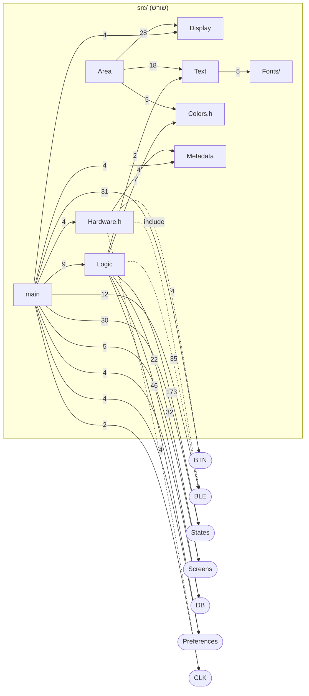
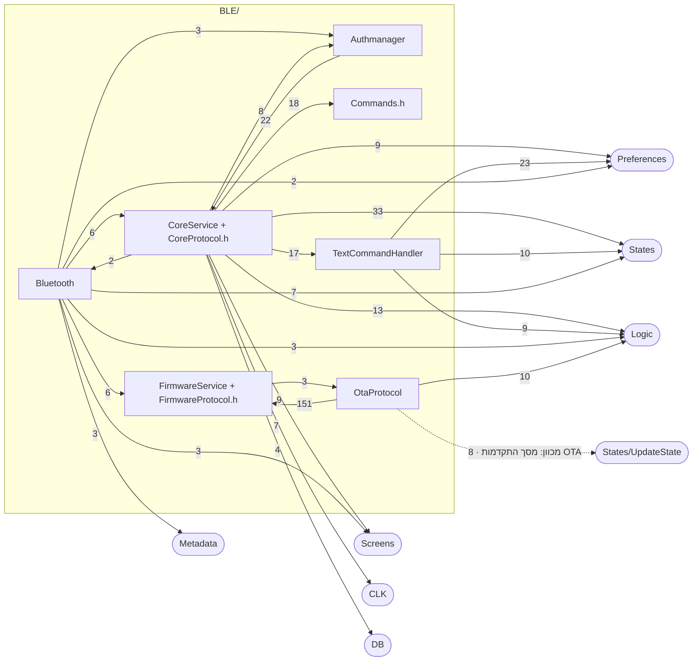
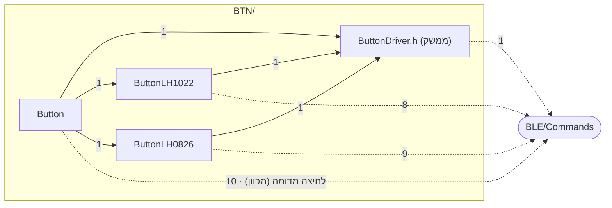
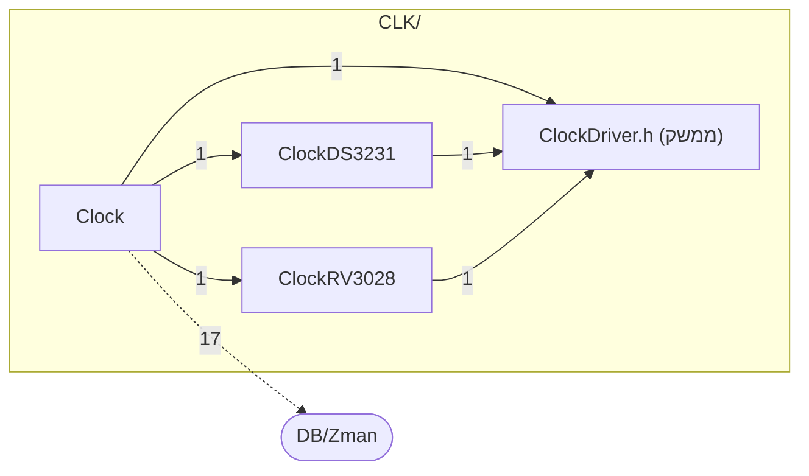
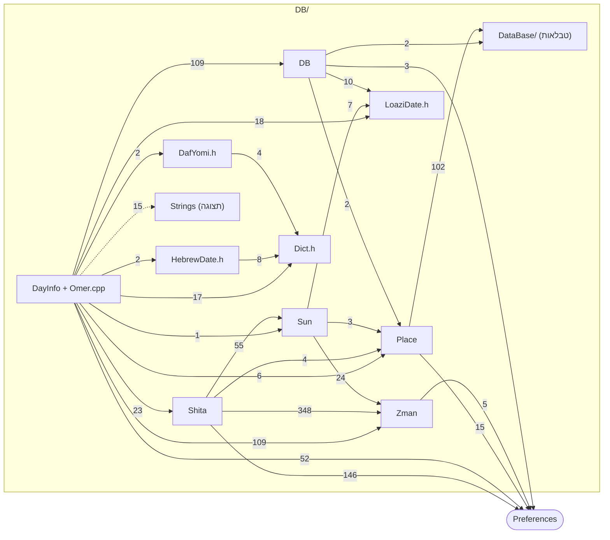
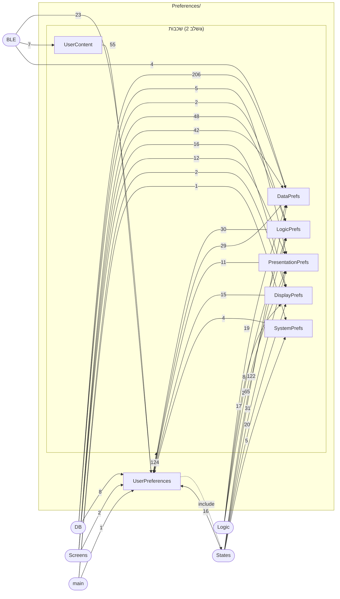

# מפת קשרים בין יחידות — JC6416

שלב 0, משימה ב, חלק 1. המסמך ממפה את הקשרים בין יחידות הקוד, כבסיס לחלוקה לשכבות.
הוא לא מחפש פגמים ולא מציע תיקונים.

תשובות, החלטות ושיוך לשכבות של יחידות שהיו לא ברורות: [notes.md](notes.md).

## 1. בסיס ושיטה

**בסיס:** פרויקט `JC6416`, העץ `src/` הנוכחי (הגישה להעדפות עוברת דרך אובייקטי השכבות). הבלוקים שנוצרים בכלי (§4, §9, נספח A) עדכניים (`gen_deps_doc.py check`), וכך גם המספרים של השכבות ב-§5.6. ההפניות לקוד הן לפי קובץ וסמל. מספרי שורות מופיעים רק בבלוק שנוצר ב-§9 (פלט הכלי, לפי העץ הנוכחי). הספירה נעשתה בכלי [tools/count_deps.py](../../tools/count_deps.py). הבדלים ב-JC4020 וב-JC6432 מופיעים רק כהערות, בסעיף 10.

### יחידה

יחידה היא זוג `.h`/`.cpp`, עם החריגים האלה:

- `BLE/CoreProtocol.h` שייך ל-`BLE/CoreService`, ו-`BLE/FirmwareProtocol.h` שייך ל-`BLE/FirmwareService`.
- `DB/Omer.cpp` שייך ל-`DB/DayInfo`. הוא מממש מתודות של `DayInfo`.
- `metadata.cpp` שייך ל-`Metadata`.
- `Screens/Screens.h` ו-`States/States.h` הן כותרות משותפות שמצהירות על כל המחלקות. כל `.cpp` תחתיהן הוא תת-יחידה נפרדת. הכותרת עצמה מופיעה כיחידה בשם `Screens/Screens.h` או `States/States.h`.
- `States/State` (מחלקת הבסיס) ו-`States/Digit` הן יחידות רגילות.
- `DB/DataBase/*` (101 טבלאות) ו-`Fonts/*` (25 קבצים) הן יחידות נתונים בשם `DataBase` ו-`Fonts`.
- יחידות השכבות של שלב 2a (`Preferences/SystemPrefs`, `UserContent`, `PresentationPrefs`, `DisplayPrefs`, `LogicPrefs`, `DataPrefs`) הן יחידות רגילות של `.h`/`.cpp`. מ-2a.3.3 כל אחת מהן הבעלים של ההעדפות שלה (הגלובלי וההגדרות ב-`.cpp`). `Preferences/PrefsViews` נמחק ב-2a.3.3.

### הפניה

הפניה היא אזכור בקוד של מזהה ששייך ליחידה אחרת: מחלקה, פונקציה חופשית, גלובלי, מאקרו, enumerator או const ברמת הקובץ.
הערות ומחרוזות לא נספרות.

### כלל הספירה לגלובליים

- שימוש בגלובלי נספר כתלות ביחידה שמגדירה את **הטיפוס** שלו, ולא ביחידה שבה המשתנה מוגדר.
  - דוגמאות: `mainScreen` → `Screens/Screens.h`, `dayInfo` → `DB/DayInfo`, `strings` → `DB/Strings`, `bl` → `Logic`, `currentState` → `States/State`, `userPreferences` → `Preferences/UserPreferences`.
- גלובלי מטיפוס בסיסי או מטיפוס של ספרייה חיצונית נספר ביחידה שמצהירה עליו בכותרת.
  - דוגמאות: `display` → `Display`, `now` → `CLK/Clock`, `lonPre` → `DB/Place`.
- המקום שבו כל גלובלי מוגדר בפועל מופיע כמידע בלבד, בסעיף 8.

### שרשראות גישה

- בשרשרת כמו `bl.mainState.numOfValidTexts`, כל יחידה שהשרשרת נוגעת בה נספרת **פעם אחת**:
  - `Logic`, הטיפוס של `bl`.
  - `States/States.h`, השדה של `MainState`.
- קריאה למתודה נספרת ביחידה שבה המתודה ממומשת. למשל `bl.updateState.showUpdateProgress` נספר ב-`States/UpdateState`.
- גישה דרך אובייקט שכבה של שלב 2a, למשל `dataPrefs.zmanim.shita`, נספרת **פעם אחת** ביחידת השכבה (`Preferences/DataPrefs`), והמזהה הוא השרשרת עד ההעדפה. היא לא נספרת ב-`Preferences/UserPreferences`, גם כשקוראים למתודה של ההעדפה. `userContent.textPrefs` נספר כ-`userContent`, כמו ש-`userPreferences.textPrefs` נספר כ-`userPreferences` (סוג חבר עם namespace לא נעקב).

### עוצמה

עוצמה היא מספר ההפניות, ולצדו מספר המזהים השונים. ההפניות כוללות גם אזכורי טיפוס בחתימות, ולכן למשל `DB/Shita → DB/Zman` הוא 348 הפניות למזהה אחד בלבד.

### החרגות ידניות

- הצללות מקומיות:
  - `now` ב-`DayInfo.*` (פרמטר) וב-`OtaProtocol.cpp` (משתנה `uint32_t` מקומי).
  - `place` ב-`DayInfo.*`, ב-`DB.*` ובפרמטרים של `Sun.*`.
- התנגשויות שמות:
  - `Place::orHachaim` מול המחלקה `orHachaim`.
  - `Strings::model` ופרמטר `model` מול `Metadata::model`. Metadata נספר רק דרך `Metadata::`.
  - השדות `place` ו-`zmanim` של `DataPrefs` (`DataPrefs.h`) מול הגלובלי `place` (`DB/Place`) והמערך `zmanim` (`DB/Shita`). מוחרג מ-2a.2.10.
- פונקציות עזר ב-`.cpp` שאף כותרת לא מצהירה עליהן נחשבות פנימיות לקובץ. דוגמאות: `getZriha()` ב-`MinhagState.cpp`, `loaziStr()` ב-`SetTochenTimeState.cpp`.

### מגבלות ידועות של הכלי (לא הוחרגו)

- **includes בסוגריים משולשים** (`#include <States/States.h>`) לא מזוהים. שניים כאלה רלוונטיים (ב-`UserPreferences.cpp` וב-`Bluetooth.cpp`). הם מופיעים ביד ב-§9, ולא בנספח.

### אימות

הספירה נעשתה בסקריפט קריאה-בלבד. הסקריפט המקורי לא נשמר. הוא נכתב מחדש לפי הכללים שלמעלה, ונשמר ב-[tools/count_deps.py](../../tools/count_deps.py). הוראות שימוש בראש הקובץ. על `9c75812` הוא שחזר את כל 374 הקשתות של המפה הקודמת עם אותו מספר הפניות בדיוק (6,747). מספר המזהים היה זהה ב-372 קשתות, ובשתיים (`MainStateInfoSets→DayInfo`, `MainState→DayInfo`) הוא היה שונה בגלל תוויות של שרשראות עמוקות. על הבסיס הנוכחי: 420 קשתות, 7,131 הפניות.

חמשת התאים שנבדקו ידנית מול grep בספירה המקורית נבדקו שוב על הבסיס הנוכחי, והכלי נותן בהם את אותן תוצאות כמו grep:

- `ConfigState→Authmanager` = 2 (`SetResetPassState` ו-`SetResetAllState`)
- `OtaProtocol→UpdateState` = 8
- `TextCommandHandler→States.h` = 9
- `MainStateInfoSets→Screens.h` = 197
- `Clock→Zman` = 17. grep מוצא 19 מופעים, אבל שניים מהם בהערה ובשורת include.

### עדכון המסמך

- **מתי:** יוצרים מחדש בכל סנכרון פרודקשן ובסוף כל תת-שלב שמשנה תלויות (למשל בסוף שכפול 2a). לא מוסיפים סעיף דלתא.
- **בלוקים שנוצרים מהכלי:** הטבלה ב-§4, הרשימה ב-§9 וארבע המטריצות בנספח א'. כל אחד מהם נמצא בין סימנים `<!-- generated:<שם>:begin -->` ו-`<!-- generated:<שם>:end -->`, והתוכן שלו הוא הפלט של הכלי בלבד. עמודת "סימון" ב-§4 מחושבת מטבלת הרמות ב-§2 ומשתי הקשתות המכוונות שב-[notes.md](notes.md).
- **המחולל:** [tools/gen_deps_doc.py](../../tools/gen_deps_doc.py). `write` כותב את הבלוקים שבין הסימנים, ורק אותם, עם CRLF. זו החריגה היחידה מהכלל "עריכה רק בכלי העורך" (CLAUDE.md). `check` בודק שהבלוקים מעודכנים, ושהסיכום ב-§4 והגרף והטבלה ב-§3 תואמים לנספח. `selfcheck` משחזר את המפה הקודמת מ-`9c75812`. הוראות שימוש בראש הקובץ.
- **השאר נכתב ביד:** ההסברים, החלוקה לקבוצות, הגרפים והסיווגים. המספרים בהם נלקחים מאותו פלט.
- **השוואה בין בסיס קודם לעץ הנוכחי:**

  ```
  git archive <commit-before> JC6416/src | tar -x -C <empty-folder>
  python -I tools/count_deps.py <empty-folder>/JC6416/src --compare JC6416/src
  ```

- לספירת ההעדפות (סעיף 4 ב-[preferences.md](preferences.md)): [tools/count_prefs.py](../../tools/count_prefs.py).

## 2. רמות לפי ההשערה

ההשערה, מלמעלה למטה: `main` → קלט → זרימה → תצוגה ודומיין → שירותי מערכת → חומרה. `Metadata` היא תצורה בבסיס, וכולם רשאים להשתמש בה.
השיוך של היחידות שלא היו ברורות מבוסס על [notes.md](notes.md).

| רמה | יחידות |
| --- | --- |
| 0 · כניסה | `main` |
| 1 · קלט | כל `BLE/*`, כולל `Commands` ו-`TextCommandHandler`; `BTN/Button` |
| 2 · זרימה | `Logic`; `States/State`; `States/States.h`; כל `States/*.cpp` חוץ מ-`Digit` ו-`UpdateState` |
| 3 · תצוגה | `Screens/*`; `Area`; `Text`; `Colors`; `Fonts`; `States/Digit`; `States/UpdateState`; `DB/Strings` |
| 3 · דומיין | `DB/*` חוץ מ-`Strings`; `DataBase` |
| 4 · שירותי מערכת | `Preferences/UserPreferences`; יחידות השכבות של שלב 2a (`Preferences/SystemPrefs`, `UserContent`, `PresentationPrefs`, `DisplayPrefs`, `LogicPrefs`, `DataPrefs`); `CLK/Clock` |
| 5 · חומרה | `Display`; `Hardware.h`; `BTN/ButtonDriver`; `BTN/ButtonLH1022`; `BTN/ButtonLH0826`; `CLK/ClockDriver`; `CLK/ClockDS3231`; `CLK/ClockRV3028` |
| תצורה | `Metadata` |

יחידות השכבות נמצאות ברמה 4 יחד עם `UserPreferences`, כמו התיקייה `Preferences/`. השיוך של כל יחידת שכבה לשכבת היעד שלה הוא החלטה של שלב 2, ולא של המפה הזו.

## 3. גרף ברמת נושא

הצמתים מבוססים על תיקיות. את השורש פיצלתי לשלושה נושאים: `Render` (`Area`, `Text`, `Colors`, `Fonts/`), `HW` (`Display`, `Hardware.h`) ו-`Metadata`.

יש צמתים שמכילים יחידות מרמות שונות:

- `States` כולל את `Digit` ואת `UpdateState`, ששייכות לתצוגה.
- `DB` כולל את `Strings`, ששייכת לתצוגה, ואת `DataBase`.
- `BTN` ו-`CLK` כוללים את הדרייברים, ששייכים לחומרה.

הגרף מציג רק קשתות של **10 הפניות ומעלה**. קשתות חלשות יותר מופיעות ברשימה (סעיף 4) ובנספח א'.
קו מקווקו = קשת בין נושאים שהולכת נגד הכיוון, או קשת שסומנה כמכוונת.


**קשתות נושא מתחת לסף:**

| קשת | הפניות | הערה |
| --- | --- | --- |
| `Logic → Render` | 9 | |
| `main → Logic` | 9 | |
| `main → HW` | 8 | |
| `BLE → CLK` | 7 | |
| `main → Screens` | 5 | |
| `BLE → DB` | 4 | בדיקות הטווח ב-`PREF_OP_WRITE` (`numOfOfeks`, `numOfShitot`, `numOfZeetCochavin`) |
| `HW → BTN` | 4 | |
| `HW → CLK` | 4 | |
| `HW → Metadata` | 4 | `Hardware.h` → `Metadata::setHardwareVersion` |
| `main → DB` | 4 | |
| `main → Metadata` | 4 | |
| `main → Prefs` | 4 | |
| `Screens → Metadata` | 4 | |
| `BLE → Metadata` | 3 | |
| `main → CLK` | 2 | |
| `Prefs → States` | 0 | include בלבד (`<States/States.h>`, לא מזוהה בכלי, §9) |
| `HW → BLE` | 0 | include בלבד |

## 4. רשימת קשתות בין יחידות (א)

כל הקשתות בין יחידות, ממוינות לפי עוצמה. קשתות בתוך אותה יחידה לא נכללות. הטבלה נוצרת מהכלי (§1, "עדכון המסמך"). בתיקו, הדוגמאות ממוינות לפי האלף-בית.

בעמודת "סימון":

- **מכוון**: לפי [notes.md](notes.md).
- **נגד הכיוון**: לפי טבלת הרמות בסעיף 2. פירוט בסעיף 7.
- **צדדית**: קשת בין תצוגה לדומיין, שתיהן ברמה 3. פירוט בסעיף 7.

<div dir="ltr">

<!-- generated:edges:begin -->

| # | מ- | אל | הפניות | מזהים | דוגמאות | סימון |
| --- | --- | --- | --- | --- | --- | --- |
| 1 | `DB/Shita` | `DB/Zman` | 348 | 1 | `Zman`×348 |  |
| 2 | `States/MainStateInfoSets` | `Screens/Screens.h` | 197 | 29 | `mainScreen`×88, `mainScreen.infoDown`×18, `mainScreen.infoUp`×17 |  |
| 3 | `Screens/Screens.h` | `Area` | 175 | 1 | `Area`×175 |  |
| 4 | `Logic` | `States/States.h` | 171 | 171 | `AboutDeviceState`, `AboutUsState`, `AlotState` |  |
| 5 | `States/States.h` | `States/State` | 159 | 1 | `State`×159 |  |
| 6 | `BLE/OtaProtocol` | `BLE/FirmwareService` | 151 | 41 | `OTA_TAG`×70, `getStateName`×8, `OTA_IN_PROGRESS`×6 |  |
| 7 | `DB/Shita` | `Preferences/DataPrefs` | 144 | 14 | `dataPrefs.zmanim.nerot`×12, `dataPrefs.zmanim.zmanTalit`×12, `dataPrefs.zmanim.alotHashahar`×11 |  |
| 8 | `States/MinhagState` | `DB/Shita` | 130 | 19 | `numOfZeetCochavin`×24, `numOfSozMga`×12, `numOfZS`×12 |  |
| 9 | `States/MainStateInfoSets` | `DB/DayInfo` | 121 | 71 | `dayInfo.isShabat`×6, `dayInfo.getGeshemTal`×5, `dayInfo.getBircatHashanim`×4 |  |
| 10 | `DB/DayInfo` | `DB/DB` | 109 | 103 | `db.holidayType`×2, `db.roshHodesh`×2, `db.shabatPlus`×2 |  |
| 11 | `DB/DayInfo` | `DB/Zman` | 109 | 1 | `Zman`×109 |  |
| 12 | `States/MinhagState` | `States/States.h` | 105 | 32 | `bl.mainState.updateDayValues`×14, `MinhagNerotSetState`×5, `MinhagShanimSetState`×5 |  |
| 13 | `DB/Place` | `DataBase` | 102 | 98 | `chai_tel_aviv_db`×3, `chai_hazor_haglilit_db`×2, `chai_kfar_saba_raanana_db`×2 |  |
| 14 | `States/MainStateTimeSets` | `Screens/Screens.h` | 91 | 9 | `mainScreen`×45, `mainScreen.zmanLeftUp`×9, `mainScreen.zmanLeftDown`×7 |  |
| 15 | `States/MainStateInfoSets` | `Screens/MainScreen` | 88 | 1 | `mainScreen.update`×88 |  |
| 16 | `States/MainStateInfoSets` | `States/States.h` | 85 | 1 | `MainState`×85 |  |
| 17 | `States/SetClockState` | `CLK/Clock` | 81 | 11 | `now`×62, `currentDay`×3, `currentHour`×3 |  |
| 18 | `States/MinhagState` | `Screens/Screens.h` | 80 | 4 | `menuScreen`×44, `messageScreen`×24, `menuScreen.nerot`×6 |  |
| 19 | `States/MinhagState` | `DB/Strings` | 78 | 19 | `strings.menuMinag`×18, `strings.zeetHacochavim`×5, `strings.alotHashahar`×4 |  |
| 20 | `States/SetClockState` | `States/States.h` | 75 | 18 | `SetClockState`×10, `SetDay`×6, `SetHour`×6 |  |
| 21 | `States/OfekState` | `States/States.h` | 71 | 21 | `SetOfekState`×6, `SetGovaCustomState`×5, `SetLatCustomState`×5 |  |
| 22 | `States/MinhagState` | `DB/DayInfo` | 70 | 29 | `dayInfo.shkiaaM`×11, `dayInfo.sun`×10, `dayInfo.zrihaM`×10 |  |
| 23 | `Screens/RegsScreen` | `Colors` | 65 | 3 | `BLACK`×63, `GREEN`, `RED` |  |
| 24 | `Screens/RegsScreen` | `Area` | 64 | 1 | `Area`×64 |  |
| 25 | `States/MainState` | `CLK/Clock` | 63 | 18 | `now`×38, `currentSecond1`×3, `currentSecond2`×3 |  |
| 26 | `States/SetTochenTimeState` | `DB/Strings` | 63 | 14 | `strings.zmaneHayom`×10, `strings.hazotMinhaGMinhaK`×7, `strings.talitAlotZriha`×7 |  |
| 27 | `States/SetTochenTimeState` | `States/States.h` | 59 | 32 | `SetTohenTimeStateKezevSet`×5, `SetTohenBottomLineHAZ0`×2, `SetTohenBottomLineHAZ1`×2 |  |
| 28 | `States/OfekState` | `DB/Place` | 56 | 10 | `places`×8, `numOfOfeks`×7, `latFrac`×6 |  |
| 29 | `DB/Shita` | `DB/Sun` | 55 | 1 | `Sun`×55 |  |
| 30 | `Preferences/UserContent` | `Preferences/UserPreferences` | 55 | 5 | `UserPref`×50, `userPreferences`×2, `UserPrefBase` |  |
| 31 | `States/SetClockState` | `Screens/Screens.h` | 53 | 13 | `setClockScreen`×19, `menuScreen`×10, `messageScreen`×10 |  |
| 32 | `Screens/MainScreen` | `Area` | 51 | 1 | `Area`×51 |  |
| 33 | `States/SetTochenTimeState` | `Preferences/LogicPrefs` | 51 | 9 | `logicPrefs.HAZ`×6, `logicPrefs.HMM`×6, `logicPrefs.PSZ`×6 |  |
| 34 | `Preferences/UserPreferences` | `Preferences/UserContent` | 50 | 50 | `userContent.textInput1`, `userContent.textInput10`, `userContent.textInput11` |  |
| 35 | `Screens/MainScreen` | `Colors` | 49 | 1 | `BLACK`×49 |  |
| 36 | `States/ColorState` | `States/States.h` | 49 | 14 | `SetColorBottomTLine`×5, `SetColorBottomVLine`×5, `SetColorIluyLine`×5 |  |
| 37 | `Screens/RegsScreen` | `Preferences/LogicPrefs` | 48 | 24 | `logicPrefs.HAZ`×2, `logicPrefs.HMM`×2, `logicPrefs.IORT`×2 |  |
| 38 | `States/MainStateInfoSets` | `Text` | 48 | 2 | `Text`×32, `CENTER`×16 |  |
| 39 | `States/MinhagState` | `Preferences/DataPrefs` | 48 | 16 | `dataPrefs.zmanim.shita`×11, `dataPrefs.minhagim.shanim`×6, `dataPrefs.zmanim.nerot`×6 |  |
| 40 | `DB/DayInfo` | `Preferences/DataPrefs` | 46 | 10 | `dataPrefs.minhagim.eda`×24, `dataPrefs.zmanim.shita`×5, `dataPrefs.zmanim.zriha`×4 |  |
| 41 | `States/SetTochenInfoState` | `Preferences/LogicPrefs` | 46 | 10 | `logicPrefs.IORT`×6, `logicPrefs.intervalInfo`×6, `logicPrefs.netzClk`×6 |  |
| 42 | `States/MainStateTimeSets` | `Screens/MainScreen` | 45 | 1 | `mainScreen.update`×45 |  |
| 43 | `States/MainStateInfoSets` | `DB/Strings` | 44 | 31 | `strings.yaaleveyavo`×5, `strings.halelShalem`×3, `strings.alHanisim`×2 |  |
| 44 | `States/MinhagState` | `Screens/MenuScreen` | 44 | 2 | `menuScreen.printMenu`×31, `menuScreen.addZman`×13 |  |
| 45 | `Screens/RegsScreen` | `Preferences/DataPrefs` | 42 | 21 | `dataPrefs.minhagim.eda`×2, `dataPrefs.minhagim.hul`×2, `dataPrefs.minhagim.shanim`×2 |  |
| 46 | `States/MainState` | `DB/DayInfo` | 42 | 24 | `DayInfo`×5, `dayInfo.getZriha`×4, `dayInfo.shaon`×3 |  |
| 47 | `States/SetTochenInfoState` | `DB/Strings` | 42 | 16 | `strings.meidaHayom`×12, `strings.cShabatZShabatRT`×6, `strings.dafHayomiBavli`×2 |  |
| 48 | `States/ColorState` | `Screens/Screens.h` | 41 | 12 | `messageScreen`×14, `colorScreen`×7, `mainScreen.clockAll`×2 |  |
| 49 | `States/MainStateInfoSets` | `Preferences/LogicPrefs` | 41 | 8 | `logicPrefs.tfila`×20, `logicPrefs.moadim`×9, `logicPrefs.IORT`×4 |  |
| 50 | `States/SetInputText` | `States/States.h` | 41 | 8 | `bl.mainState.indexText`×21, `SetTohenIluyStateKezevSet`×5, `SetTohenIluyStateTextList`×5 |  |
| 51 | `States/ConfigState` | `DB/Strings` | 40 | 15 | `strings.menuConfg`×9, `strings.MemoryMap`×4, `strings.resetPref`×4 |  |
| 52 | `States/States` | `DB/Strings` | 40 | 12 | `strings.menuTitle`×7, `strings.behirut`×3, `strings.gufan`×3 |  |
| 53 | `States/OfekState` | `Preferences/DataPrefs` | 39 | 9 | `dataPrefs.place.ofek`×7, `dataPrefs.place.nz_height`×6, `dataPrefs.place.nz_hul`×6 |  |
| 54 | `States/OfekState` | `Screens/Screens.h` | 39 | 7 | `setClockScreen`×14, `menuScreen`×11, `menuScreen.timeZone`×4 |  |
| 55 | `States/MainState` | `States/States.h` | 37 | 4 | `MainState`×28, `numOfInfoSets`×3, `numOfNameSets`×3 |  |
| 56 | `States/ConfigState` | `States/States.h` | 36 | 16 | `SetBTState`×5, `SetResetAllState`×5, `SetResetPassState`×5 |  |
| 57 | `Logic` | `BLE/Commands` | 34 | 1 | `MenuCommand`×34 | נגד הכיוון |
| 58 | `States/MainStateTimeSets` | `DB/DayInfo` | 33 | 19 | `dayInfo.getZeetCochavim`×5, `dayInfo.getZriha`×4, `dayInfo.minhaKtana`×3 |  |
| 59 | `States/MainStateTimeSets` | `States/States.h` | 33 | 1 | `MainState`×33 |  |
| 60 | `States/SetTochenInfoState` | `States/States.h` | 33 | 15 | `SetTohenBottomLineNetzSet`×5, `SetTohenInfoStateKezevSet`×5, `SetTohenBottomLineDafYomi`×2 |  |
| 61 | `Logic` | `Screens/Screens.h` | 32 | 32 | `AboutScreen`, `BrightnessScreen`, `ColorScreen` |  |
| 62 | `Screens/MainScreen` | `Text` | 32 | 4 | `Text`×25, `CENTER`×5, `LEFT` |  |
| 63 | `States/ConfigState` | `Screens/Screens.h` | 32 | 7 | `messageScreen`×10, `menuScreen`×9, `resetScreen`×8 |  |
| 64 | `States/ColorState` | `Logic` | 31 | 4 | `bl.mainState`×22, `bl.configStates`×7, `Logic` |  |
| 65 | `States/SetInputText` | `Logic` | 31 | 4 | `bl.mainState`×27, `bl.configStates`×2, `Logic` |  |
| 66 | `main` | `BTN/Button` | 31 | 12 | `long_push_temp`×8, `Button`×4, `okButton.isPushed`×4 |  |
| 67 | `Preferences/LogicPrefs` | `Preferences/UserPreferences` | 30 | 4 | `UserPref`×27, `UserPreferences`, `userPreferences` |  |
| 68 | `States/MainState` | `Screens/Screens.h` | 30 | 11 | `mainScreen`×16, `mainScreen.colorBottomT`×3, `mainScreen.colorBottomV`×2 |  |
| 69 | `States/SetInputText` | `Screens/Screens.h` | 30 | 11 | `menuScreen.kezev`×6, `textScreen.text2`×5, `mainScreen.iluyNishmat`×3 |  |
| 70 | `Preferences/DataPrefs` | `Preferences/UserPreferences` | 29 | 4 | `UserPref`×26, `UserPreferences`, `userPreferences` |  |
| 71 | `States/MinhagState` | `Logic` | 29 | 4 | `bl.mainState`×14, `bl.configStates`×13, `Logic` |  |
| 72 | `States/SetClockState` | `DB/Strings` | 29 | 11 | `strings.menuClock`×9, `strings.kivunShaon`×6, `strings.kavuy`×2 |  |
| 73 | `main` | `States/State` | 29 | 12 | `currentState`×10, `currentState.showStateScreen`×9, `State` |  |
| 74 | `Area` | `Display` | 28 | 1 | `display`×28 |  |
| 75 | `BLE/CoreService` | `States/State` | 28 | 3 | `currentState`×17, `State`×6, `currentState.showStateScreen`×5 |  |
| 76 | `States/SetTochenInfoState` | `Screens/Screens.h` | 28 | 4 | `menuScreen`×14, `menuScreen.kezev`×6, `menuScreen.netz`×6 |  |
| 77 | `Preferences/UserPreferences` | `Preferences/LogicPrefs` | 27 | 27 | `logicPrefs.HAZ`, `logicPrefs.HMM`, `logicPrefs.IORT` |  |
| 78 | `Preferences/UserPreferences` | `Preferences/DataPrefs` | 26 | 26 | `dataPrefs.minhagim.eda`, `dataPrefs.minhagim.hul`, `dataPrefs.minhagim.shanim` |  |
| 79 | `States/Digit` | `Colors` | 26 | 1 | `BLACK`×26 |  |
| 80 | `States/SetClockState` | `Preferences/PresentationPrefs` | 26 | 4 | `presentationPrefs.timeFormat`×10, `presentationPrefs.dateFormat`×7, `presentationPrefs.clockFormat`×5 |  |
| 81 | `States/MainStateTimeSets` | `DB/Strings` | 25 | 16 | `strings.zriha`×3, `strings.aHashahar`×2, `strings.adhaz`×2 |  |
| 82 | `States/OfekState` | `DB/Strings` | 25 | 9 | `strings.ofekTitle`×11, `strings.bharOfek`×3, `strings.hagderMakom`×3 |  |
| 83 | `States/SetInputText` | `Area` | 25 | 23 | `mainScreen.iluyNishmat.addRoundRectBorder`×2, `textScreen.text2.addRoundRectBorder`×2, `mainScreen.iluyNishmat.textFits` |  |
| 84 | `DB/Sun` | `DB/Zman` | 24 | 3 | `Zman`×21, `decimalDayToTime`×2, `TimeToDecimalDay` |  |
| 85 | `States/States.h` | `Screens/Screens.h` | 24 | 24 | `AboutScreen`, `BrightnessScreen`, `ColorScreen` |  |
| 86 | `DB/DayInfo` | `DB/Shita` | 23 | 9 | `TEIMAN_BALADI`×4, `ASHKENAZ`×3, `CHABAD`×3 |  |
| 87 | `BLE/Authmanager` | `BLE/CoreService` | 22 | 3 | `AUTH_CLIENT_ID_SIZE`×12, `AUTH_TRUSTED_SLOTS`×6, `AUTH_DEFAULT_PIN`×4 |  |
| 88 | `States/MainStateTimeSets` | `Preferences/LogicPrefs` | 22 | 8 | `logicPrefs.HAZ`×3, `logicPrefs.HMM`×3, `logicPrefs.PSZ`×3 |  |
| 89 | `States/EdotState` | `DB/Strings` | 21 | 8 | `strings.minhagTitle`×7, `strings.ashkenaz`×2, `strings.bneiHul`×2 |  |
| 90 | `Screens/SetClockScreen` | `Text` | 20 | 2 | `Text`×16, `CENTER`×4 |  |
| 91 | `States/ColorState` | `Area` | 20 | 10 | `mainScreen.clockAll.addRoundRectBorder`×2, `mainScreen.iluyNishmat.addRoundRectBorder`×2, `mainScreen.infoDown.addRoundRectBorder`×2 |  |
| 92 | `States/MainStateInfoSets` | `Fonts` | 20 | 4 | `font6`×10, `font7`×5, `font5`×3 |  |
| 93 | `States/MainStateTimeSets` | `CLK/Clock` | 20 | 2 | `zmanPlusDakot`×11, `isTimeInRange`×9 |  |
| 94 | `Logic` | `Preferences/DataPrefs` | 19 | 19 | `dataPrefs.minhagim.shanim`, `dataPrefs.place.nz_height`, `dataPrefs.place.ofek` |  |
| 95 | `Screens/SetClockScreen` | `Colors` | 19 | 4 | `BLACK`×8, `WHITE`×7, `BLUE`×2 |  |
| 96 | `States/SetClockState` | `Screens/SetClockScreen` | 19 | 8 | `setClockScreen.focusArea`×6, `setClockScreen.updateDay`×2, `setClockScreen.updateHour`×2 |  |
| 97 | `Area` | `Text` | 18 | 3 | `Text`×14, `CENTER`×2, `RIGHT`×2 |  |
| 98 | `BLE/CoreService` | `BLE/Commands` | 18 | 4 | `ButtonCommand`×6, `MenuCommand`×5, `currentButtonCommand`×5 |  |
| 99 | `DB/DayInfo` | `DB/LoaziDate` | 18 | 1 | `LoaziDate`×18 |  |
| 100 | `Screens/MenuScreen` | `Colors` | 18 | 4 | `RED`×11, `BLACK`×3, `BLUE`×2 |  |
| 101 | `Screens/RegsScreen` | `DB/Place` | 18 | 6 | `latPre`×4, `lonPre`×4, `latInt`×3 | צדדית |
| 102 | `BLE/CoreService` | `BLE/TextCommandHandler` | 17 | 12 | `CommandResult`×6, `ERR_EMPTY_TEXT`, `ERR_INVALID_FORMAT` |  |
| 103 | `CLK/Clock` | `DB/Zman` | 17 | 1 | `Zman`×17 | נגד הכיוון |
| 104 | `DB/DayInfo` | `DB/Dict` | 17 | 9 | `daysOfTheWeek`×6, `hodesh_list_l`×3, `holidays`×2 |  |
| 105 | `Logic` | `Preferences/DisplayPrefs` | 17 | 9 | `displayPrefs.clockFont`×2, `displayPrefs.colorBottomT`×2, `displayPrefs.colorBottomV`×2 |  |
| 106 | `States/EdotState` | `Preferences/DataPrefs` | 17 | 3 | `dataPrefs.minhagim.eda`×12, `dataPrefs.minhagim.hul`×4, `dataPrefs.zmanim.shita` |  |
| 107 | `States/SetTochenTimeState` | `Screens/Screens.h` | 17 | 3 | `menuScreen`×13, `mainScreen.zmanAll`×2, `menuScreen.kezev`×2 |  |
| 108 | `BLE/TextCommandHandler` | `Preferences/UserPreferences` | 16 | 3 | `UserPref`×14, `UserPreferences`, `userPreferences` |  |
| 109 | `Screens/RegsScreen` | `Preferences/DisplayPrefs` | 16 | 8 | `displayPrefs.clockFont`×2, `displayPrefs.colorBottomT`×2, `displayPrefs.colorBottomV`×2 |  |
| 110 | `Screens/VersionScreen` | `Colors` | 16 | 4 | `BLACK`×11, `BLUE`×2, `RED`×2 |  |
| 111 | `States/MainState` | `Screens/MainScreen` | 16 | 13 | `mainScreen.update`×4, `mainScreen.printScreen`, `mainScreen.updateHebDate` |  |
| 112 | `DB/DayInfo` | `DB/Strings` | 15 | 14 | `strings.vetenTalUmatar`×2, `Strings`, `strings` | צדדית |
| 113 | `Preferences/DisplayPrefs` | `Preferences/UserPreferences` | 15 | 4 | `UserPref`×12, `UserPreferences`, `userPreferences` |  |
| 114 | `Screens/MainScreen` | `Screens/Screens.h` | 15 | 1 | `MainScreen`×15 |  |
| 115 | `States/EdotState` | `States/States.h` | 15 | 8 | `EdotAshkenaz`×2, `EdotBneiHul`×2, `EdotChabad`×2 |  |
| 116 | `States/MainStateInfoSets` | `DB/Zman` | 15 | 1 | `Zman`×15 |  |
| 117 | `Screens/MenuScreen` | `Area` | 14 | 1 | `Area`×14 |  |
| 118 | `Screens/messageScreen` | `Text` | 14 | 4 | `Text`×9, `CENTER`×2, `LEFT`×2 |  |
| 119 | `States/ColorState` | `Preferences/DisplayPrefs` | 14 | 7 | `displayPrefs.colorBottomT`×2, `displayPrefs.colorBottomV`×2, `displayPrefs.colorIluy`×2 |  |
| 120 | `States/ColorState` | `States/MainState` | 14 | 2 | `bl.mainState.showStateScreen`×7, `bl.mainState.stateLoop`×7 |  |
| 121 | `States/MinhagState` | `DB/Zman` | 14 | 1 | `Zman`×14 |  |
| 122 | `States/OfekState` | `Screens/SetClockScreen` | 14 | 4 | `setClockScreen.updateHour`×4, `setClockScreen.updateMinute`×4, `setClockScreen.updateSecond`×4 |  |
| 123 | `States/SetTochenInfoState` | `Area` | 14 | 13 | `mainScreen.infoAll.addRoundRectBorder`×2, `menuScreen.kezev.addArrows`, `menuScreen.kezev.addRoundRect` |  |
| 124 | `States/SetTochenInfoState` | `Screens/MenuScreen` | 14 | 1 | `menuScreen.printMenu`×14 |  |
| 125 | `BLE/CoreService` | `Logic` | 13 | 8 | `bl.updateState`×5, `bl.setClockState`×2, `Logic` |  |
| 126 | `DB/Place` | `Preferences/DataPrefs` | 13 | 9 | `dataPrefs.place.ofek`×3, `dataPrefs.place.nz_lat`×2, `dataPrefs.place.nz_long`×2 |  |
| 127 | `States/SetTochenTimeState` | `Screens/MenuScreen` | 13 | 1 | `menuScreen.printMenu`×13 |  |
| 128 | `States/ShitaState` | `DB/Shita` | 13 | 3 | `numOfShitot`×7, `shitot`×5, `Shita` |  |
| 129 | `Logic` | `DB/Place` | 12 | 6 | `latFrac`×2, `latInt`×2, `latPre`×2 |  |
| 130 | `Preferences/UserPreferences` | `Preferences/DisplayPrefs` | 12 | 12 | `displayPrefs.brightness`, `displayPrefs.clockFont`, `displayPrefs.colorBottomT` |  |
| 131 | `Screens/RegsScreen` | `Preferences/PresentationPrefs` | 12 | 6 | `presentationPrefs.clockFormat`×2, `presentationPrefs.dateFormat`×2, `presentationPrefs.layout.middleLine`×2 |  |
| 132 | `States/MinhagState` | `Area` | 12 | 12 | `menuScreen.nerot.addArrows`, `menuScreen.nerot.addRoundRect`, `menuScreen.nerot.high` |  |
| 133 | `States/MinhagState` | `Screens/messageScreen` | 12 | 1 | `messageScreen.printMessages`×12 |  |
| 134 | `States/States.h` | `States/Digit` | 12 | 1 | `Digit`×12 |  |
| 135 | `Preferences/PresentationPrefs` | `Preferences/UserPreferences` | 11 | 4 | `UserPref`×8, `UserPreferences`, `userPreferences` |  |
| 136 | `Screens/TextScreen` | `Colors` | 11 | 3 | `BLACK`×8, `BLUE`×2, `WHITE` |  |
| 137 | `Screens/VersionScreen` | `Area` | 11 | 1 | `Area`×11 |  |
| 138 | `States/Digit` | `Display` | 11 | 1 | `display`×11 |  |
| 139 | `States/OfekState` | `Screens/MenuScreen` | 11 | 1 | `menuScreen.printMenu`×11 |  |
| 140 | `States/SetInputText` | `DB/Strings` | 11 | 5 | `strings.aroch`×3, `strings.empty`×3, `strings.hakdasha`×3 |  |
| 141 | `States/UpdateState` | `Screens/Screens.h` | 11 | 1 | `messageScreen`×11 |  |
| 142 | `main` | `BLE/Commands` | 11 | 4 | `currentMenuCommand`×4, `MenuCommand`×3, `ButtonCommand`×2 |  |
| 143 | `BLE/OtaProtocol` | `Logic` | 10 | 3 | `bl.updateState`×8, `Logic`, `bl` |  |
| 144 | `BTN/Button` | `BLE/Commands` | 10 | 2 | `ButtonCommand`×8, `currentButtonCommand`×2 | מכוון: לחיצה מדומה |
| 145 | `DB/DB` | `DB/LoaziDate` | 10 | 1 | `LoaziDate`×10 |  |
| 146 | `Logic` | `DB/DayInfo` | 10 | 6 | `DayInfo`×5, `dayInfo`, `dayInfoNextShabat` |  |
| 147 | `Screens/ResetScreen` | `Colors` | 10 | 4 | `BLACK`×4, `BLUE`×2, `GREEN`×2 |  |
| 148 | `Screens/SetClockScreen` | `Screens/Screens.h` | 10 | 1 | `SetClockScreen`×10 |  |
| 149 | `States/FontState` | `States/States.h` | 10 | 2 | `SetFontState`×6, `bl.mainState.morphing`×4 |  |
| 150 | `States/MainState` | `Text` | 10 | 2 | `CENTER`×5, `Text`×5 |  |
| 151 | `States/OfekState` | `Area` | 10 | 5 | `menuScreen.timeZone.addArrows`×2, `menuScreen.timeZone.addRoundRectBorder`×2, `setClockScreen.hour.addArrows`×2 |  |
| 152 | `States/OfekState` | `Logic` | 10 | 4 | `bl.configStates`×4, `bl.mainState`×4, `Logic` |  |
| 153 | `States/SetClockState` | `Screens/MenuScreen` | 10 | 1 | `menuScreen.printMenu`×10 |  |
| 154 | `States/States` | `Screens/MenuScreen` | 10 | 1 | `menuScreen.printMenu`×10 |  |
| 155 | `States/States` | `Screens/Screens.h` | 10 | 1 | `menuScreen`×10 |  |
| 156 | `States/States` | `States/States.h` | 10 | 10 | `BrightnessState`, `ColorState`, `FontState` |  |
| 157 | `BLE/TextCommandHandler` | `Logic` | 9 | 4 | `bl.mainState`×6, `Logic`, `bl` |  |
| 158 | `BLE/TextCommandHandler` | `States/States.h` | 9 | 4 | `numOfNameSets`×3, `bl.mainState.flagNameSetChanged`×2, `bl.mainState.numOfValidTexts`×2 |  |
| 159 | `BTN/ButtonLH0826` | `BLE/Commands` | 9 | 1 | `ButtonCommand`×9 | נגד הכיוון |
| 160 | `Screens/AboutScreen` | `Colors` | 9 | 4 | `BLACK`×5, `GREEN`×2, `BLUE` |  |
| 161 | `Screens/MenuScreen` | `Text` | 9 | 4 | `Text`×6, `CENTER`, `LEFT` |  |
| 162 | `Screens/SetClockScreen` | `Area` | 9 | 1 | `Area`×9 |  |
| 163 | `Screens/VersionScreen` | `Text` | 9 | 4 | `Text`×5, `LEFT`×2, `CENTER` |  |
| 164 | `States/ConfigState` | `Screens/MenuScreen` | 9 | 1 | `menuScreen.printMenu`×9 |  |
| 165 | `States/MainStateInfoSets` | `CLK/Clock` | 9 | 2 | `isTimeInRange`×8, `zmanPlusDakot` |  |
| 166 | `States/SetInputText` | `Text` | 9 | 2 | `Text`×6, `CENTER`×3 |  |
| 167 | `main` | `Logic` | 9 | 8 | `bl.mainState`×2, `Logic`, `bl` |  |
| 168 | `BLE/CoreService` | `BLE/Authmanager` | 8 | 6 | `authManager.grantSession`×2, `authManager.isSessionAuthenticated`×2, `authManager.checkPin` |  |
| 169 | `BLE/OtaProtocol` | `States/UpdateState` | 8 | 5 | `bl.updateState.showUpdateSuccessScreen`×3, `bl.updateState.showUpdateFailedScreen`×2, `bl.updateState.showUpdateCancelledScreen` | מכוון: מסך התקדמות OTA |
| 170 | `BTN/ButtonLH1022` | `BLE/Commands` | 8 | 1 | `ButtonCommand`×8 | נגד הכיוון |
| 171 | `DB/HebrewDate` | `DB/Dict` | 8 | 6 | `hodesh_list_l`×2, `yom_list`×2, `hodesh_list_s` |  |
| 172 | `Logic` | `Preferences/LogicPrefs` | 8 | 4 | `logicPrefs.intervalIluy`×2, `logicPrefs.intervalInfo`×2, `logicPrefs.intervalTime`×2 |  |
| 173 | `Preferences/UserPreferences` | `Preferences/PresentationPrefs` | 8 | 8 | `presentationPrefs.clockFormat`, `presentationPrefs.dateFormat`, `presentationPrefs.layout.middleLine` |  |
| 174 | `Screens/MainScreen` | `Fonts` | 8 | 3 | `font6`×4, `ariel10`×2, `font7`×2 |  |
| 175 | `Screens/SetClockScreen` | `Fonts` | 8 | 2 | `font7`×4, `number19`×4 |  |
| 176 | `Screens/TextScreen` | `Area` | 8 | 1 | `Area`×8 |  |
| 177 | `Screens/messageScreen` | `Screens/Screens.h` | 8 | 2 | `MessageScreen`×6, `MessageType`×2 |  |
| 178 | `States/ConfigState` | `Screens/ResetScreen` | 8 | 2 | `resetScreen.SetScreen`×4, `resetScreen.focusArea`×4 |  |
| 179 | `States/FontState` | `Logic` | 8 | 3 | `bl.mainState`×6, `Logic`, `bl` |  |
| 180 | `States/FontState` | `Text` | 8 | 2 | `font_list`×4, `numOfFonts`×4 |  |
| 181 | `States/MainState` | `States/Digit` | 8 | 2 | `Digit`×6, `MorphMulty`×2 |  |
| 182 | `States/SetClockState` | `Area` | 8 | 8 | `menuScreen.clkFormat.addArrows`, `menuScreen.clkFormat.addRoundRectBorder`, `menuScreen.format.addArrows` |  |
| 183 | `States/UpdateState` | `Logic` | 8 | 4 | `bl.updateState`×4, `bl.mainState`×2, `Logic` | נגד הכיוון |
| 184 | `BLE/Bluetooth` | `States/State` | 7 | 3 | `currentState`×4, `State`×2, `currentState.showStateScreen` |  |
| 185 | `BLE/CoreService` | `CLK/Clock` | 7 | 1 | `now`×7 |  |
| 186 | `BLE/TextCommandHandler` | `Preferences/UserContent` | 7 | 1 | `userContent`×7 |  |
| 187 | `DB/Sun` | `DB/LoaziDate` | 7 | 1 | `LoaziDate`×7 |  |
| 188 | `Logic` | `Colors` | 7 | 1 | `color_list`×7 |  |
| 189 | `Screens/ColorScreen` | `Colors` | 7 | 3 | `BLACK`×4, `BLUE`×2, `color_list` |  |
| 190 | `States/ColorState` | `Screens/ColorScreen` | 7 | 1 | `colorScreen.setColor`×7 |  |
| 191 | `States/ColorState` | `Screens/messageScreen` | 7 | 1 | `messageScreen.printMessages`×7 |  |
| 192 | `States/EdotState` | `Screens/MenuScreen` | 7 | 1 | `menuScreen.printMenu`×7 |  |
| 193 | `States/EdotState` | `Screens/Screens.h` | 7 | 1 | `menuScreen`×7 |  |
| 194 | `States/FontState` | `Screens/Screens.h` | 7 | 4 | `mainScreen.clockFont`×3, `messageScreen`×2, `mainScreen` |  |
| 195 | `States/MainState` | `DB/Place` | 7 | 2 | `place`×6, `Place` |  |
| 196 | `States/MainStateInfoSets` | `Preferences/DataPrefs` | 7 | 3 | `dataPrefs.minhagim.eda`×4, `dataPrefs.place.homa`×2, `dataPrefs.minhagim.hul` |  |
| 197 | `States/MainStateTimeSets` | `DB/Zman` | 7 | 1 | `Zman`×7 |  |
| 198 | `States/ShitaState` | `States/States.h` | 7 | 2 | `ShitaState`×6, `bl.mainState.updateDayValues` |  |
| 199 | `States/UpdateState` | `States/State` | 7 | 3 | `currentState`×4, `currentState.showStateScreen`×2, `State` | נגד הכיוון |
| 200 | `States/UpdateState` | `States/States.h` | 7 | 1 | `UpdateState`×7 | נגד הכיוון |
| 201 | `BLE/Bluetooth` | `BLE/CoreService` | 6 | 4 | `applyDeviceName`×2, `loadDeviceName`×2, `CORE_SERVICE_UUID` |  |
| 202 | `BLE/Bluetooth` | `BLE/FirmwareService` | 6 | 5 | `onOtaMtuChanged`×2, `OTA_SERVICE_UUID`, `initFirmwareService` |  |
| 203 | `BLE/CoreService` | `Screens/Screens.h` | 6 | 1 | `messageScreen`×6 |  |
| 204 | `DB/DayInfo` | `DB/Place` | 6 | 1 | `Place`×6 |  |
| 205 | `Screens/BrightnessScreen` | `Colors` | 6 | 3 | `BLACK`×2, `BLUE`×2, `WHITE`×2 |  |
| 206 | `Screens/TextScreen` | `Text` | 6 | 2 | `Text`×4, `CENTER`×2 |  |
| 207 | `Screens/VersionScreen` | `DB/Strings` | 6 | 6 | `strings.hwVersion`, `strings.lastUpdate`, `strings.model` |  |
| 208 | `Screens/messageScreen` | `Colors` | 6 | 2 | `BLACK`×4, `WHITE`×2 |  |
| 209 | `States/SetInputText` | `BLE/TextCommandHandler` | 6 | 2 | `getTextByIndex`×5, `handleDeleteText` | נגד הכיוון |
| 210 | `States/SetTochenInfoState` | `Logic` | 6 | 4 | `bl.configStates`×2, `bl.mainState`×2, `Logic` |  |
| 211 | `States/UpdateState` | `Screens/messageScreen` | 6 | 3 | `messageScreen.printMessages`×4, `messageScreen.printProgressBar`, `messageScreen.printScreen` |  |
| 212 | `Area` | `Colors` | 5 | 2 | `YELLOW`×3, `BLUE`×2 |  |
| 213 | `BLE/CoreService` | `Preferences/UserPreferences` | 5 | 2 | `userPreferences`×4, `UserPreferences` |  |
| 214 | `Screens/AboutScreen` | `Area` | 5 | 1 | `Area`×5 |  |
| 215 | `Screens/AboutScreen` | `Text` | 5 | 1 | `Text`×5 |  |
| 216 | `Screens/MenuScreen` | `Screens/Screens.h` | 5 | 1 | `MenuScreen`×5 |  |
| 217 | `Screens/ResetScreen` | `Text` | 5 | 2 | `Text`×4, `CENTER` |  |
| 218 | `Screens/messageScreen` | `Fonts` | 5 | 3 | `font7`×2, `logo`×2, `font6` |  |
| 219 | `States/BrightnessState` | `States/States.h` | 5 | 1 | `SetBrightnessState`×5 |  |
| 220 | `States/ConfigState` | `Preferences/SystemPrefs` | 5 | 1 | `systemPrefs.bt`×5 |  |
| 221 | `States/ConfigState` | `Screens/messageScreen` | 5 | 1 | `messageScreen.printMessages`×5 |  |
| 222 | `States/MainState` | `Fonts` | 5 | 3 | `font5`×2, `font6`×2, `font8` |  |
| 223 | `States/MainStateInfoSets` | `Area` | 5 | 3 | `mainScreen.infoAll.textFits`×3, `mainScreen.infoDown.textFits`, `mainScreen.infoUp.textFits` |  |
| 224 | `States/SetClockState` | `Preferences/DataPrefs` | 5 | 1 | `dataPrefs.place.shaonKaiz`×5 |  |
| 225 | `States/SetClockState` | `Screens/messageScreen` | 5 | 1 | `messageScreen.printMessages`×5 |  |
| 226 | `States/SetTochenTimeState` | `Logic` | 5 | 4 | `bl.mainState`×2, `Logic`, `bl` |  |
| 227 | `States/States.h` | `Text` | 5 | 1 | `Text`×5 |  |
| 228 | `Text` | `Fonts` | 5 | 4 | `number25d`×2, `number22`, `number23` |  |
| 229 | `BLE/CoreService` | `Preferences/DataPrefs` | 4 | 4 | `dataPrefs.zmanim.rabenuTam`, `dataPrefs.zmanim.zeetCochavim`, `dataPrefs.zmanim.zeetShabat` |  |
| 230 | `DB/DafYomi` | `DB/Dict` | 4 | 2 | `masechet_list`×2, `ot_list`×2 |  |
| 231 | `DB/Shita` | `DB/Place` | 4 | 4 | `Place`, `place`, `place.kiseRahamim` |  |
| 232 | `Hardware` | `BTN/Button` | 4 | 2 | `ButtonDriverType`×2, `selectButtonDriver`×2 | נגד הכיוון |
| 233 | `Hardware` | `CLK/Clock` | 4 | 2 | `ClockType`×2, `selectClock`×2 | נגד הכיוון |
| 234 | `Hardware` | `Metadata` | 4 | 1 | `Metadata`×4 |  |
| 235 | `Preferences/SystemPrefs` | `Preferences/UserPreferences` | 4 | 4 | `UserPref`, `UserPreferences`, `userPreferences` |  |
| 236 | `Screens/AboutScreen` | `DB/Strings` | 4 | 4 | `strings.info1`, `strings.info2`, `strings.phone` |  |
| 237 | `Screens/ResetScreen` | `Area` | 4 | 1 | `Area`×4 |  |
| 238 | `Screens/ResetScreen` | `Screens/Screens.h` | 4 | 1 | `ResetScreen`×4 |  |
| 239 | `Screens/TextScreen` | `Screens/Screens.h` | 4 | 1 | `TextScreen`×4 |  |
| 240 | `Screens/messageScreen` | `Area` | 4 | 1 | `Area`×4 |  |
| 241 | `States/BrightnessState` | `Display` | 4 | 1 | `display`×4 |  |
| 242 | `States/ColorState` | `States/MainStateInfoSets` | 4 | 1 | `bl.mainState.infoSetShabatInShabatOutRabenuTam`×4 |  |
| 243 | `States/ColorState` | `States/MainStateTimeSets` | 4 | 1 | `bl.mainState.timeSetZrihaShkiaaCochavim`×4 |  |
| 244 | `States/ConfigState` | `Preferences/UserPreferences` | 4 | 2 | `userPreferences.resetSimplePrefs`×2, `userPreferences.resetTextPrefs`×2 |  |
| 245 | `States/MainState` | `Preferences/PresentationPrefs` | 4 | 2 | `presentationPrefs.clockFormat`×3, `presentationPrefs.dateFormat` |  |
| 246 | `States/SetClockState` | `DB/DayInfo` | 4 | 4 | `DayInfo`, `dayInfo`, `dayInfo.isShaonKaiz` |  |
| 247 | `States/SetClockState` | `Logic` | 4 | 3 | `bl.mainState`×2, `Logic`, `bl` |  |
| 248 | `States/SetInputText` | `Colors` | 4 | 3 | `YELLOW`×2, `RED`, `WHITE` |  |
| 249 | `States/SetInputText` | `Preferences/LogicPrefs` | 4 | 1 | `logicPrefs.intervalIluy`×4 |  |
| 250 | `States/SetTochenTimeState` | `Area` | 4 | 3 | `mainScreen.zmanAll.addRoundRectBorder`×2, `menuScreen.kezev.addArrows`, `menuScreen.kezev.addRoundRectBorder` |  |
| 251 | `States/ShitaState` | `Logic` | 4 | 4 | `Logic`, `bl`, `bl.configStates` |  |
| 252 | `main` | `Display` | 4 | 2 | `display`×3, `initDisplay` |  |
| 253 | `main` | `Hardware` | 4 | 3 | `hardwareModel`×2, `configureHardware`, `detectHardwareModel` |  |
| 254 | `main` | `Metadata` | 4 | 1 | `Metadata`×4 |  |
| 255 | `BLE/Bluetooth` | `BLE/Authmanager` | 3 | 2 | `authManager.resetSession`×2, `authManager.init` |  |
| 256 | `BLE/Bluetooth` | `Logic` | 3 | 3 | `Logic`, `bl`, `bl.updateState` |  |
| 257 | `BLE/Bluetooth` | `Metadata` | 3 | 1 | `Metadata`×3 |  |
| 258 | `BLE/CoreService` | `Screens/messageScreen` | 3 | 1 | `messageScreen.printMessages`×3 |  |
| 259 | `BLE/FirmwareService` | `BLE/OtaProtocol` | 3 | 1 | `OtaProtocol`×3 |  |
| 260 | `DB/DB` | `Preferences/DataPrefs` | 3 | 1 | `dataPrefs.zmanim.shita`×3 |  |
| 261 | `DB/Sun` | `DB/Place` | 3 | 1 | `Place`×3 |  |
| 262 | `DB/Zman` | `Preferences/PresentationPrefs` | 3 | 2 | `presentationPrefs.timeFormat`×2, `presentationPrefs.clockFormat` |  |
| 263 | `Screens/AboutScreen` | `Fonts` | 3 | 2 | `font6`×2, `logo` |  |
| 264 | `Screens/BrightnessScreen` | `Screens/Screens.h` | 3 | 1 | `BrightnessScreen`×3 |  |
| 265 | `Screens/BrightnessScreen` | `Text` | 3 | 2 | `Text`×2, `CENTER` |  |
| 266 | `Screens/ColorScreen` | `Screens/Screens.h` | 3 | 1 | `ColorScreen`×3 |  |
| 267 | `Screens/ColorScreen` | `Text` | 3 | 2 | `Text`×2, `CENTER` |  |
| 268 | `Screens/MenuScreen` | `Fonts` | 3 | 1 | `font7`×3 |  |
| 269 | `Screens/RegsScreen` | `Screens/Screens.h` | 3 | 1 | `RegsScreen`×3 |  |
| 270 | `Screens/RegsScreen` | `Text` | 3 | 2 | `Text`×2, `CENTER` |  |
| 271 | `Screens/ResetScreen` | `DB/Strings` | 3 | 3 | `strings.no`, `strings.resetTitle`, `strings.yes` |  |
| 272 | `Screens/ResetScreen` | `Fonts` | 3 | 1 | `font7`×3 |  |
| 273 | `Screens/Screens.h` | `Colors` | 3 | 3 | `GREEN`, `RED`, `YELLOW` |  |
| 274 | `Screens/VersionScreen` | `Fonts` | 3 | 2 | `font7`×2, `font6` |  |
| 275 | `Screens/VersionScreen` | `Metadata` | 3 | 1 | `Metadata`×3 |  |
| 276 | `Screens/VersionScreen` | `Screens/Screens.h` | 3 | 1 | `VersionScreen`×3 |  |
| 277 | `States/BrightnessState` | `Screens/Screens.h` | 3 | 2 | `messageScreen`×2, `brightnessScreen` |  |
| 278 | `States/EdotState` | `Logic` | 3 | 3 | `Logic`, `bl`, `bl.mainState` |  |
| 279 | `States/FontState` | `Preferences/DisplayPrefs` | 3 | 1 | `displayPrefs.clockFont`×3 |  |
| 280 | `States/MainState` | `DB/Strings` | 3 | 3 | `strings.hazmanShenotar`, `strings.henetzHahama`, `strings.parashatShavua` |  |
| 281 | `States/MainStateInfoSets` | `DB/Shita` | 3 | 3 | `ASHKENAZ`, `CHABAD`, `SFARAD` |  |
| 282 | `States/MainStateTimeSets` | `Text` | 3 | 2 | `Text`×2, `CENTER` |  |
| 283 | `States/SetInputText` | `Fonts` | 3 | 2 | `font6`×2, `font7` |  |
| 284 | `States/SetInputText` | `Screens/MenuScreen` | 3 | 1 | `menuScreen.printMenu`×3 |  |
| 285 | `States/ShitaState` | `Preferences/DataPrefs` | 3 | 1 | `dataPrefs.zmanim.shita`×3 |  |
| 286 | `States/ShitaState` | `Screens/Screens.h` | 3 | 2 | `messageScreen`×2, `menuScreen` |  |
| 287 | `main` | `DB/Strings` | 3 | 3 | `Strings`, `strings`, `strings.setStringsHeb` |  |
| 288 | `main` | `Screens/Screens.h` | 3 | 2 | `messageScreen`×2, `logoScreen` |  |
| 289 | `BLE/Bluetooth` | `Preferences/UserPreferences` | 2 | 2 | `UserPreferences`, `userPreferences` |  |
| 290 | `BLE/Bluetooth` | `Screens/Screens.h` | 2 | 1 | `messageScreen`×2 |  |
| 291 | `BLE/CoreService` | `BLE/Bluetooth` | 2 | 1 | `deviceConnected`×2 |  |
| 292 | `BLE/CoreService` | `DB/Place` | 2 | 1 | `numOfOfeks`×2 |  |
| 293 | `BLE/CoreService` | `DB/Shita` | 2 | 2 | `numOfShitot`, `numOfZeetCochavin` |  |
| 294 | `BLE/CoreService` | `States/OfekState` | 2 | 2 | `bl.setCustomState.printUpdateSucc`, `bl.setOfekState.printUpdateSucc` |  |
| 295 | `BLE/CoreService` | `States/SetClockState` | 2 | 2 | `bl.setClockState.commonMenuAction`, `bl.setClockState.validateAndSetTime` |  |
| 296 | `DB/DB` | `DB/Place` | 2 | 1 | `Place`×2 |  |
| 297 | `DB/DB` | `DataBase` | 2 | 2 | `Tucazinsky_db`, `common_db` |  |
| 298 | `DB/DayInfo` | `DB/DafYomi` | 2 | 1 | `DafYomi`×2 |  |
| 299 | `DB/DayInfo` | `DB/HebrewDate` | 2 | 1 | `HebrewDate`×2 |  |
| 300 | `DB/DayInfo` | `Preferences/LogicPrefs` | 2 | 1 | `logicPrefs.showIsraeli`×2 |  |
| 301 | `DB/DayInfo` | `Preferences/PresentationPrefs` | 2 | 1 | `presentationPrefs.leil`×2 |  |
| 302 | `DB/DayInfo` | `Preferences/UserPreferences` | 2 | 2 | `UserPreferences`, `userPreferences` |  |
| 303 | `DB/Place` | `Preferences/UserPreferences` | 2 | 2 | `UserPreferences`, `userPreferences` |  |
| 304 | `DB/Shita` | `Preferences/UserPreferences` | 2 | 2 | `UserPreferences`, `userPreferences` |  |
| 305 | `DB/Zman` | `Preferences/UserPreferences` | 2 | 2 | `UserPreferences`, `userPreferences` |  |
| 306 | `Logic` | `Preferences/PresentationPrefs` | 2 | 2 | `presentationPrefs.clockFormat`, `presentationPrefs.dateFormat` |  |
| 307 | `Logic` | `States/State` | 2 | 1 | `State`×2 |  |
| 308 | `Logic` | `Text` | 2 | 1 | `font_list`×2 |  |
| 309 | `Screens/AboutScreen` | `Screens/Screens.h` | 2 | 1 | `AboutScreen`×2 |  |
| 310 | `Screens/BrightnessScreen` | `Area` | 2 | 1 | `Area`×2 |  |
| 311 | `Screens/ColorScreen` | `Area` | 2 | 1 | `Area`×2 |  |
| 312 | `Screens/LogoScreen` | `Colors` | 2 | 2 | `BLACK`, `BLUE` |  |
| 313 | `Screens/LogoScreen` | `Screens/Screens.h` | 2 | 1 | `LogoScreen`×2 |  |
| 314 | `Screens/LogoScreen` | `Text` | 2 | 1 | `Text`×2 |  |
| 315 | `Screens/RegsScreen` | `Preferences/UserPreferences` | 2 | 2 | `UserPreferences`, `userPreferences` |  |
| 316 | `Screens/Screens.h` | `DB/Strings` | 2 | 2 | `Strings`, `strings` |  |
| 317 | `Screens/Screens.h` | `DB/Zman` | 2 | 1 | `Zman`×2 | צדדית |
| 318 | `Screens/Screens.h` | `Text` | 2 | 1 | `Text`×2 |  |
| 319 | `Screens/TextScreen` | `DB/Strings` | 2 | 2 | `strings.TextsTitle`, `strings.mchak` |  |
| 320 | `Screens/TextScreen` | `Fonts` | 2 | 2 | `font6`, `font7` |  |
| 321 | `States/BrightnessState` | `Preferences/DisplayPrefs` | 2 | 1 | `displayPrefs.brightness`×2 |  |
| 322 | `States/ConfigState` | `Area` | 2 | 2 | `menuScreen.bt.addArrows`, `menuScreen.bt.addRoundRectBorder` |  |
| 323 | `States/ConfigState` | `BLE/Authmanager` | 2 | 1 | `authManager.factoryReset`×2 | נגד הכיוון |
| 324 | `States/ConfigState` | `BLE/Bluetooth` | 2 | 1 | `bleApplyState`×2 | נגד הכיוון |
| 325 | `States/ConfigState` | `Logic` | 2 | 2 | `Logic`, `bl` |  |
| 326 | `States/FontState` | `States/MainState` | 2 | 2 | `bl.mainState.checkTimeChanged`, `bl.mainState.updateClockOnScreen` |  |
| 327 | `States/MainState` | `Area` | 2 | 2 | `mainScreen.infoAll.clearArea`, `mainScreen.zmanAll.clearArea` |  |
| 328 | `States/MainState` | `DB/HebrewDate` | 2 | 1 | `dayInfo.hebrewDate.toString`×2 |  |
| 329 | `States/MainState` | `DB/Zman` | 2 | 1 | `Zman`×2 |  |
| 330 | `States/MainStateInfoSets` | `DB/DafYomi` | 2 | 2 | `dayInfo.dafYomiBavli.toString`, `dayInfo.dafYomiYerushalmi.toString` |  |
| 331 | `States/MainStateInfoSets` | `DB/HebrewDate` | 2 | 1 | `dayInfo.hebrewDate.toString`×2 |  |
| 332 | `States/MainStateTimeSets` | `DB/Shita` | 2 | 1 | `CHABAD`×2 |  |
| 333 | `States/MainStateTimeSets` | `Preferences/DataPrefs` | 2 | 1 | `dataPrefs.minhagim.eda`×2 |  |
| 334 | `States/MinhagState` | `Colors` | 2 | 1 | `YELLOW`×2 |  |
| 335 | `States/OfekState` | `Display` | 2 | 1 | `display`×2 |  |
| 336 | `States/OfekState` | `Preferences/UserPreferences` | 2 | 2 | `UserPreferences`, `userPreferences` |  |
| 337 | `States/OfekState` | `Screens/messageScreen` | 2 | 1 | `messageScreen.printMessages`×2 |  |
| 338 | `States/SetClockState` | `DB/Zman` | 2 | 1 | `Zman`×2 |  |
| 339 | `States/SetInputText` | `Preferences/UserPreferences` | 2 | 2 | `UserPreferences`, `userPreferences` |  |
| 340 | `States/SetInputText` | `Screens/TextScreen` | 2 | 2 | `textScreen.printDelete`, `textScreen.printScreen` |  |
| 341 | `States/SetInputText` | `States/MainState` | 2 | 2 | `bl.mainState.showStateScreen`, `bl.mainState.stateLoop` |  |
| 342 | `States/SetTochenInfoState` | `Colors` | 2 | 1 | `YELLOW`×2 |  |
| 343 | `States/SetTochenInfoState` | `Preferences/UserPreferences` | 2 | 2 | `UserPreferences`, `userPreferences` |  |
| 344 | `States/SetTochenInfoState` | `States/MainState` | 2 | 2 | `bl.mainState.showStateScreen`, `bl.mainState.stateLoop` |  |
| 345 | `States/SetTochenTimeState` | `Preferences/UserPreferences` | 2 | 2 | `UserPreferences`, `userPreferences` |  |
| 346 | `States/SetTochenTimeState` | `States/MainState` | 2 | 2 | `bl.mainState.showStateScreen`, `bl.mainState.stateLoop` |  |
| 347 | `States/ShitaState` | `Preferences/UserPreferences` | 2 | 2 | `UserPreferences`, `userPreferences` |  |
| 348 | `States/States` | `Logic` | 2 | 2 | `Logic`, `bl` |  |
| 349 | `States/States.h` | `DB/Zman` | 2 | 1 | `Zman`×2 |  |
| 350 | `States/States.h` | `Preferences/UserPreferences` | 2 | 2 | `UserPreferences`, `userPreferences` |  |
| 351 | `main` | `CLK/Clock` | 2 | 2 | `validate_rtc`, `validate_time` |  |
| 352 | `main` | `Preferences/DisplayPrefs` | 2 | 1 | `displayPrefs.brightness`×2 |  |
| 353 | `BLE/Bluetooth` | `Screens/messageScreen` | 1 | 1 | `messageScreen.printMessages` |  |
| 354 | `BLE/CoreService` | `States/ShitaState` | 1 | 1 | `bl.shitaState.setShita` |  |
| 355 | `BLE/TextCommandHandler` | `States/SetInputText` | 1 | 1 | `bl.setTohenIluyStateTextList.validateTextLen` |  |
| 356 | `BTN/Button` | `BTN/ButtonDriver` | 1 | 1 | `IButtonDriver` |  |
| 357 | `BTN/Button` | `BTN/ButtonLH0826` | 1 | 1 | `ButtonLH0826` |  |
| 358 | `BTN/Button` | `BTN/ButtonLH1022` | 1 | 1 | `ButtonLH1022` |  |
| 359 | `BTN/ButtonDriver` | `BLE/Commands` | 1 | 1 | `ButtonCommand` | נגד הכיוון |
| 360 | `BTN/ButtonLH0826` | `BTN/ButtonDriver` | 1 | 1 | `IButtonDriver` |  |
| 361 | `BTN/ButtonLH1022` | `BTN/ButtonDriver` | 1 | 1 | `IButtonDriver` |  |
| 362 | `CLK/Clock` | `CLK/ClockDS3231` | 1 | 1 | `ClockDS3231` |  |
| 363 | `CLK/Clock` | `CLK/ClockDriver` | 1 | 1 | `ClockDriver` |  |
| 364 | `CLK/Clock` | `CLK/ClockRV3028` | 1 | 1 | `ClockRV3028` |  |
| 365 | `CLK/ClockDS3231` | `CLK/ClockDriver` | 1 | 1 | `ClockDriver` |  |
| 366 | `CLK/ClockRV3028` | `CLK/ClockDriver` | 1 | 1 | `ClockDriver` |  |
| 367 | `DB/DayInfo` | `DB/Sun` | 1 | 1 | `Sun` |  |
| 368 | `Logic` | `BLE/TextCommandHandler` | 1 | 1 | `handleGetTextCount` | נגד הכיוון |
| 369 | `Preferences/UserPreferences` | `Preferences/SystemPrefs` | 1 | 1 | `systemPrefs.bt` |  |
| 370 | `Screens/AboutScreen` | `Display` | 1 | 1 | `display` |  |
| 371 | `Screens/AboutScreen` | `Metadata` | 1 | 1 | `Metadata` |  |
| 372 | `Screens/BrightnessScreen` | `DB/Strings` | 1 | 1 | `strings.brightnessTitle` |  |
| 373 | `Screens/BrightnessScreen` | `Display` | 1 | 1 | `display` |  |
| 374 | `Screens/BrightnessScreen` | `Fonts` | 1 | 1 | `font7` |  |
| 375 | `Screens/ColorScreen` | `DB/Strings` | 1 | 1 | `strings.colorsTitle` |  |
| 376 | `Screens/ColorScreen` | `Display` | 1 | 1 | `display` |  |
| 377 | `Screens/ColorScreen` | `Fonts` | 1 | 1 | `font7` |  |
| 378 | `Screens/LogoScreen` | `Area` | 1 | 1 | `Area` |  |
| 379 | `Screens/LogoScreen` | `Display` | 1 | 1 | `display` |  |
| 380 | `Screens/LogoScreen` | `Fonts` | 1 | 1 | `logo` |  |
| 381 | `Screens/MainScreen` | `DB/Zman` | 1 | 1 | `Zman` | צדדית |
| 382 | `Screens/MainScreen` | `Display` | 1 | 1 | `display` |  |
| 383 | `Screens/MenuScreen` | `DB/Zman` | 1 | 1 | `Zman` | צדדית |
| 384 | `Screens/MenuScreen` | `Display` | 1 | 1 | `display` |  |
| 385 | `Screens/RegsScreen` | `Display` | 1 | 1 | `display` |  |
| 386 | `Screens/RegsScreen` | `Fonts` | 1 | 1 | `font6` |  |
| 387 | `Screens/ResetScreen` | `Display` | 1 | 1 | `display` |  |
| 388 | `Screens/SetClockScreen` | `DB/Strings` | 1 | 1 | `strings.kivunShaon` |  |
| 389 | `Screens/SetClockScreen` | `Display` | 1 | 1 | `display` |  |
| 390 | `Screens/TextScreen` | `Display` | 1 | 1 | `display` |  |
| 391 | `Screens/VersionScreen` | `Display` | 1 | 1 | `display` |  |
| 392 | `Screens/messageScreen` | `Display` | 1 | 1 | `display` |  |
| 393 | `States/BrightnessState` | `Screens/BrightnessScreen` | 1 | 1 | `brightnessScreen.setBrightness` |  |
| 394 | `States/BrightnessState` | `Screens/messageScreen` | 1 | 1 | `messageScreen.printMessages` |  |
| 395 | `States/ConfigState` | `Screens/AboutScreen` | 1 | 1 | `aboutScreen.printScreen` |  |
| 396 | `States/ConfigState` | `Screens/RegsScreen` | 1 | 1 | `regsScreen.printScreen` |  |
| 397 | `States/ConfigState` | `Screens/VersionScreen` | 1 | 1 | `versionScreen.printScreen` |  |
| 398 | `States/FontState` | `Area` | 1 | 1 | `mainScreen.clockAll.addArrows` |  |
| 399 | `States/FontState` | `Screens/MainScreen` | 1 | 1 | `mainScreen.printScreen` |  |
| 400 | `States/FontState` | `Screens/messageScreen` | 1 | 1 | `messageScreen.printMessages` |  |
| 401 | `States/MainState` | `BLE/TextCommandHandler` | 1 | 1 | `getTextByIndex` | נגד הכיוון |
| 402 | `States/MainState` | `DB/LoaziDate` | 1 | 1 | `dayInfo.loaziDate.toString` |  |
| 403 | `States/MainState` | `Preferences/DataPrefs` | 1 | 1 | `dataPrefs.place.shaonKaiz` |  |
| 404 | `States/MainState` | `Preferences/DisplayPrefs` | 1 | 1 | `displayPrefs.clockFont` |  |
| 405 | `States/MainState` | `Preferences/LogicPrefs` | 1 | 1 | `logicPrefs.netzClk` |  |
| 406 | `States/MainState` | `Screens/messageScreen` | 1 | 1 | `messageScreen.printMessages` |  |
| 407 | `States/MainStateTimeSets` | `DB/LoaziDate` | 1 | 1 | `dayInfo.loaziDate.toString` |  |
| 408 | `States/MainStateTimeSets` | `Preferences/PresentationPrefs` | 1 | 1 | `presentationPrefs.dateFormat` |  |
| 409 | `States/MinhagState` | `DB/LoaziDate` | 1 | 1 | `dayInfo.loaziDate.year` |  |
| 410 | `States/SetClockState` | `DB/LoaziDate` | 1 | 1 | `dayInfo.loaziDate.toString` |  |
| 411 | `States/ShitaState` | `DB/Strings` | 1 | 1 | `strings.shitaTitle` |  |
| 412 | `States/ShitaState` | `Screens/MenuScreen` | 1 | 1 | `menuScreen.printMenu` |  |
| 413 | `States/ShitaState` | `Screens/messageScreen` | 1 | 1 | `messageScreen.printMessages` |  |
| 414 | `main` | `BLE/Bluetooth` | 1 | 1 | `initBluetooth` |  |
| 415 | `main` | `DB/Place` | 1 | 1 | `initPlace` |  |
| 416 | `main` | `Preferences/SystemPrefs` | 1 | 1 | `systemPrefs.bt` |  |
| 417 | `main` | `Preferences/UserPreferences` | 1 | 1 | `setupPreferences` |  |
| 418 | `main` | `Screens/LogoScreen` | 1 | 1 | `logoScreen.printScreen` |  |
| 419 | `main` | `Screens/messageScreen` | 1 | 1 | `messageScreen.printMessages` |  |
| 420 | `main` | `States/MainState` | 1 | 1 | `bl.mainState.setNewDay` |  |

<!-- generated:edges:end -->

</div>

סה"כ 420 קשתות, 7,131 הפניות.

## 5. גרף לכל תיקייה (ג)

בכל גרף מופיעות היחידות שבתיקייה, הקשתות ביניהן והקשתות היוצאות אל נושאים אחרים. בגרפים הגדולים חלק מהיחידות מקובצות. הקשתות הנכנסות מסוכמות מתחת לכל גרף.

### 5.1 שורש `src/` (main, Logic, Render, HW, Metadata)



**קשתות נכנסות:**

- `Logic` ← States 143, BLE 35.
- `Area`, `Text`, `Colors`, `Fonts` ← Screens 723, States 248.
- `Display` ← States 17, Screens 12.
- `Metadata` ← Screens 4, BLE 3.

### 5.2 `BLE/`



**קשתות נכנסות:**

- `Commands` ← Logic 34, BTN 28, main 11.
- `TextCommandHandler` ← States 7 (SetInputText 6, MainState 1), Logic 1.
- `Bluetooth` ← States/ConfigState 2, main 1.
- `Authmanager` ← States/ConfigState 2.

**הערות:**

- `Authmanager → CoreService` (22) ו-`OtaProtocol → FirmwareService` (151) הן הפניות לקבועי הפרוטוקול שב-`CoreProtocol.h` וב-`FirmwareProtocol.h`, שמשויכים ליחידות האלה.
- `CoreService → DB` (4): בדיקות הטווח ב-`PREF_OP_WRITE` (`numOfOfeks` 2, `numOfShitot` ו-`numOfZeetCochavin`). `CoreService → States` כולל את `bl.shitaState.setShita` (הטמעת `shita`) ואת `currentState` בבלוק ההטמעה.

### 5.3 `BTN/`



**קשתות נכנסות:**

- `Button` ← main 31, Hardware.h 4.

`Button → Commands` כולל את `ButtonCommand` (8) ואת `currentButtonCommand` (2). את `currentButtonCommand` מצהיר `Commands.h` ומגדיר `CoreService.cpp`.

### 5.4 `CLK/`



**קשתות נכנסות:**

- `Clock` ← States 173 (SetClockState 81, MainState 63, MainStateTimeSets 20, MainStateInfoSets 9).
- `Clock` ← BLE/CoreService 7, Hardware.h 4, main 2.

### 5.5 `DB/`



**קשתות נכנסות:**

- מ-States, 955 בסך הכול:
  - Strings 422
  - DayInfo 270
  - Shita 148
  - Place 63
  - Zman 42
  - HebrewDate, LoaziDate ו-DafYomi 10
- מ-Screens 42: RegsScreen→Place 18, Strings 20, Zman 4.
- מ-Logic 22: Place 12, DayInfo 10.
- מ-CLK 17 (Zman) ומ-main 4 (Strings 3, Place 1).
- מ-BLE 4: `CoreService` → Place 2 (`numOfOfeks`), Shita 2 (`numOfShitot`, `numOfZeetCochavin`).

### 5.6 `Preferences/`



**לפי יעד:**

| מ- | `UserPreferences` | `DataPrefs` | `LogicPrefs` | `PresentationPrefs` | `DisplayPrefs` | `SystemPrefs` | `UserContent` | סה"כ |
| --- | --- | --- | --- | --- | --- | --- | --- | --- |
| States | 16 | 122 | 165 | 31 | 20 | 5 | | 359 |
| DB | 8 | 206 | 2 | 5 | | | | 221 |
| Screens | 2 | 42 | 48 | 12 | 16 | | | 120 |
| Logic | | 19 | 8 | 2 | 17 | | | 46 |
| BLE | 23 | 4 | | | | | 7 | 34 |
| main | 1 | | | | 2 | 1 | | 4 |
| **סה"כ** | 50 | 393 | 223 | 50 | 55 | 6 | 7 | 784 |

**הערות:**

- כל הקשתות מ-Screens מגיעות מ-`RegsScreen`.
- **מה שנשאר ישיר ל-`UserPreferences`** (50): הרישום (`userPreferences.simplePrefs` / `allPrefs`, שנספרים כ-`userPreferences`; `resetSimplePrefs`, `resetTextPrefs`), הטיפוסים `UserPreferences` ו-`UserPref` (הצהרות `extern` וחתימות), ו-`setupPreferences`. אין גישה ישירה לשדה של העדפה.
- **שכבה → `UserPreferences`** (מ-2a.3.3, כשהשכבות הן הבעלים): הטיפוס `UserPref` לכל שדה, הטיפוס `UserPreferences` וההצהרה `extern UserPreferences userPreferences;`, ו-`userPreferences.prefs` (ההפניה המקומית `prefs` בכל `.cpp`, מופע ה-`Preferences` של `clk` ששייך לרישום). ב-`UserContent` גם `UserPrefBase` ו-`userPreferences.textPrefs` (ההפניה `textPrefs` לווקטור של הרישום): 50 + 5 = 55.
- **`UserPreferences` → שכבות** (124): שורות ה-`push_back` בבנאי הרישום (`UserPreferences.cpp`), כתובת אחת לכל העדפה של שכבה: Data 26, Logic 27, Presentation 8, Display 12, System 1, UserContent 50. זה צימוד דו-כיווני בתוך התיקייה (הרישום מחזיק את הרשימות, השכבות משתמשות בטיפוסים ובמופע `prefs` שלו); 2a.4 בונה את הרישום מחדש. בנוסף יש לרישום include ל-`States/States.h` ב-`UserPreferences.cpp` (סוגריים משולשים, §9).

### 5.7 `Screens/`


**קשתות נכנסות:** States 1070, Logic 32, BLE 12 (`messageScreen`), main 5.

### 5.8 `States/`

לקריאוּת, היחידות מקובצות בגרף לארבע קבוצות. הפירוט לפי קובץ נמצא בנספח א', טבלה א.2.

- **בסיס:** `State`, `States.h`, `States.cpp` (כותרות תפריט).
- **מסך ראשי:** `MainState`, `MainStateInfoSets`, `MainStateTimeSets`, `Digit`.
- **הגדרות:** `ColorState`, `BrightnessState`, `FontState`, `EdotState`, `MinhagState`, `ShitaState`, `OfekState`, `SetClockState`, `ConfigState`, `SetInputText`, `SetTochenInfoState`, `SetTochenTimeState`.
- **OTA:** `UpdateState`.


**קשתות נכנסות:**

- Logic 173 (`States.h` 171: כל המחלקות שבתוך `Logic`).
- BLE 58 (`CoreService→State` 28, `TextCommandHandler` 10, `OtaProtocol→UpdateState` 8, `Bluetooth→State` 7, `CoreService→SetClockState/OfekState/ShitaState` 5).
- main 30.

**חלוקה פנימית:**

- `MAING → SETG` (30): `ColorState`, `FontState`, `SetInputText` ו-`SetTochen*` קוראים ל-`bl.mainState.*`, למשל `showStateScreen`, `stateLoop`, `timeSet*` ו-`infoSet*`.
- `DB` כולל `Strings`, 422 מתוך 955: מסך ראשי 72, הגדרות 310, בסיס 40.
- `Preferences` (מסך ראשי 80, הגדרות 277, בסיס 2) עובר כמעט כולו דרך אובייקטי השכבות. הפירוט לפי שכבה נמצא ב-§5.6.

## 6. קבוצות שקשורות חזק (ד)

**מסך ראשי.**

- **חברים:** `MainState`, `MainStateInfoSets`, `MainStateTimeSets`, `Digit`, `MainScreen` ו-`Screens.h` (השדות של `MainScreen`), `DayInfo`.
- **מה עושה:** בוחרת בכל רגע איזה מידע מוצג בשורות התחתונות ומציירת אותו.
- **קשתות פנימיות:** `MainState*` → `mainScreen` 468, `dayInfo`/`DayInfo` 270, `Strings` 72, `Prefs` 80 (דרך השכבות: `LogicPrefs` 64, `DataPrefs` 10, `PresentationPrefs` 5, `DisplayPrefs` 1), `Clock` 92.
- **קשר לאחרים:** מעט. `main` קורא ל-`setNewDay` ומפעיל את ה-loop דרך `currentState`, ומצבי ההגדרות קוראים ל-`bl.mainState.*`.

**חישוב יום (דומיין).**

- **חברים:** `DayInfo`, `DB`, `Shita`, `Sun`, `Zman`, `Place`, `LoaziDate`, `HebrewDate`, `DafYomi`, `Dict`, `DataBase`.
- **קשתות פנימיות:**
  - `Shita→Zman` 348, `DayInfo→DB` 109, `DayInfo→Zman` 109, `Place→DataBase` 102, `Shita→Sun` 55.
- **מה יוצא החוצה:** רק `Prefs` (221: `DataPrefs` 206, `UserPreferences` 8, `PresentationPrefs` 5, `LogicPrefs` 2). `Shita` 146 ו-`DayInfo` 52 מגיעות ממנהגים, שיטה ומקום.
- **קשרים נוספים:** קשת צדדית אחת ל-`Strings` (`DayInfo` 15).
- **מי משתמש בקבוצה:** בעיקר `States`, דרך `dayInfo`, `shitot` ו-`places`.

**מצבי הגדרות.**

- **חברים:** 12 קבצי ההגדרות ב-`States`, `MenuScreen`, `SetClockScreen`, `messageScreen`, `ResetScreen`, `TextScreen`, `Strings`, `UserPreferences`.
- **מה עושה:** כל קובץ מציג תפריט, משנה ערך זמני וכותב העדפה.
- **קשתות:** `Screens` 541, `DB` 601 (מהן `Strings` 310 ו-`Shita` 143), `Prefs` 277 (`DataPrefs` 112, `LogicPrefs` 101, `PresentationPrefs` 26, `DisplayPrefs` 19, `UserPreferences` 14, `SystemPrefs` 5).
- **החזרה למנוע:** ההגדרות חוזרות למנוע דרך `bl.configStates()` ו-`bl.mainState.updateDayValues` (`Logic` 133).

**Logic ↔ States.**

- **חברים:** `Logic`, `States/States.h`, כל המצבים.
- **מה עושה:** `Logic` מחזיק את כל אובייקטי המצב ומחבר ביניהם (`Logic→States.h` 171 מזהים). המצבים פונים חזרה ל-`bl` (`States→Logic` 143).
- **אופי הקשר:** קשר דו-כיווני. `Logic` הוא גם הבעלים של הגרף וגם נקודת הגישה של המצבים זה לזה.

**Render.**

- **חברים:** `Area`, `Text`, `Colors`, `Fonts`, ו-`Display` מתחתם.
- **מי משתמש:** `Screens` (723) ו-`States` (248). `States` משתמש בעיקר ב-`Area` של שדות המסכים, ב-`Text` וב-`Fonts`.
- **מה מתחתם:** `Render` תלוי רק ב-`Display`, דרך `display`, 28 הפניות מ-`Area`.

**BLE Core.**

- **חברים:** `CoreService`, `Authmanager`, `Commands`, `TextCommandHandler`, `Bluetooth`.
- **קשתות פנימיות:** `Authmanager→CoreService` 22, `CoreService→Commands` 18, `CoreService→TextCommandHandler` 17.
- **קשתות החוצה:**
  - `States/State` 28, דרך `currentState`
  - `Logic` 13
  - `Screens` 9, דרך `messageScreen`
  - `Prefs` 9 (מהן `DataPrefs` 4, בדיקת צאת הכוכבים)
  - `CLK` 7 (`now`)
  - `DB` 4, בדיקות הטווח (`numOfOfeks`, `numOfShitot`, `numOfZeetCochavin`)
  - `TextCommandHandler→Prefs` 23 (`UserContent` 7)

**BLE OTA.**

- **חברים:** `FirmwareService`, `OtaProtocol`, `UpdateState`.
- **קשתות:** `OtaProtocol→FirmwareService` 151, שהן קבועי פרוטוקול.
- **הקשת למסך:** `OtaProtocol→UpdateState` 8. מכוון: מסך התקדמות OTA.

**קלט.**

- **חברים:** `main`, `BTN/*`, `Commands`.
- **קשתות:**
  - `main→Button` 31, דרך `menuButton`, `upButton`, `downButton`, `okButton` ו-`long_push_temp`
  - `main→Commands` 11
  - `Button→Commands` 10, לחיצה מדומה (מכוון)

## 7. קשתות נגד הכיוון הרצוי (ה)

הרשימה מבוססת על טבלת הרמות בסעיף 2. אין בה שיפוט ואין הצעות.

### 7.1 קשתות לרמה גבוהה יותר

| # | מ- | אל | רמה → רמה | הפניות | מזהים | דוגמה |
| --- | --- | --- | --- | --- | --- | --- |
| 1 | `Logic` | `BLE/Commands` | זרימה → קלט | 34 | `MenuCommand` | include של `BLE/Commands.h` ב-`Logic.h`; `Logic::goToMenuCommand` (`Logic.h`, `Logic.cpp`) |
| 2 | `Logic` | `BLE/TextCommandHandler` | זרימה → קלט | 1 | `handleGetTextCount` | include ב-`Logic.cpp`; `Logic::configStates` |
| 3 | `States/SetInputText` | `BLE/TextCommandHandler` | זרימה → קלט | 6 | `getTextByIndex`, `handleDeleteText` | include ב-`SetInputText.cpp`; `SetTohenIluyStateTextList::showStateScreen`, `removeTextByIndex` |
| 4 | `States/MainState` | `BLE/TextCommandHandler` | זרימה → קלט | 1 | `getTextByIndex` | include ב-`MainState.cpp`; `MainState::UpdateNameSet` |
| 5 | `States/ConfigState` | `BLE/Bluetooth` | זרימה → קלט | 2 | `bleApplyState` | include ב-`ConfigState.cpp`; `SetBTState::okAction` |
| 6 | `States/ConfigState` | `BLE/Authmanager` | זרימה → קלט | 2 | `authManager.factoryReset` | include ב-`ConfigState.cpp`; `SetResetPassState::okAction`, `SetResetAllState::okAction` |
| 7 | `States/UpdateState` | `Logic` | תצוגה → זרימה | 8 | `bl.updateState`, `bl.mainState` | המתודות `UpdateState::showUpdate*Screen` ב-`UpdateState.cpp` |
| 8 | `States/UpdateState` | `States/State` | תצוגה → זרימה | 7 | `currentState`, `State` | `extern State* currentState` ב-`UpdateState.cpp`; `showUpdateStartScreen`, `showUpdateCancelledScreen`, `showUpdateFailedScreen` |
| 9 | `States/UpdateState` | `States/States.h` | תצוגה → זרימה | 7 | `UpdateState` (המחלקה מוצהרת ב-`States.h`) | `class UpdateState` ב-`States.h` |
| 10 | `CLK/Clock` | `DB/Zman` | שירותי מערכת → דומיין | 17 | `Zman` | include של `DB/Zman.h` ב-`Clock.h`; `zmanToDateTime`, `dateTimeToZman`, `zmanPlusDakot`, `zmanMinusDakot`, `isTimeInRange` (`Clock.h`) |
| 11 | `Preferences/UserPreferences` | `States/States.h` | שירותי מערכת → זרימה | include בלבד | — | include של `<States/States.h>` ב-`UserPreferences.cpp` |
| 12 | `Hardware.h` | `BTN/Button` | חומרה → קלט | 4 | `selectButtonDriver`, `ButtonDriverType` | include של `BTN/Button.h` ב-`Hardware.h`; `configureHardware` |
| 13 | `Hardware.h` | `BLE/Bluetooth` | חומרה → קלט | include בלבד | — | include של `BLE/Bluetooth.h` ב-`Hardware.h` |
| 14 | `Hardware.h` | `CLK/Clock` | חומרה → שירותי מערכת | 4 | `selectClock`, `ClockType` | include של `CLK/Clock.h` ב-`Hardware.h`; `configureHardware` |
| 15 | `BTN/ButtonLH0826` | `BLE/Commands` | חומרה → קלט | 9 | `ButtonCommand` | `ButtonLH0826::isPushed` (`ButtonLH0826.h`); `ButtonLH0826::readAdcButton` (`ButtonLH0826.cpp`) |
| 16 | `BTN/ButtonLH1022` | `BLE/Commands` | חומרה → קלט | 8 | `ButtonCommand` | `ButtonLH1022::isPushed` (`ButtonLH1022.h`); `ButtonLH1022::pinForCommand` (`ButtonLH1022.cpp`) |
| 17 | `BTN/ButtonDriver` | `BLE/Commands` | חומרה → קלט | 1 | `ButtonCommand` | include של `<BLE/Commands.h>` ב-`ButtonDriver.h`; `IButtonDriver::isPushed` |

### 7.2 קשתות מסומנות (מכוון)

| מ- | אל | הפניות | סימון |
| --- | --- | --- | --- |
| `BTN/Button` | `BLE/Commands` | 10 | מכוון: לחיצה מדומה. `extern ButtonCommand currentButtonCommand` ו-`Button::isPushed` ב-`Button.cpp` (שתי היחידות ברמת הקלט) |
| `BLE/OtaProtocol` | `States/UpdateState` | 8 | מכוון: מסך התקדמות OTA. `OtaProtocol::_handleStart`, `OtaProtocol::_workerTaskLoop` ועוד (`OtaProtocol.cpp`) |

### 7.3 קשתות צדדיות, ברמה 3 בין תצוגה לדומיין (מידע)

| מ- | אל | כיוון | הפניות | מזהים | דוגמה |
| --- | --- | --- | --- | --- | --- |
| `DB/DayInfo` | `DB/Strings` | דומיין → תצוגה | 15 | `strings.*`, `Strings` | include של `Strings.h` ב-`DayInfo.h`; `extern Strings strings` ב-`DayInfo.cpp` |
| `Screens/RegsScreen` | `DB/Place` | תצוגה → דומיין | 18 | `lonPre`, `lonInt`, `lonFrac`, `latPre`, `latInt`, `latFrac` | `RegsScreen.cpp` |
| `Screens/Screens.h` | `DB/DayInfo` | תצוגה → דומיין | include | דרך הכותרת הזו מגיעים `Zman` ו-`Strings` | include של `DB/DayInfo.h` ב-`Screens.h` |
| `Screens/Screens.h` | `DB/Zman` | תצוגה → דומיין | 2 | `Zman` | `Screens.h` (`MainScreen::update`, `MenuScreen::addZman`) |
| `Screens/MainScreen` | `DB/Zman` | תצוגה → דומיין | 1 | `Zman` | |
| `Screens/MenuScreen` | `DB/Zman` | תצוגה → דומיין | 1 | `Zman` | |

## 8. גלובליים: איפה מוגדרים (מידע)

התלות נספרת לפי הטיפוס (סעיף 1). הטבלה כאן מתעדת רק את המיקום הפיזי.

| גלובלי | טיפוס | נספר ב- | הצהרה בכותרת | הגדרה |
| --- | --- | --- | --- | --- |
| `currentState` | `State*` | `States/State` | אין. `extern` בכל קובץ משתמש | `main.cpp` |
| `strings` | `Strings` | `DB/Strings` | `Screens.h` | `main.cpp` |
| `bl` | `Logic` | `Logic` | אין. `extern` בכל קובץ משתמש | `main.cpp` |
| `userPreferences` | `UserPreferences` | `Preferences/UserPreferences` | `States.h`, `DayInfo.h`, `Place.h`, ובכל כותרת שכבה (`DataPrefs.h` וכו') | `UserPreferences.cpp` |
| `systemPrefs`, `userContent`, `presentationPrefs`, `displayPrefs`, `logicPrefs`, `dataPrefs` (השכבות, שלב 2a) | ה-struct של כל שכבה (`SystemPrefs` …) | היחידה של השכבה (`Preferences/SystemPrefs` …) | `extern` בכותרת של השכבה (`SystemPrefs.h` …) | ה-`.cpp` של השכבה (`SystemPrefs.cpp` …) |
| `display` | `MatrixPanel_I2S_DMA*` | `Display` | `Display.h` | `Display.cpp` |
| `now`, `currentHour` … `currentYear` | `DateTime`, `int` | `CLK/Clock` | `Clock.h` | `Clock.cpp` |
| `db` | `DB` | `DB/DB` | אין. `extern` ב-`DayInfo.cpp` | `DB.cpp` |
| `place`, `numOfOfeks`, `lonPre` … `latFrac`, `places[]` | `Place*`, `int`, `Place[]` | `DB/Place` | אין. `extern` בקבצים המשתמשים | `Place.cpp` |
| `shitot[]` | `Shita*[10]` (`numOfShitot` = 10) | `DB/Shita` | אין. `extern` בקבצים המשתמשים | `Shita.cpp` |
| `mainScreen`, `menuScreen`, `brightnessScreen`, `colorScreen`, `aboutScreen`, `logoScreen`, `versionScreen`, `regsScreen`, `setClockScreen`, `resetScreen`, `textScreen`, `messageScreen` | מחלקות `Screens.h` | `Screens/Screens.h` (והמתודות ב-`Screens/*.cpp`) | `States.h` | `Logic.cpp` |
| `dayInfo`, `dayInfoYesterday`, `dayInfoTomorrow`, `dayInfoNextShishi`, `dayInfoNextShabat` | `DayInfo` | `DB/DayInfo` | אין. `extern` בקבצים המשתמשים | `Logic.cpp` |
| `authManager` | `AuthManager` | `BLE/Authmanager` | `Authmanager.h` | `Authmanager.cpp` |
| `otaService` | `FirmwareService` | `BLE/FirmwareService` | `FirmwareService.h` | `FirmwareService.cpp` |
| `deviceConnected` | `bool` | `BLE/Bluetooth` | `Bluetooth.h` | `Bluetooth.cpp` |
| `currentButtonCommand`, `currentMenuCommand` | `ButtonCommand`, `MenuCommand` | `BLE/Commands` | `Commands.h` | `CoreService.cpp` |
| `loadDeviceName()`, `applyDeviceName()` (פונקציות) | — | `BLE/CoreService` (לפי ההגדרה) | `Bluetooth.h` | `CoreService.cpp` |
| `menuButton`, `upButton`, `downButton`, `okButton` | `Button` | `BTN/Button` | `Button.h` | `Button.cpp` |
| `long_push_temp` | `int` | `BTN/Button` | אין. `extern` ב-`main.cpp` | `Button.cpp` |
| `font_list[]` | `const GFXfont*[5]` | `Text` | אין. `extern` ב-`Logic.cpp` וב-`FontState.cpp` | `Text.cpp` |
| `color_list[]` | `const int[7]` | `Colors` | `Colors.h` (הגדרה בכותרת) | `Colors.h` |
| `hardwareModel` | `HardwareModel` | `Hardware` | הגדרה בכותרת, `inline` (בכל הדגמים) | `Hardware.h` |
| `Metadata::HWversion` | `char[7]` | `Metadata` | `Metadata.h` | `metadata.cpp`. נקבע בזמן ריצה ב-`Metadata::setHardwareVersion` |
| `showAll`, `globalchanged`, `globalchangedOfek` | `bool` | בשימוש רק בקובץ המגדיר | — | `MainStateInfoSets.cpp`, `SetClockState.cpp`, `OfekState.cpp` |

## 9. includes שלא מלוות בהפניה ישירה (מידע)

includes שמביאות יחידה שאין אליה הפניה ישירה, אלא רק אל מה שהיא מכלילה הלאה. הרשימה נוצרת מהכלי (`--includes`), שמזהה רק includes במירכאות:

<!-- generated:includes:begin -->

- `BLE/Bluetooth` → `BLE/Commands` (`BLE/Bluetooth.h:7`)
- `BLE/FirmwareService` → `BLE/Bluetooth` (`BLE/FirmwareService.h:6`)
- `Hardware` → `BLE/Bluetooth` (`Hardware.h:6`)
- `Screens/Screens.h` → `DB/DayInfo` (`Screens/Screens.h:5`)
- `States/MainState` → `DB/DB` (`States/MainState.cpp:2`)
- `States/SetClockState` → `DB/DB` (`States/SetClockState.cpp:2`)
- `States/States.h` → `CLK/Clock` (`States/States.h:8`)
- `Text` → `Colors` (`Text.h:7`)
- `main` → `DB/DB` (`main.cpp:2`)

<!-- generated:includes:end -->

**includes בסוגריים משולשים** (לא מזוהים בכלי, נבדקו ביד):

- `Preferences/UserPreferences.cpp` → `<States/States.h>`. אין הפניה ל-`States`.
- `BLE/Bluetooth.cpp` → `<Display.h>`. אין הפניה ל-`Display`.

**פרשנות:**

- `Screens/Screens.h` → `DB/DayInfo.h`: השימוש בפועל הוא ב-`Zman` וב-`Strings`.
- `States/MainState.cpp` ו-`States/SetClockState.cpp` → `DB/DB.h`: השימוש בפועל הוא ב-`Place`.
- `main.cpp` → `DB/DB.h`: השימוש בפועל הוא ב-`initPlace` מ-`Place.h`.
- `States/States.h` → `CLK/Clock.h`, `Text.h` → `Colors.h`, `BLE/Bluetooth.h` → `Commands.h`, `BLE/FirmwareService.h` → `Bluetooth.h`: הכלי מצא אותן, והרשימה הידנית הקודמת לא כללה אותן. השימוש בפועל לא נבדק.

## 10. הבדלים בין דגמים (הערות)

הסעיף נבדק מול JC4020 ו-JC6432 כמו שהם ב-`ae29f42`. בשלושת הדגמים הגישה להעדפות עוברת דרך אובייקטי השכבות.

אחרי 2a.3.3 (נבדק בשלושת הדגמים): הקשתות של `Preferences/` זהות בשלושת הדגמים, וגם השינוי שלהן ב-2a.3.3 (19 קשתות, אותן הפניות). הסיכום לכל דגם, קשתות / הפניות: JC6416 421 / 7,175 → 420 / 7,131; JC4020 392 / 7,135 → 391 / 7,091; JC6432 439 / 7,891 → 438 / 7,847. סכומי הצרכנים לא השתנו: 784 / 820 / 847.

### JC4020

- **יחידות שחסרות:** אין `States/SetInputText`, `States/SetTochenInfoState`, `States/SetTochenTimeState` ו-`Screens/TextScreen`. במקומן יש `States/SetTochenState.cpp`.
- **TextCommandHandler:** הבדיקה `validateTextLen` והעדכון של `bl.mainState` בהערה. נשארו רק קשתות חלשות: `TextCommandHandler → Logic` 2 (רק ההצהרה `extern Logic bl;`) ו-`→ States/States.h` 3 (`numOfNameSets`). במפה הקודמת נכתב שהקשתות האלה לא קיימות, וזה לא היה מדויק כבר אז.
- **MainState:** לא מכליל את `TextCommandHandler`.
- **Logic:** לא מכליל את `TextCommandHandler`.
- **קשתות נגד הכיוון:** מתוך 7.1, קשתות 2-4 לא קיימות.

### JC6432

- **Display:** `display` הוא `VirtualMatrixPanel_T<…>*`, ויש גם `dma_display` (`Display.h`). `main.cpp` משתמש ב-`dma_display`.
- **DafYomi:** `DB/DafYomi.h` מכליל את `strings.h` ומשתמש ב-`extern Strings strings`. זו קשת נוספת דומיין → תצוגה.
- **Screens:** `Screens.h` מכליל את `States/Digit.h`. שתי היחידות ברמת התצוגה.
- **MainStateInfoSets:** מפוצל ל-`MainStateInfoSets1.cpp` ול-`MainStateInfoSets2.cpp`.
- **ההעדפה `screen`:** שולטת ב-`MainScreen::setScreen`, שנקרא מ-`Logic`, מ-`FontState`, מ-`SetClockState` ומ-`MainState` (לחיצה למעלה או למטה במסך הראשי).
- **Fonts:** `Text.h` מכליל ארבעה פונטים נוספים.
- **`Screens/MainScreen → Preferences/PresentationPrefs`** 1 (`presentationPrefs.dateFormat`, `MainScreen::Small`): שכבת התצוגה קוראת העדפה ישירות. קשת כלפי מטה (3 → 4), ולכן לא ב-7.1. צימוד בין שכבות לשלב בידוד השכבות ([notes.md](notes.md), מודל הפריסה).

### העדפות לפי דגם

בשלושת הדגמים הגישה להעדפות עוברת דרך אובייקטי השכבות. נספרים רק צרכנים: יחידות השכבות ו-`UserPreferences` לא נכללות. בכל תא: הפניות / צרכנים. הפירוט לכל צעד, לפני ואחרי ולכל צרכן, נמצא ב-[refactor-log.md](../refactor-log.md) (2a.2 של כל דגם).

| יעד | JC6416 | JC4020 | JC6432 |
| --- | --- | --- | --- |
| `DataPrefs` | 393 / 15 | 393 / 15 | 400 / 16 |
| `LogicPrefs` | 223 / 9 | 254 / 7 | 258 / 10 |
| `PresentationPrefs` | 50 / 7 | 74 / 8 | 62 / 8 |
| `DisplayPrefs` | 55 / 7 | 43 / 7 | 64 / 7 |
| `SystemPrefs` | 6 / 2 | 6 / 2 | 6 / 2 |
| `UserContent` | 7 / 1 | 6 / 1 | 7 / 1 |
| `UserPreferences` ישיר | 50 / 16 | 44 / 14 | 50 / 16 |
| **סה"כ** | **784** | **820** | **847** |

- **`UserPreferences` ישיר** בשלושת הדגמים: חברי הרישום (`resetSimplePrefs`, `resetTextPrefs` ב-`ConfigState`; `simplePrefs`, `allPrefs` ב-`CoreService`, שנספרים כ-`userPreferences` כי השרשרת לא נעקבת לתוך `std::vector`), ההצהרות `extern UserPreferences userPreferences;`, הטיפוסים `UserPref` ו-`UserPreferences`, ו-`setupPreferences` (`main`). אין גישה ישירה לשדה של העדפה.
- **`UserContent` ב-JC4020:** 6 ולא 7, כי אחת משבע הגישות של `TextCommandHandler` נמצאת בבלוק המוער של F3, והכלי לא סופר הערות.
- **`DisplayPrefs` ב-JC6432** כולל את שלושת הצבעים של הדגם (`colorIvri`, `colorLoazi`, `colorParashaV`, בסוף המבנה לפי האינדקס): 9 הפניות משני צרכנים, `Logic` 3 ו-`ColorState` 6.

## נספח א' — מטריצות

### א.1 נושא × נושא

שורה = מקור, עמודה = יעד.

<div dir="ltr">

<!-- generated:a1:begin -->

| מ-\אל | main | BLE | BTN | Logic | States | Screens | Render | DB | Prefs | CLK | HW | Meta |
| --- | --- | --- | --- | --- | --- | --- | --- | --- | --- | --- | --- | --- |
| **main** | · | 12 | 31 | 9 | 30 | 5 |  | 4 | 4 | 2 | 8 | 4 |
| **BLE** |  | · |  | 35 | 58 | 12 |  | 4 | 34 | 7 |  | 3 |
| **BTN** |  | 28 | · |  |  |  |  |  |  |  |  |  |
| **Logic** |  | 35 |  | · | 173 | 32 | 9 | 22 | 46 |  |  |  |
| **States** |  | 11 |  | 143 | · | 1070 | 248 | 955 | 359 | 173 | 17 |  |
| **Screens** |  |  |  |  |  | · | 723 | 42 | 120 |  | 12 | 4 |
| **Render** |  |  |  |  |  |  | · |  |  |  | 28 |  |
| **DB** |  |  |  |  |  |  |  | · | 221 |  |  |  |
| **Prefs** |  |  |  |  |  |  |  |  | · |  |  |  |
| **CLK** |  |  |  |  |  |  |  | 17 |  | · |  |  |
| **HW** |  | inc | 4 |  |  |  |  |  |  | 4 | · | 4 |
| **Meta** |  |  |  |  |  |  |  |  |  |  |  | · |

<!-- generated:a1:end -->

</div>

`inc` = include בלבד, כמו שהכלי מזהה אותו (רק במירכאות). ב-DB נכללים `Strings` ו-`DataBase`. ב-Prefs נכללות יחידות השכבות.
- `Prefs → States` הוא include בלבד (`UserPreferences.cpp`), בסוגריים משולשים, ולכן לא מופיע כאן (§9).

### א.2 קבצי States × נושא

`intra` = קשתות לקבצים אחרים בתוך `States/`.

<div dir="ltr">

<!-- generated:a2:begin -->

| States/ | BLE | Logic | intra | Screens | Render | DB (מתוכם Strings) | Prefs | CLK | HW |
| --- | --- | --- | --- | --- | --- | --- | --- | --- | --- |
| States.h |  |  | 171 | 24 | 5 | 2 (0) | 2 |  |  |
| State |  |  |  |  |  |  |  |  |  |
| States.cpp |  | 2 | 10 | 20 |  | 40 (40) |  |  |  |
| MainState | 1 |  | 45 | 47 | 17 | 57 (3) | 7 | 63 |  |
| MainStateInfoSets |  |  | 85 | 285 | 73 | 187 (44) | 48 | 9 |  |
| MainStateTimeSets |  |  | 33 | 136 | 3 | 68 (25) | 25 | 20 |  |
| Digit |  |  |  |  | 26 |  |  |  | 11 |
| UpdateState |  | 8 | 14 | 17 |  |  |  |  |  |
| ColorState |  | 31 | 71 | 55 | 20 |  | 14 |  |  |
| BrightnessState |  |  | 5 | 5 |  |  | 2 |  | 4 |
| FontState |  | 8 | 12 | 9 | 9 |  | 3 |  |  |
| EdotState |  | 3 | 15 | 14 |  | 21 (21) | 17 |  |  |
| MinhagState |  | 29 | 105 | 136 | 14 | 293 (78) | 48 |  |  |
| ShitaState |  | 4 | 7 | 5 |  | 14 (1) | 5 |  |  |
| OfekState |  | 10 | 71 | 66 | 10 | 81 (25) | 41 |  | 2 |
| SetClockState |  | 4 | 75 | 87 | 8 | 36 (29) | 31 | 81 |  |
| ConfigState | 4 | 2 | 36 | 57 | 2 | 40 (40) | 9 |  |  |
| SetInputText | 6 | 31 | 43 | 35 | 41 | 11 (11) | 6 |  |  |
| SetTochenInfoState |  | 6 | 35 | 42 | 16 | 42 (42) | 48 |  |  |
| SetTochenTimeState |  | 5 | 61 | 30 | 4 | 63 (63) | 53 |  |  |
| **סה"כ (בלי intra)** | 11 | 143 |  | 1070 | 248 | 955 (422) | 359 | 173 | 17 |

<!-- generated:a2:end -->

</div>

### א.3 קבצי Screens × יעד

<div dir="ltr">

<!-- generated:a3:begin -->

| Screens/ | Screens.h | Area | Colors | Text | Fonts | Prefs | DB | Display | Metadata |
| --- | --- | --- | --- | --- | --- | --- | --- | --- | --- |
| Screens.h | · | 175 | 3 | 2 |  |  | 4 |  |  |
| MainScreen | 15 | 51 | 49 | 32 | 8 |  | 1 | 1 |  |
| RegsScreen | 3 | 64 | 65 | 3 | 1 | 120 | 18 | 1 |  |
| SetClockScreen | 10 | 9 | 19 | 20 | 8 |  | 1 | 1 |  |
| MenuScreen | 5 | 14 | 18 | 9 | 3 |  | 1 | 1 |  |
| messageScreen | 8 | 4 | 6 | 14 | 5 |  |  | 1 |  |
| VersionScreen | 3 | 11 | 16 | 9 | 3 |  | 6 | 1 | 3 |
| TextScreen | 4 | 8 | 11 | 6 | 2 |  | 2 | 1 |  |
| AboutScreen | 2 | 5 | 9 | 5 | 3 |  | 4 | 1 | 1 |
| ResetScreen | 4 | 4 | 10 | 5 | 3 |  | 3 | 1 |  |
| ColorScreen | 3 | 2 | 7 | 3 | 1 |  | 1 | 1 |  |
| BrightnessScreen | 3 | 2 | 6 | 3 | 1 |  | 1 | 1 |  |
| LogoScreen | 2 | 1 | 2 | 2 | 1 |  |  | 1 |  |

<!-- generated:a3:end -->

</div>

### א.4 שאר היחידות × נושא

ערכים בסוגריים הם קשתות בתוך אותו נושא. כשיש בנושא יעד יחיד, שם היחידה מופיע (`BLE: CoreService 22`). `(include X)` הוא include בלבד, כמו שהכלי מזהה אותו (רק במירכאות).

<div dir="ltr">

<!-- generated:a4:begin -->

| יחידה | יעדים |
| --- | --- |
| main | BTN 31, States 30, BLE 12, Logic 9, HW 8, Screens 5, DB 4, Prefs 4, Metadata 4, CLK 2 |
| Logic | States 173, Prefs 46, BLE 35, Screens 32, DB 22, Render 9 |
| Hardware.h | BTN 4, CLK 4, Metadata 4, (include BLE) |
| Display | — |
| Area | HW 28, (Render 23) |
| Text | (Render: Fonts 5) |
| Colors, Fonts, Metadata | — |
| BLE/Bluetooth | States 7, Logic 3, Screens 3, Metadata 3, Prefs 2, (BLE 15) |
| BLE/CoreService | States 33, Logic 13, Screens 9, Prefs 9, CLK 7, DB 4, (BLE 45) |
| BLE/Authmanager | (BLE: CoreService 22) |
| BLE/Commands | — |
| BLE/TextCommandHandler | Prefs 23, States 10, Logic 9 |
| BLE/FirmwareService | (BLE: OtaProtocol 3) |
| BLE/OtaProtocol | Logic 10, States 8, (BLE: FirmwareService 151) |
| BTN/Button | BLE 10, (BTN 3) |
| BTN/ButtonDriver | BLE 1 |
| BTN/ButtonLH1022 | BLE 8, (BTN: ButtonDriver 1) |
| BTN/ButtonLH0826 | BLE 9, (BTN: ButtonDriver 1) |
| CLK/Clock | DB 17, (CLK 3) |
| CLK/ClockDriver | — |
| CLK/ClockDS3231, CLK/ClockRV3028 | (CLK: ClockDriver 1 כל אחת) |
| DB/DayInfo | Prefs 52, (DB 302) |
| DB/Shita | Prefs 146, (DB 407) |
| DB/Place | Prefs 15, (DB: DataBase 102) |
| DB/DB | Prefs 3, (DB 14) |
| DB/Sun | (DB 34) |
| DB/Zman | Prefs 5 |
| DB/HebrewDate | (DB: Dict 8) |
| DB/DafYomi | (DB: Dict 4) |
| DB/Strings, DB/Dict, DB/LoaziDate, DataBase | — |
| Preferences/UserPreferences | (Prefs 124) |
| Preferences/SystemPrefs | (Prefs: UserPreferences 4) |
| Preferences/UserContent | (Prefs: UserPreferences 55) |
| Preferences/PresentationPrefs | (Prefs: UserPreferences 11) |
| Preferences/DisplayPrefs | (Prefs: UserPreferences 15) |
| Preferences/LogicPrefs | (Prefs: UserPreferences 30) |
| Preferences/DataPrefs | (Prefs: UserPreferences 29) |

<!-- generated:a4:end -->

</div>
